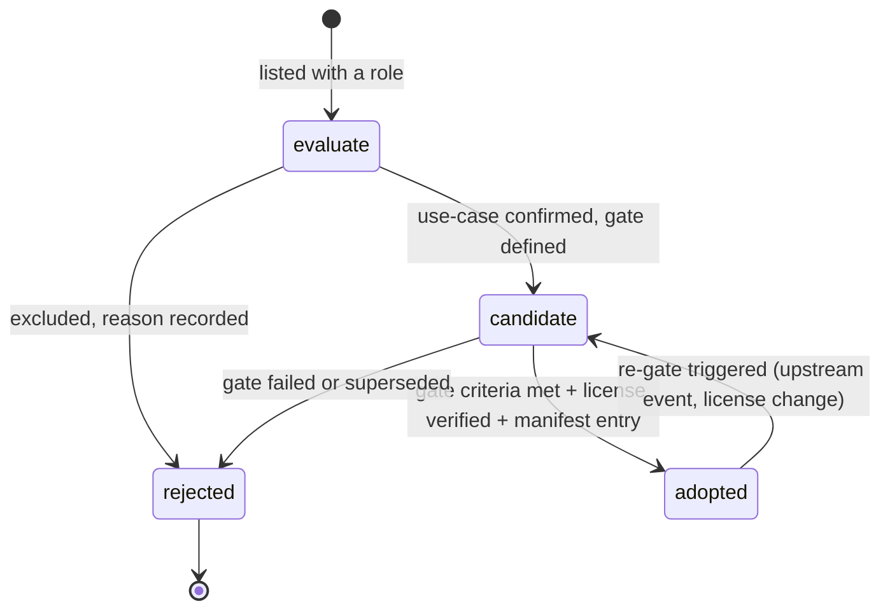

# Component adoption matrix

- **Status:** M0 planning baseline — **nothing is adopted at M0**. Every row below is `candidate` or `evaluate` and carries an explicit adoption gate.
- **Owner:** TL (Technical Lead)
- **Date:** 2026-10-19
- **Vocabulary:** docs/GLOSSARY.md (binding)

## 1. Preamble: listing ≠ integrated

Appearance in this matrix is **not** an integration decision. It means the component is on the radar with a defined role, risks and gate. A row moves to `adopted` in the release manifest (`dependencies[].status`) only when its gate criteria are met with recorded evidence (test IDs + artifacts, per the glossary §5 evidence rule), its license-inventory row is verified at that date, and the TL signs the release-manifest change.

At handoff the release manifest records `dependencies: []` — **zero adoptions**. The matrix is maintained by the TL and changes only through review. Rows failing a gate are never silently dropped: the failure is recorded and the row stays `candidate`/`evaluate`.

Honest gap stated up front: **dynamic-block semantics (ORG area) have no open-source implementation** and must be built in-product; no row below supplies them.

Status vocabulary for this matrix:

- `candidate` — planned for adoption behind a named gate; may appear in glossary §5 `dep` codes for feature authors.
- `evaluate` — under consideration; may be excluded without a gate failure (the exclusion itself is recorded with a reason).
- `adopted` — forbidden at M0; only reachable via the §3 gate process with recorded evidence.
- `rejected` — terminal state with a recorded reason; rejected rows stay in the manifest history, never silently deleted.

The matrix is re-baselined at each milestone gate calendar event (§7); rows never change status outside a reviewed change.

## 2. Column definitions

| Column | Semantics |
|---|---|
| Role in product | The capability the component would provide. Written as a plan, not a claim. |
| Target module | The module (of the 13, glossary §4) that would own the integration. |
| License (confidence) | License + glossary §9 confidence tag; `(verify)` items are unresolved until their gate. |
| Integration path | How the component would reach the product (pip dep, native lib, sidecar, study-only, fixture-only). |
| Status | `candidate` (planned for adoption behind a gate) or `evaluate` (under consideration; may be excluded). **No row may say `adopted` at M0.** |
| Rationale | Why this component is on the list. |
| Key risks | The honest failure modes, including licensing, maturity and packaging risks. |
| Adoption gate criteria | The concrete, checkable conditions required before the release-manifest status changes. |
| ADR | The architecture decision that governs the row, where one exists. |
| Notes | Extra facts that must not be lost (pins, exclusions, hard rules). |

## 3. Status lifecycle and gate process

Gate process (how a row becomes `adopted`):

1. Gate criteria from §4 are met; evidence recorded with test IDs + artifacts (the glossary §5 evidence rule applied to components).
2. The component's license-inventory.md row is verified at that date (confidence tag refreshed; `(verify)` items resolved, or the row stays candidate).
3. The release manifest gains/updates a `dependencies[]` entry with `status: adopted` (schema per glossary §8; `module` must exist in `modules/modules.json`).
4. TL sign-off in the same reviewed change; rejection is recorded as `status: rejected` with a one-line reason.

## 4. Matrix

| Component | Role in product | Target module | License (confidence, glossary §9) | Integration path | Status | Rationale | Key risks | Adoption gate criteria | ADR | Notes |
|---|---|---|---|---|---|---|---|---|---|---|
| OCCT | Precise geometry kernel: B-rep, analytic geometry, booleans, fillets, projections, STEP/IGES | kernel | LGPL-2.1 with exception (high) | vendored native library via chosen binding (document-model doc §5.2) | candidate | only credible open-source full B-rep kernel matching AutoCAD-class needs | large binary footprint; packaging; binding maintenance | M3-entry binding evaluation (perf, packaging, binding stability); LGPL compliance recheck; benchmark evidence with test IDs | ADR-0002 | evaluation criteria fixed in ADR-0002 |
| OCP | OCCT Python bindings — candidate binding layer | kernel | Apache-2.0 (high) | pip wheels | evaluate | proven wheels; fastest to stand up | wheel size; OCCT-version coupling | part of the ADR-0002 binding evaluation; extension-platform packaging rules (verify) | ADR-0002 | |
| FreeCAD components | Reference implementations to study (sketcher patterns, importers, PlaneGCS usage) | kernel / parametric / interchange (study) | LGPL-2.1+ per-module exceptions (high) | source study only by default | evaluate | large proven open-source CAD codebase to learn from | per-module license diversity; drift from upstream | per-copy license review + attribution if any code is copied; default = no product dependency | — | study-only default is recorded policy |
| PlaneGCS | 2D geometric constraint solver | parametric | LGPL (medium — (verify)) | vendor with build, or source-embed after license verification | candidate | proven in FreeCAD's sketcher; right scope for 2D constraints (PAR area) | license (verify); robustness on large sketches | license verification; solver conformance suite passes (PAR area features); packaging decision | ADR-0002 | |
| build123d | Python CAD scripting API — candidate user-facing scripting layer | kernel / scripting | Apache-2.0 (high) | pip dependency if adopted | evaluate | modern API over OCP | overlaps kernel API design; version churn | use-case decision (user scripting API vs internal); API stability review; otherwise exclude | — | |
| CadQuery | Python CAD scripting API — alternative to build123d | kernel / scripting | Apache-2.0 (high) | pip dependency if adopted | evaluate | mature; same OCP base | duplicate dependency vs build123d | same evaluation as build123d; adopt at most one | — | |
| ezdxf | First-class DXF read/write | interchange | MIT (high) | pip dependency | candidate | mature, documented DXF path; M1 DXF read/write depends on it | DXF version/entity coverage gaps become loss-ledger entries | M1 DXF read/write acceptance (TP-CAT-04); performance on large files; vendoring plan | ADR-0003 | every round-trip gap recorded in the loss ledger |
| LibreDWG | DWG read (M3) and write (M4) | interchange | GPL-3.0 (high) | native library bundled with the extension | candidate (gated) | the only open-source DWG library | **write-path maturity** (honest risk); 3D-solids SAT/ASM representation risk | read gate M3: TP-CAT-04 read conformance; write gate M4: write conformance + write-path stability review; GPL-3.0 compliance review | ADR-0003 | STEP is the neutral 3D exchange for solids (OCCT); dynamic-block semantics are NOT provided by any open-source DWG library — built in-product |
| ODA File Converter | Dev-fixture tooling: DWG/DXF version conversion for test fixtures | testing | proprietary freeware (verify) | offline CI/dev tool only | evaluate | produces reference fixtures for TP-CAT-04 without product dependency | proprietary terms (verify); availability; must never leak into the product | usage documented in testing module; hard rule: never bundled, never linked, never shipped | ADR-0003 | **never a product dependency — fixture tooling only** |
| SolveSpace | Reference/alternative constraint solver and small kernel (comparison) | parametric (study) | GPL-3.0 (verify) | evaluate-only; no integration planned | evaluate | independent solver to compare against PlaneGCS results | not a drop-in for 2D drafting constraints at scale (verify) | evaluation note only; no adoption path unless PlaneGCS fails its gate | — | evaluate-only |
| Bonsai (BlenderBIM) | BIM workflows inside Blender (IFC authoring patterns, Blender-integration experience) | bim | (verify — license history has changed) | interop with IfcOpenShell; integration design at M4 | evaluate | proven BIM-in-Blender; community experience | **license must be verified at the gate** (blocking); architecture overlap with our document model | license verification at adoption gate (mandatory); integration review vs document model; TP-CAT-05 conformance plan | — | license "(verify)" is a blocking gate item |
| IfcOpenShell | IFC read/write | bim / interchange | LGPL-3.0-or-later (medium — (verify)) | native library | candidate | de-facto open IFC library | license (verify); large binary; IFC schema breadth | license verification; IFC round-trip conformance (TP-CAT-04/05); version pin policy | — | |
| GDAL | Geospatial raster/vector formats and CRS | toolsets (gis) | MIT/X11-style (medium — (verify)) | native library | candidate | industry-standard geospatial I/O | binary size; license (verify); CRS complexity | license verification; gis toolset requirements defined (TS area); packaging plan | — | |
| PDAL | Point-cloud processing | toolsets (gis) | BSD-style permissive (medium — (verify)) | native library | candidate | point-cloud pipelines | niche; binary size | license verification; toolset requirements defined; packaging plan | — | |
| shapely | 2D planar/geometry operations for civil/gis toolsets | toolsets | BSD-3-Clause (high) | pip dependency | candidate | simple, robust 2D ops | overlaps kernel ops — used only where toolset-specific | toolset requirements defined; version pin | — | |
| Blender (upstream host) | Host application: viewport, UI, file format, Python API | shell (host) | GPL-2.0-or-later per blender.org; GitHub shows NOASSERTION (high, cite blender.org/license) | fork + minimal patch series | candidate (host, pinned) | the platform we extend; mission requires retaining ALL native capabilities | upstream API churn (monthly windows); release-cycle timing | M1 walking skeleton: extension loads in the fork; TP-CAT-06 green; patch-series discipline holds | — | upstream pin at handoff: `bf200615b83252a7be951aed5593d068f0f2438a` |
| ZCode (zai-org/ZCode) | Agent runtime (sidecar) + skill loading conventions | agent | Apache-2.0 (high — verified via GitHub API 2026-10-19) | sidecar process + versioned RPC interface (ADR-0004); pinned fork | candidate | proven agent harness ("Z.ai's coding agent harness.", v3.16.1); skill ecosystem conventions; mission criterion 3 | upstream churn; audit cost; scope of reused packages | M5-entry source audit (ADR-0004 checklist); security review; pin + quarterly audits; TP-CAT-07 conformance | ADR-0004 | fork created as "Gen", renamed `ZCode` (cosmetic; parent verified = zai-org/ZCode); pin at handoff `0a1fc56d279fd1001f78387bd81aec1c26767411`; ZCode UI packages excluded per glossary §6 |

## 5. Honest risk notes (recorded, not hidden)

1. **LibreDWG write-path maturity**: the write path is younger than the read path. DWG write at M4 is explicitly conformance-gated (TP-CAT-04); until that gate passes, DWG is read-only in-product and communications state exactly that.
2. **DWG 3D solids fidelity**: DWG stores ACIS solids as SAT/ASM data; LibreDWG's handling of that representation is a fidelity risk (verify at M3). Therefore **STEP (via OCCT) is the neutral 3D exchange format**; DWG 3D-solids round-trip is a measured-loss item in the loss ledger (ADR-0003), not a silent assumption.
3. **Bonsai license "(verify)"**: license history has changed upstream; verification is a mandatory, blocking item of the adoption gate — no bim-module integration decision is made on an unverified license.
4. **Dynamic blocks**: no open-source implementation exists (LibreDWG included). Parameter/action semantics must be built in-product (ORG area, P2). No parity claim until implemented and tested.
5. **ODA File Converter**: proprietary freeware used offline for fixture generation only (TP-CAT-04 fixtures); it must never appear in shipped artifacts, runtime requirements or product documentation as a dependency.
6. **Native-binary packaging**: OCCT, LibreDWG, IfcOpenShell, GDAL and PDAL all imply native binaries; Blender extension-platform policy on bundled native libraries is unverified (verify at first packaging milestone) and constrains several gates at once.

## 6. Dependency-code mapping (glossary §5 `dep` codes → matrix rows)

The feature inventory's `dep` component codes resolve to rows as follows — this is the single mapping used by `data/inventory/*.yaml` authors (task 1-b1):

| `dep` code | Matrix row(s) | Notes |
|---|---|---|
| `occt` | OCCT | via the chosen binding (ADR-0002) |
| `ocp` | OCP | only if OCP is the chosen binding |
| `freecad` | FreeCAD components | study-only by default |
| `planegcs` | PlaneGCS | 2D constraint solving (PAR area) |
| `build123d` | build123d | only if adopted as scripting layer |
| `cadquery` | CadQuery | only if adopted as scripting layer |
| `ezdxf` | ezdxf | DXF read/write (ADR-0003) |
| `libredwg` | LibreDWG | DWG read (M3) / write (M4) (ADR-0003) |
| `ifcopenshell` | IfcOpenShell | IFC (bim bridge, M4) |
| `bonsai` | Bonsai (BlenderBIM) | BIM workflows (license gate blocking) |
| `gdal` | GDAL | gis toolset |
| `pdal` | PDAL | gis toolset (point cloud) |
| `shapely` | shapely | civil/gis toolsets |
| `blender-native` | Blender (upstream host) | host-provided capability used by an extension feature |
| `zcode-runtime` | ZCode (zai-org/ZCode) | agent runtime (ADR-0004) |

## 7. Milestone gate calendar (planning)

| Milestone | Gates expected to fire | Rows touched |
|---|---|---|
| M1 (walking skeleton) | ezdxf DXF read/write; Blender host (extension loads in fork) | ezdxf, Blender |
| M3 entry (binding decision) | kernel binding evaluation concludes | OCCT, OCP / pythonocc-core / pybind11 (chosen option), PlaneGCS |
| M3 (precision & parametrics) | LibreDWG read conformance | LibreDWG (read only) |
| First packaging milestone | extension-platform policy verification; notice bundling plan | Blender (host row), all native-lib rows (packaging constraints) |
| M4 (interop & toolsets) | LibreDWG write conformance; IFC round-trip; Bonsai integration review | LibreDWG (write), IfcOpenShell, Bonsai |
| gis toolset milestone | license verification + requirements freeze | GDAL, PDAL, shapely |
| M5 (agent integration) | ZCode source audit + security review | ZCode |
| Any new dependency | license-inventory row + verdict **before merge** | (new rows) |

## 8. References

- `docs/GLOSSARY.md` §5 (`dep` component codes), §8 (manifest), §9 (license confidence tags), §11 (milestones).
- `docs/00-architecture/license-inventory.md` — licensing compliance record (ADR-0005).
- `docs/00-architecture/document-model-and-geometry-kernel.md` §5 — kernel binding options and evaluation criteria.
- ADR-0002 (OCCT/PlaneGCS), ADR-0003 (ezdxf/LibreDWG + fixture policy), ADR-0004 (ZCode sidecar + audit).
- Test categories: TP-CAT-02, TP-CAT-04, TP-CAT-05, TP-CAT-07.
