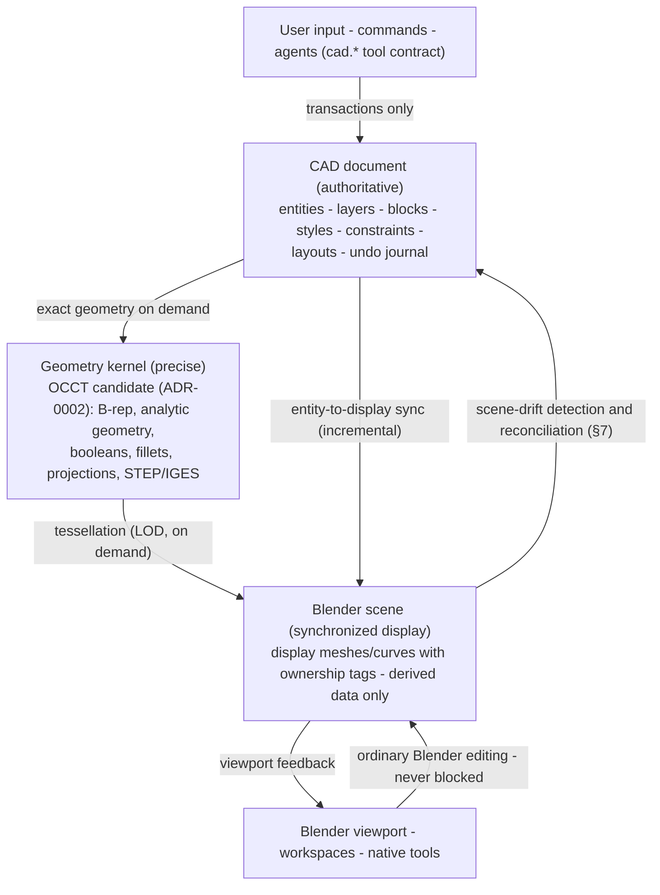
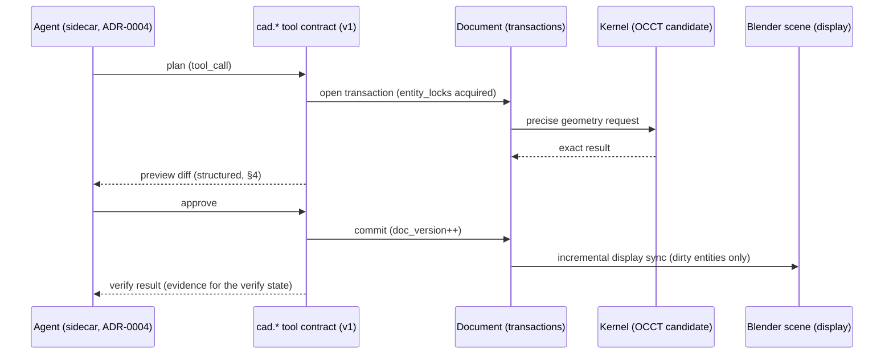

# CAD document model and geometry kernel

- **Status:** M0 design baseline — nothing implemented; every structure described here is planned. Uncertain facts are tagged `(verify)`.
- **Owner:** TL (architecture); implementation ownership per glossary §10 (`document`/`kernel` = W2).
- **Date:** 2026-10-19
- **Vocabulary:** docs/GLOSSARY.md (binding)

## 1. Purpose and scope

The `document` module is the authoritative engineering model; the `kernel` module provides precise geometry; the Blender scene is a synchronized display representation — derived data only. This document specifies the layered architecture, the document model's contents, transaction semantics, the kernel strategy (ADR-0002), precision guarantees, the CAD↔Blender synchronization policy, and performance budgets. Features are referenced by name + area (PREC, DRAW, P3D, PAR, IO …); feature IDs are intentionally not cited here (numbering is owned by the inventory task).

## 2. Layered architecture



Invariants:

1. The document is the only authority for CAD content. Agents and commands change drawings **only** through document transactions (glossary §6 runtime principle).
2. The kernel computes precise results from document data; results are written back only via transactions.
3. The Blender scene holds display representations with ownership tags (§7). Deleting display data never deletes document entities; the document can always regenerate the display (§6).
4. Ordinary Blender editing and `.blend` file compatibility are never broken (§7; verified by TP-CAT-06).

### 2.1 Agent transaction flow (example sequence)



The pipeline states (plan → preview → approve → execute → verify) and permission classes are specified in the agent documentation (task 1-c); this document owns the document-side guarantees that pipeline depends on.

## 3. Document model

### 3.1 Entity store and dual identity

Every document entity carries:

- a **stable UUID** (v4, generated at creation; immutable; never reused) — the product-internal identity used by the API, `cad.*` tools, constraints, skills and history;
- a **DWG-handle-style handle** (per-document, monotonically allocated, stable within the document) — the identity used for DWG/DXF round-trip: handles read from imported files are preserved; exports map entities back to original handles where possible.

| Field | Scope | Stable across | Used by |
|---|---|---|---|
| UUID | global | everything; never reused | API, `cad.*` tools, constraints, skills, parametric history |
| handle | per document | save/load round-trip; DWG/DXF import/export mapping | interchange module (ADR-0003), xref resolution |

The store maintains a bidirectional UUID↔handle index; lookups are O(1) by either key. Iteration order is insertion order, giving deterministic undo/redo and stable agent-visible diff output.

### 3.2 Entity types

| Entity | Kind | Authoritative record (document) | Kernel representation (OCCT candidate) | Blender display |
|---|---|---|---|---|
| point | 2D | position + display properties | `gp_Pnt` | marker object |
| line | 2D | two endpoints | trimmed line segment | curve/mesh |
| arc | 2D | center, radius, start/end angle, normal | trimmed `Geom_Circle` | curve |
| circle | 2D | center, radius, normal | `Geom_Circle` | curve |
| polyline | 2D | ordered vertices + per-vertex bulge (arc segments), widths | sequence of segments | polyline/curve |
| spline | 2D/3D | control points, knots, weights, degree, fit points | `Geom_BSplineCurve` | curve |
| hatch | 2D | boundary references, pattern, scale, angle | planar region(s) | filled display geometry |
| text | 2D | insertion, height, rotation, oblique, style, value | — (annotation) | text display |
| mtext | 2D | styled runs, width, flow, columns | — (annotation) | text display |
| dimension | 2D | type, definition points, measurement (derived), style + overrides | exact measurement from referenced geometry | generated annotation display |
| leader / mleader | 2D | points, arrow, content reference | — (annotation) | annotation display |
| block definition | org | entity set + base point + attribute definitions | — | not displayed directly |
| insert (block instance) | org | block reference, transform (position/scale/rotation), attribute values | transformed instance | instanced display |
| xref | org | path reference + attachment semantics (§3.9) | — | instanced via interchange |
| solid (B-rep) | 3D | kernel shape handle + operation journal | `TopoDS_Shape` (exact) | tessellated mesh |
| surface | 3D | kernel shape handle / NURBS data | `Geom_Surface` / `TopoDS_Face` | tessellated mesh |

3D solids and surfaces are stored as exact B-rep via the kernel, plus the parametric history (§3.8) sufficient to rebuild them.

### 3.3 Layers

| Property | Semantics | Notes |
|---|---|---|
| on/off | display + plot toggle; hidden entities still regenerated and hit-testable | distinct from freeze |
| freeze | excluded from regeneration and hit-testing (performance); per-viewport freeze is a planned extension | freeze ≠ off for large documents |
| color | ACI-style index or true color | bylayer/byblock resolution order owned by drafting module |
| linetype | reference to linetype table (§3.5) | |
| lineweight | mm values; default/bylayer/byblock | |
| plot style | plot-style table reference; CTB/STB model evaluation deferred to drawings module | |
| lock | selectable for reference, not editable | |

Layer states (snapshots) and layer groups are planned extensions in the ORG area (layers/blocks/organization).

### 3.4 Blocks

- **Definitions**: named block-table records — entity set, base point, attribute definitions (tag/prompt/default).
- **Instances**: insert entities — block reference + transform (position, scale, rotation). Arrayed/multi-row-column instancing is a drafting-module concern.
- **Attributes**: per-instance values stored on the insert; synchronized with the definition's attribute definitions; edit/sync commands in the ORG area manage them.
- **Dynamic blocks — honest gap**: dynamic-block semantics have **no open-source implementation**; they must be built in-product (parameter/action engine). Planned as a P2 item in the ORG area; no parity claim until built and tested (recorded also in component-adoption-matrix.md).

### 3.5 Linetypes, text & dimension styles, annotation scales

- **Linetype table**: dash/gap/dot pattern definitions, global and per-entity scale factors; seed library mirrors common AutoCAD patterns (exact pattern set owned by drafting module).
- **Text styles**: font reference, height, width factor, oblique. SHX-vs-TTF rendering depth is a known unknown (verify at implementation); display uses Blender's text engine.
- **Dimension styles**: arrows, text placement, fit rules, tolerances, scaling — full style table owned by the drawings module (ANN area).
- **Annotation scales**: per-viewport annotation scale + annotative entity flag; scale-list management owned by the drawings module.

### 3.6 Units and coordinate systems

- **Display units**: per-document length/angle unit + precision — formatting only; never converts stored values.
- **Machine units (INSUNITS-like)**: per-document unit code used for block/xref insertion scaling; `unitless` (factor 1) supported. Common codes: unitless, inches, feet, miles, millimeters, centimeters, meters, kilometers, yards — exact enumeration mirrored from the DXF specification (verify at implementation; owned by interchange).
- **Coordinate systems**: geometry is stored in document/world coordinates; **UCS** (named, per-context, per-viewport in layouts) affects input and display only; UCS icon shown in viewport. Entities with AutoCAD OCS/extrusion-normal semantics (e.g. arcs/circles with non-Z normals) keep their normal vector — full OCS fidelity is a known DWG nuance (verify; owned by interchange).
- **Insertion base point**: per-document; used by xref/insert alignment.

### 3.7 Layouts and viewports

- Multiple paper-space layouts plus model space; per-layout plot settings (paper size, orientation, margins, scale).
- Viewports: boundary (optionally clipped), view target/center, twist, zoom scale, per-viewport layer-visibility overrides, annotation scale, display lock, shade plot.
- The plot/publish pipeline is owned by the drawings module (LAY area); the document stores definitions only.

### 3.8 Constraint graph and parametric history

- **2D constraints (PAR area)**: geometric (coincident, parallel, perpendicular, tangent, horizontal, vertical, concentric, equal, symmetric …) and dimensional (distance, angle, radius). Stored as a graph over entity references; solving delegated to **PlaneGCS (candidate, ADR-0002)**; incremental solves over dirty subgraphs; over/under-constrained diagnostics reported to the user.
- **3D parametrics**: ordered feature history (sketch → extrude/revolve/boolean/fillet/chamfer …) with a recompute DAG; editing a history node re-evaluates dependents. History is stored in the document and is undoable.
- 3D constraint solving beyond feature history is out of M3 scope; scope decisions will be recorded in the parametric module documentation when M3 planning starts.

### 3.9 Xref model

| Aspect | Planned semantics |
|---|---|
| attach vs overlay | attach participates in nested resolution; overlay is reference-only and never nests into the parent's own xref tree |
| bind | converts an xref into a local block definition (with prefixing rules) |
| clip | clipping boundary on the xref instance |
| path types | full path, relative path, no-path — documented resolution order |
| nesting | tree structure with cycle prevention; reload notifications |

DWG/DXF-level xref encoding is owned by the interchange module (IO area; ADR-0003).

## 4. Transactions

- **Atomicity**: every document mutation occurs inside a transaction; commit assigns a new `doc_version` (monotonic counter, glossary §6). Failed transactions roll back completely.
- **Grouped undo/redo**: transactions compose into named undo groups; the undo journal is append-only; the redo stack is cleared on new mutation.
- **Checkpoints**: named rollback points (glossary §6). Restoring a checkpoint is itself a transaction (it appends a restore record), so history is never destructively rewritten — users and agents can undo a restore.
- **Agent-visible diffs**: every committed transaction produces a structured diff (added/modified/removed entities with property deltas) exposed through `cad.doc` tools for the plan → preview → approve → execute → verify pipeline (glossary §6). `entity_lock` advisory locks are honored during agent transactions. Permissions, modes and conflict handling: `docs/20-agent/permissions-and-execution-model.md` (task 1-c); conformance: TP-CAT-07 (agent tools/sync/conflict/rollback).
- **Determinism**: iteration order, handle allocation and diff formatting are deterministic so agent verification is reproducible.

Transaction diff record (design example — the field set is the contract; values are illustrative):

```json
{
  "transaction_id": "txn-0181",
  "doc_version_before": 128,
  "doc_version_after": 129,
  "group": "MODIFY - FILLET",
  "added": [],
  "modified": [
    {"uuid": "...", "handle": "1F4", "fields": {"radius": [12.0, 15.0]}}
  ],
  "removed": [],
  "checkpoint": null,
  "locks_held": ["1F4"]
}
```

The diff is the single artifact consumed by agent preview, agent verification and the undo journal — one format, three consumers.

## 5. Geometry kernel

### 5.1 What the kernel provides (ADR-0002: OCCT leading candidate)

Exact B-rep modeling (solids, shells, faces), analytic and NURBS geometry, boolean operations (union/subtract/intersect), fillets/chamfers, offsets (verify depth at evaluation), projections and curve/surface intersections, and STEP/IGES read/write. Tessellation-for-display is generated from exact shapes with deviation control.

### 5.2 Binding strategy — options to evaluate at M3 entry

| Option | Description | Pros | Cons / risks |
|---|---|---|---|
| OCP | CadQuery's OCCT bindings (Apache-2.0, high confidence), prebuilt wheels | pip-installable, versioned; proven by the CadQuery/build123d ecosystems | wheel size (large binaries); binding surface shaped by CadQuery's needs; OCCT version coupled to OCP releases |
| pythonocc-core | community SWIG bindings for OCCT | long history; broad OCCT surface coverage | distribution historically conda-first; pip-wheel maturity (verify); license LGPL (verify); call overhead (verify) |
| In-tree C++ extension (pybind11) | minimal binding of exactly the OCCT calls used | smallest packaging surface; full control | per-platform build burden; slowest iteration; toolchain in the release pipeline |

**Evaluation criteria (binding decision at M3 entry, ADR-0002)**: (1) performance on hot paths (entity create/modify, booleans, tessellation); (2) packaging under Blender extension-platform constraints (verify policy on bundled native libraries at first packaging milestone); (3) Python-bindings stability across OCCT upgrades; (4) coverage of required OCCT modules; (5) license compliance recheck (license-inventory.md).

### 5.3 Threading and performance notes

- Kernel jobs (booleans, tessellation, solves) run on worker threads via a cancellable job queue; document transactions are serialized on the document thread.
- GIL behavior depends on the chosen binding (pybind11-based bindings can release the GIL for long OCCT calls — verify for the chosen option at M3 entry).
- Tessellation is chunked and incremental; results cached per (entity, deviation, transform).

## 6. Precision guarantees

1. **Exact analytic representation persists in the document.** A circle is center+radius+normal; a spline is control points+knots+weights — never a tessellated approximation.
2. **Tessellation is display-only.** Display meshes are regenerated on demand (LOD by viewport deviation setting, zoom-dependent); deleting or corrupting display data never affects document content.
3. **Exports use exact data.** DXF/DWG/STEP export reads the document/kernel, never display meshes. TP-CAT-04 validates round-trip exactness.
4. **Numeric policy**: document values are double precision; operation tolerances are kernel-module constants (documented when implemented); any tolerable round-trip degradation is measured and recorded in the interchange loss ledger (ADR-0003).

## 7. CAD↔Blender synchronization policy (critical)

### 7.1 Ownership tags

| Tag | Meaning | Display sync |
|---|---|---|
| `cad-owned` | managed by the document model; authoritative data = document entity | display updated FROM the document after every committed transaction |
| `blender-native` | ordinary Blender object, never touched by CAD tools | none — CAD never modifies, restyles or deletes these |
| `adopted` | blender-native object explicitly brought under CAD management | becomes cad-owned when conversion commits |
| `detached` | display object no longer linked to its entity | document entity unchanged; sync suspended; re-link restores it |

### 7.2 Rules

1. **Ordinary Blender edits are never blocked** (mission rule). Moving/rotating/scaling, editing object properties, parenting, etc. work on CAD-owned display objects at all times.
2. The sync layer diffs scene state against the last-synced state and produces a **scene-drift record**.
3. **Reconciliation**: transform-only drift that maps to a document-supported operation (e.g. moving an insert) is offered for apply-back as a transaction; unmappable drift (mesh edits, sculpting) prompts the user with explicit options — (a) adopt as document modification where representable, (b) **detach** (keep the mesh work; entity untouched), (c) restore from document (discards the display edit; never automatic — requires explicit confirmation).
4. **Mesh conversion is one-way detachment unless re-imported.** Converting a CAD-owned display object to a plain mesh (converter, modifier application) severs live sync; the document entity remains. Re-importing under CAD management is an explicit adopt action creating a new entity — the precision loss of mesh→exact reconstruction is stated honestly as best-effort.
5. **Adoption is always explicit.** blender-native objects are never silently claimed by the CAD layer.
6. **File compatibility is never broken.** `.blend` files save/load identically with or without the extension installed; without the extension, display geometry remains visible and document data persists as extension data. Verified by TP-CAT-06 (native Blender regression) and TP-CAT-12 (packaged E2E).

Reconciliation examples (concrete cases for the rules above):

| User action on a cad-owned display object | Detected as | Outcome |
|---|---|---|
| move the object in the viewport | transform-only drift | apply-back offered as a document transaction (rule 3) |
| sculpt on the display mesh | unmappable drift | user chooses adopt / detach / restore (rule 3); never auto-discard |
| apply a modifier stack (bake) | mesh conversion | one-way detachment; entity remains authoritative (rule 4) |
| delete the display object | deletion of derived data | display regenerated from the document on next sync (§6 guarantee) |

### 7.3 Ownership lifecycle

```mermaid
stateDiagram-v2
    [*] --> blender-native : ordinary Blender object
    [*] --> cad-owned : created by CAD tool (transaction)
    blender-native --> adopted : explicit adopt action
    adopted --> cad-owned : conversion commits
    cad-owned --> detached : mesh conversion / modifier bake / explicit detach
    detached --> cad-owned : re-link (or re-import + adopt)
    cad-owned --> blender-native : explicit release of ownership
    blender-native --> deleted : user deletes object
    cad-owned --> deleted : entity deleted (transaction)
    detached --> deleted : entity deleted (transaction)
    deleted --> [*]
```

## 8. Performance budgets (planning targets — not achievements)

Targets are to be validated by recorded benchmark evidence at M3+; none is claimed delivered at M0:

| Metric | Planning target | Validation vehicle |
|---|---|---|
| Single-entity edit → display sync | within one interactive frame (~16 ms), excluding solver runs | M3 benchmarks (TP-CAT-02) |
| Dirty-set re-tessellation | ≤ 250 ms for a 1k-entity dirty set, background + cancellable | M3 benchmarks |
| Large 2D document | 100k 2D entities with interactive pan/zoom on reference hardware (spec (verify)) | M3/M4 benchmark suite |
| 2D sketch solve | ≤ 50 ms incremental for typical sketches (< 200 constraints) | M3 (TP-CAT-02) |
| Sync granularity | incremental — only entities touched by committed transactions re-sync; full resync only on load/restore | design constraint; verified via TP-CAT-06/07 |
| Display memory | LRU mesh cache with configurable budget; eviction never loses document data | design constraint |

## 9. References

- `docs/GLOSSARY.md` §4 (modules), §5 (areas), §6 (agent terms: `doc_version`, `entity_lock`, `checkpoint`), §13 (writing standards).
- ADR-0002 (kernel + binding strategy), ADR-0003 (interchange + loss ledger), ADR-0004 (agent runtime sidecar).
- `docs/20-agent/permissions-and-execution-model.md` (task 1-c) — permission modes, conflict model.
- Test categories: TP-CAT-02, TP-CAT-04, TP-CAT-06, TP-CAT-07, TP-CAT-12.
