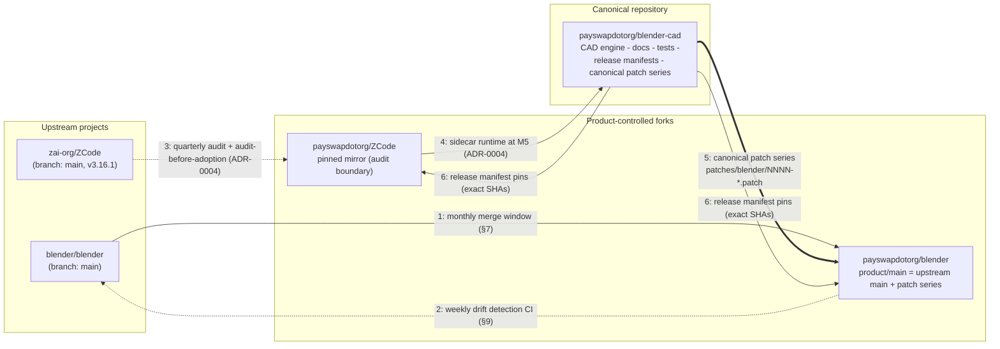

# Repository & upstream synchronization design

- **Status:** M0 planning baseline. URLs and upstream pins below are facts fixed at handoff (2026-10-19); every process, CI job and policy described here is a design target — nothing is implemented at M0.
- **Owner:** TL (Technical Lead)
- **Date:** 2026-10-19
- **Vocabulary:** docs/GLOSSARY.md (binding)

## 1. Purpose and scope

This document fixes: (a) how the three product repositories relate to their upstream projects, (b) how the Blender fork's native patch series is managed, (c) the cadence and step-by-step procedure for taking upstream updates, and (d) how releases stay reproducible. Governing rule inherited from the glossary (§8):

> **An upstream update must never silently replace a working release.**

Test vocabulary used here (citable): upstream-update conformance — **TP-CAT-11**; native Blender regression — **TP-CAT-06**; packaged end-to-end — **TP-CAT-12**. CI workflow scaffolding is owned by task 1-d; §9 summarizes the jobs relevant to synchronization.

## 2. Three-repo architecture

### 2.1 Facts fixed at handoff (2026-10-19)

| Component | Repository | Upstream & pin | License |
|---|---|---|---|
| Blender fork | `https://github.com/payswapdotorg/blender` | Fork of `blender/blender` (default branch `main`). Upstream pin: `bf200615b83252a7be951aed5593d068f0f2438a` (blender/blender main, 2026-10-19T09:56Z). | GPL-2.0-or-later per blender.org — GitHub reports `NOASSERTION`; both recorded (license-inventory.md). |
| ZCode runtime fork | `https://github.com/payswapdotorg/ZCode` | Fork of `zai-org/ZCode` (default branch `main`). Upstream pin: `0a1fc56d279fd1001f78387bd81aec1c26767411` (zai-org/ZCode main, 2026-10-19T02:34Z); upstream version v3.16.1. | Apache-2.0 |
| CAD extension (this repo) | `https://github.com/payswapdotorg/blender-cad` | None — this repository is the canonical source of truth. | GPL-3.0-or-later (ADR-0005). |

Provenance note (record, do not "fix" cosmetically): GitHub created the ZCode fork under the name **"Gen"** (network-root name cache) and it was renamed to `ZCode` — cosmetic only; fork parent was verified to be `zai-org/ZCode`.

### 2.2 Responsibilities and negative scope

| Repo | Responsibilities | What must NOT live there |
|---|---|---|
| `payswapdotorg/blender` (Blender fork) | Host application: build, packaging, launch config, minimal native patch set. | **The CAD engine never lives in the Blender fork.** No CAD modules, no feature inventory, no agent integration, no release manifests. Product code reaches the fork only as a loadable extension built from this repo. |
| `payswapdotorg/ZCode` (ZCode runtime fork) | Pinned, audited mirror of the agent runtime; later, minimal reviewed adaptations. | Product UI, CAD logic, unaudited upstream tracking, unreviewed experiments. The fork is an audit boundary, not a development branch. |
| `payswapdotorg/blender-cad` (canonical) | Engineering architecture, feature inventory, API contracts, module packaging, tests, release manifests, canonical copies of the Blender patch series. | Vendored Blender sources; Blender build infrastructure; ZCode runtime code (only adaptation plans and audit records live here). |

The bulk of the CAD engine, toolsets and agent integration live in this repository, not in Blender's tree. The fork stays as close to upstream as patch discipline permits; the extension stays a pure add-on wherever the architecture allows. This separation is a structural guarantee for the mission criterion that all native Blender capabilities are retained (guarded by TP-CAT-06).

Organization note: the three repositories live under the `payswapdotorg` account at handoff; migration to a dedicated organization is a documented, non-blocking option (§11).

## 3. Repository and update-flow diagram



Reading: solid arrows are content flows; dotted arrows are read-only observation flows. Drift detection observes upstream but never merges anything. The only paths by which upstream content reaches a release are the reviewed procedure in §7 (Blender) and the ADR-0004 audit checklist (ZCode).

## 4. Blender fork branch model

| Branch | Tracks / contains | Protection |
|---|---|---|
| `main` (fork default) | `blender/blender` `main`, pristine upstream mirror | fast-forward only from upstream; no product commits |
| `product/main` | upstream `main` + the numbered patch series (§5) | updated only through the §7 procedure; every native change arrives via the patch series |
| `update/<yyyy-mm-dd>` | short-lived integration branch during an update window | deleted after the window closes (merged or aborted) |

Rules:

- `product/main` is *defined* as upstream main + patch series — nothing else. Any native change to Blender behavior must exist as a numbered patch first.
- The patch series is exported and mirrored as canonical copies in this repository under `patches/blender/` (§5). The fork applies and tests patches; this repository is the source of truth for patch content.
- Release builds are made from `product/main` at a tag, with the release manifest pinning the exact upstream SHA the branch was integrated against.

## 5. Patch series and patch discipline

Canonical copies of all fork patches live in this repository as `patches/blender/NNNN-<slug>.patch`, numbered in application order (`0001-...`, `0002-...`). The on-disk format and tooling are documented in `patches/README.md` (task 1-d).

Every patch file carries a structured header, at minimum:

| Header field | Meaning |
|---|---|
| `purpose` | One paragraph: what the patch changes in Blender and why it cannot be done from add-on code. |
| `owner` | TL / W1 / W2 / W3 owner responsible for rebases. |
| `upstream-status` | `not-submitted` / `submitted` / `merged-upstream` / `abandoned` — patches merged upstream are dropped from the series at the next window. |
| `guard-test` | Test ID that fails if the patch is missing or broken; the patch-series CI job (§9, planned M1) runs all guard tests. |

Patch rules:

1. **Minimal.** Smallest diff achieving the stated purpose; no drive-by refactors, no formatting churn — churn makes monthly rebases expensive.
2. **One purpose per patch.** If the purpose statement needs two sentences joined by "and", it is probably two patches.
3. **Numbered and ordered.** `NNNN` application order is stable; renumbering happens only during an update window, with review.
4. **Every patch has a guard test** that fails without it. A patch without a guard test cannot enter the series.
5. **Prefer zero patches.** Anything achievable from extension code (Python API, extension-platform facilities) must not be a patch. The series is expected to stay small (build/packaging/launch integration first).
6. **Canonical copy discipline.** When a rebase changes a patch, the regenerated patch is committed to this repository in the same reviewed change set; the fork and this repository never diverge on patch content.
7. **Upstreaming.** Patches of general value are submitted upstream; on merge they are removed from the series (`upstream-status: merged-upstream`).

### 5.1 Patch lifecycle

```mermaid
stateDiagram-v2
    [*] --> proposed : native change identified
    proposed --> in-series : review passes (minimal diff + guard test)
    in-series --> submitted : upstream PR opened
    submitted --> merged-upstream : upstream merges
    submitted --> in-series : upstream requests rework
    merged-upstream --> dropped-from-series : next update window
    in-series --> abandoned : purpose obsolete
    dropped-from-series --> [*]
    abandoned --> [*]
```

The `upstream-status` header field mirrors this lifecycle. The patch-series CI job (§9, planned M1) asserts that every patch in the series has a guard test and a valid status value; a patch stuck in `submitted` across two windows escalates to TL.

## 6. Sync cadence

| Upstream | Cadence | Nature | Change policy |
|---|---|---|---|
| Blender (`blender/blender`) | Monthly merge window (calendar-scheduled) | Reviewed merge of upstream `main` into the fork via the full §7 procedure | Skipping a window requires a recorded reason (e.g. upstream release-freeze week); two consecutive skips escalate to TL |
| ZCode (`zai-org/ZCode`) | Pinned commit; audited quarterly and immediately before any adoption | Read-only audit; never auto-merged | Pin changes only after the ADR-0004 audit checklist passes; every pin change is a release-manifest bump |

At handoff both upstreams are pinned (§2.1); no update has been taken yet. Blender's release-branch activity (stabilization near upstream releases) is expected to influence window timing; exact handling is refined at the first real window (verify against Blender's release process at that time).

### 6.1 ZCode audit procedure (summary)

The ZCode fork is an audit boundary (§2.2); audits run quarterly and immediately before any pin change. Audit steps:

1. Diff the pinned commit against `zai-org/ZCode` HEAD — commit distance and release tags crossed since the pin.
2. Review upstream release notes/changelog since the pin for breaking changes in the reused packages (ADR-0004 reuse scope).
3. Security-relevant scan of changed files in the reused packages (headless server runtime, RPC, providers).
4. License drift check: Apache-2.0 files, `NOTICE` and third-party notices unchanged in reused packages, or changes recorded per Apache-2.0 §4(d).
5. Audit verdict recorded (adopt the new pin / stay / reject) in the next release manifest's `notes`; a pin bump is a manifest version bump.
6. The audit produces a recommendation only — never a merge. The ADR-0004 adoption checklist is applied by human review before any bump.

## 7. Upstream update procedure (Blender)

One window = one reviewed procedure, executed on a short-lived `update/<yyyy-mm-dd>` branch. Steps are sequential; any step failing its exit criteria aborts the window.

1. **Freeze.** Announce the window. Record the current release-manifest pins. Branch `update/<yyyy-mm-dd>` from `product/main`. A CI snapshot of last-known-good state is attached to the window record.
2. **Merge upstream.** Fetch `blender/blender` `main`; merge into the update branch. Merge conflicts are resolved by the owning patch maintainer; no unrelated conflict resolution without review.
3. **Apply patch series.** Re-apply `patches/blender/NNNN-*.patch` in order on the merged result. Any conflict triggers the owning patch's rebase; regenerated canonical copies are committed to this repository as part of the window.
4. **Extension compatibility matrix.** Build and run the CAD extension against the new Blender; produce/refresh the compatibility matrix (rows: the 13 modules; columns: upstream versions; cells: `compatible` / `needs-work` / `broken`, each backed by test IDs). A `broken` cell blocks the window.
5. **Native Blender regression subset (TP-CAT-06).** Run the native Blender regression subset proving ordinary Blender workflows are unaffected by the merge and patches. Failure blocks the window — native capability is never traded for update velocity.
6. **CAD suites.** Run the CAD regression suites that exist at that milestone: TP-CAT-01 (drafting/commands), TP-CAT-02 (geometry/constraints), TP-CAT-03 (drawings/documentation), TP-CAT-04 (DWG/DXF round-trip), TP-CAT-05 (BIM/toolsets), TP-CAT-07 (agent tools/sync/conflict/rollback), TP-CAT-12 (packaged E2E).
7. **Manifest bump.** Create `release-manifests/manifest-<version>.json` recording the exact new upstream ref (§10); validate with `scripts/validate_manifest.py` (task 1-d scaffold). A changed pin without a manifest version bump is invalid by definition (glossary §8).
8. **Tag.** Review sign-off; merge the update branch into `product/main`; tag the release in this repository and the corresponding fork commit; attach test evidence to the release record.

Abort policy: on any step failure the window closes with a written abort record; `product/main` and the current release manifest are untouched; failures become work items. Aborted windows leave no half-merged state on protected branches.

### 7.1 Update-window record

Every window — merged or aborted — produces a record with these fields:

| Field | Content |
|---|---|
| `window_id` | the `update/<yyyy-mm-dd>` branch name |
| `opened` / `closed` | ISO dates |
| `pins_before` / `pins_after` | 40-hex SHAs for `blender`, `zcode_runtime`, `cad_extension` |
| `patch_rebase_log` | per patch: applied-clean / rebased / conflicted + owning patch |
| `compat_matrix_ref` | link to the extension compatibility matrix produced in step 4 |
| `test_evidence` | TP-CAT-06 subset + CAD suite run IDs and artifact links |
| `decision` | merged / aborted, with reason |
| `owner` | TL sign-off |

These records live with the release artifacts and are the audit trail behind glossary §8's social enforcement.

## 8. "Never silently replace a working release" — enforcement

Four mechanisms act together:

1. **A release is its manifest.** Every release is defined by `release-manifests/manifest-<version>.json` pinning the exact Blender upstream SHA, ZCode upstream SHA and extension commit. A manifest's pins cannot be changed in place — pin changes require a new manifest with a new version (glossary §8).
2. **Immutability after tagging.** Tagged manifests are never edited; corrections are new manifests. Historical releases remain buildable from their recorded pins (fork branch + patch series at that tag).
3. **CI drift alerts observe, never apply.** The weekly/monthly upstream jobs (§9) report drift (commit counts, dates) and open issues; no automation merges upstream code or bumps pins. Adoption is always a human-reviewed procedure (§7 for Blender; ADR-0004 audit checklist for ZCode).
4. **Review gate.** Pin changes arrive as reviewed changes that include the manifest bump, the update-window record and test evidence. Glossary §8 records this as social enforcement backed by CI drift alerts.

Additionally, rolling builds are never promoted to release status by being newer — release status is declared by tagging a manifest, not by artifact age.

## 9. CI jobs summary

| Job | Workflow (repo) | Schedule | Checks | Status at M0 |
|---|---|---|---|---|
| Repo-consistency suite | `.github/workflows/ci.yml` (blender-cad) | push/PR | manifest validation, module-boundary check, inventory rendering drift | scaffolded by task 1-d; M0 exit requires green |
| Blender upstream drift detection | `.github/workflows/upstream-blender-drift.yml` (blender-cad) | weekly | manifest pin vs `blender/blender` HEAD: drift distance, dates, report issue | scaffolded by task 1-d |
| ZCode upstream audit | `.github/workflows/upstream-zcode-audit.yml` (blender-cad) | monthly | manifest pin vs `zai-org/ZCode`: new releases, audit-checklist state | scaffolded by task 1-d |
| Patch-apply regression | planned workflow in the Blender fork | per patch-series change; nightly (planned) | fresh clone of fork branch; apply the canonical patch series from blender-cad at the manifest-pinned commit; assert clean apply + all guard tests pass | **planned M1** (requires the walking-skeleton build) |

Operational details of the workflows live in `docs/30-process/upstream-update-ci.md` (task 1-d); this section is the architectural summary and the single place where schedules are fixed.

## 10. Release manifest discipline

Schema (glossary §8, binding for `release-manifests/manifest-*.json`, schema version 1):

- `schema_version` = 1; `product` = `"blender-cad"`; `version` = semver (pre-release allowed, e.g. `0.1.0-m0`); `created` = ISO date; `status` (e.g. `m0-handoff`).
- `components` = { `blender`, `zcode_runtime`, `cad_extension` } — exact refs recorded per release.
- `dependencies[]` = { `name`, `license`, `role`, `module`, `status` ∈ `candidate|adopted|rejected` } — `module` must exist in `modules/modules.json`.

Validation rules (enforced by `scripts/validate_manifest.py`, task 1-d):

- `components.blender.upstream_ref` — 40-hex SHA (handoff value: `bf200615b83252a7be951aed5593d068f0f2438a`).
- `components.zcode_runtime.upstream_ref` — 40-hex SHA or `pending:<reason>` (handoff value: `0a1fc56d279fd1001f78387bd81aec1c26767411`).
- `components.cad_extension.commit` — hex SHA or literal `self-at-release` (resolved when the release is tagged).
- Blender/ZCode pins never change silently: a changed pin requires a release-manifest version bump, enforced socially via review + CI drift alerts.

Minimal handoff-shape example:

```json
{
  "schema_version": 1,
  "product": "blender-cad",
  "version": "0.1.0-m0",
  "created": "2026-10-19",
  "status": "m0-handoff",
  "components": {
    "blender": {"upstream_ref": "bf200615b83252a7be951aed5593d068f0f2438a"},
    "zcode_runtime": {"upstream_ref": "0a1fc56d279fd1001f78387bd81aec1c26767411"},
    "cad_extension": {"commit": "self-at-release"}
  },
  "dependencies": [],
  "notes": "M0 handoff manifest; dependencies recorded as adoption decisions are made."
}
```

## 11. Repository migration note

The repositories currently live under the `payswapdotorg` account. Migration to a dedicated organization is a documented **non-blocking option**: it changes repository URLs but not content identity — all pins are content hashes, so manifests remain valid across a move. If migration happens: (a) update the URL columns in these documents via normal review, (b) record the migration in the next release manifest's `notes`, (c) re-point the CI drift/audit jobs to the new URLs, (d) preserve fork network relationships (GitHub fork networks survive renames/organization moves; parent verification re-recorded afterwards). No milestone depends on migration.

## 12. References

- `docs/GLOSSARY.md` §2 (repo map), §8 (manifest schema), §11 (milestones), §14 (worklog protocol).
- `docs/30-process/upstream-update-ci.md` (task 1-d) — workflow operational details.
- `docs/30-process/milestone-plan.md` (task 1-d) — milestone scheduling context.
- ADR-0004 (ZCode sidecar + audit checklist), ADR-0005 (extension licensing).
- Test categories: TP-CAT-06 (native Blender regression), TP-CAT-11 (upstream updates), TP-CAT-12 (packaged E2E).
