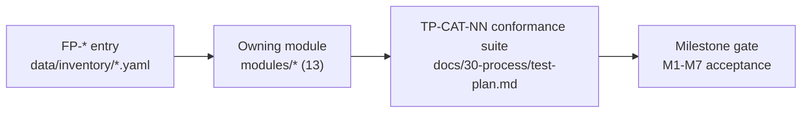

# Feature-Parity Inventory — Methodology and Index

- **Status:** Active — M0 baseline. Every entry in every inventory file is `status: planned` with `test: ""` at handoff. Nothing is implemented.
- **Owner:** TL (authored by task 1-b1, doc-engineer)
- **Date:** 2026-10-19
- **Binding vocabulary:** [docs/GLOSSARY.md](../GLOSSARY.md) — §5 defines the inventory vocabulary, §1 the honesty rules. If this document conflicts with the glossary, the glossary wins.

## 1. Purpose

The feature-parity inventory is the product's traceable feature matrix and the declared baseline against which AutoCAD parity will be measured. It is the honest, machine-checkable answer to "what would parity mean".

- **Machine-readable source of truth:** 14 YAML files at `data/inventory/<area>.yaml` (489 entries at M0).
- **Generated rendering:** `docs/10-product/inventory-tables.md` is GENERATED by `scripts/render_inventory.py`, refreshed by CI and drift-checked against the YAML files. Never hand-edit it.
- **This document:** methodology, vocabulary restatement, traceability chain, area index, maintenance rules, and the scope-honesty declarations. It does not duplicate the entry tables.

## 2. Honesty preamble (binding)

- At M0 **nothing is implemented**. Every entry is `status: planned` and `test: ""`. A milestone gate passes only on documented acceptance tests, never on intent.
- `verified` requires a non-empty `test` referencing a `TP-*` test-plan ID **and** a recorded evidence artifact (run log or screenshot link).
- Mocks, placeholder panels, dead buttons and agent-generated claims are not delivered features and never count toward parity.
- No AutoCAD-parity claim may be made until the inventory, the file-compatibility matrix and the usability benchmarks together demonstrate it.

## 3. Vocabulary (glossary §5 restated)

### 3.1 Areas and ownership

| Area | Title | Owning module (`module:`) | File |
|---|---|---|---|
| CMD | Command system | commands | cmd.yaml |
| DRAW | 2D drawing entities | drafting | draw.yaml |
| MOD | Modify operations | drafting | mod.yaml |
| PREC | Precision input & snaps | drafting | prec.yaml |
| ORG | Layers, blocks, organization | drafting | org.yaml |
| ANN | Annotation (text, dims, tables, hatches) | drawings | ann.yaml |
| LAY | Layouts, viewports, plot/publish | drawings | lay.yaml |
| P3D | 3D modeling | kernel | p3d.yaml |
| PAR | Parametric constraints | parametric | par.yaml |
| IO | Interchange & file compatibility | interchange | io.yaml |
| TS | Specialist toolsets | toolsets | toolsets.yaml |
| UX | AutoCAD-familiar interface conventions | shell | ux.yaml |
| AGT | Integrated agent operation | agent | agent.yaml |
| SKL | Skills & automation | skills | skills.yaml |

### 3.2 ID scheme

`FP-<AREA>-<NNN>` (e.g. `FP-DRAW-001`), three-digit sequential numbering per area starting at 001, unique across ALL areas. IDs are **permanent — never renumbered, never reused**.

### 3.3 Priority definitions

- **P0** — core baseline: routine professional drafting; absence blocks M2 exit (drafting core).
- **P1** — common professional workflows (documentation, layouts, common interop).
- **P2** — advanced/specialist (toolset-specific, dynamic blocks, rare interop paths).

### 3.4 Status enum and evidence rule

`planned | in-progress | partial | blocked | verified`. At M0 every entry is `planned` with `test: ""`. `verified` requires a non-empty `test` referencing a `TP-*` ID plus a recorded evidence artifact. Status transitions without evidence are invalid regardless of milestone pressure.

### 3.5 Entry schema and format

```yaml
area: DRAW
title: 2D drawing entities
module: drafting
entries:
  - {id: FP-DRAW-001, name: LINE, desc: "Two-point line with chained continuation; Close/Undo options", p: P0, dep: [], status: planned, test: "", note: ""}
```

- One entry per line, flow-style map; `desc`, `test`, `note` always double-quoted.
- `name` is the AutoCAD command name where the entry is a command; otherwise a short feature name.
- `dep` lists only allowed component codes: `occt, ocp, freecad, planegcs, build123d, cadquery, ezdxf, libredwg, ifcopenshell, bonsai, gdal, pdal, shapely, blender-native, zcode-runtime`. Empty `[]` means pure product code.
- TS-area entries additionally carry `toolset:` (`mechanical|electrical|mep|plant|civil|gis|raster`).

### 3.6 Priority interpretation policy (recorded decision)

- **TS area:** no TS entry is P0 (P0 is drafting core only). Within a toolset, P1 = the common workflow of that specialty (e.g. P&ID drafting, duct routing); P2 = advanced specialist capability (e.g. isometric extraction, clash detection).
- **P3D and PAR areas:** M3 scope; no P0 entries by the same reasoning — P0 is reserved for the M2 drafting core.
- This policy is the authoring interpretation of §3.3; it is recorded here so later status tracking can be consistent.

## 4. Methodology

1. **Baseline:** AutoCAD 2027 core functionality plus the applicable specialist toolsets (mechanical, electrical, MEP, plant, civil, GIS, raster), per the mission in glossary §1.
2. **Behavior summaries:** each `desc` records AutoCAD's observable behavior (options, prompts, defaults) in ≤ ~14 words — behavior, not marketing. Uncertain claims are tagged `(verify)` in `note`.
3. **Granularity:** one command = one entry where the command is the feature; rich commands split into their meaningful behaviors (e.g. PLINE arcs/width; CIRCLE construction families; PLINE width); a summarized entry is used where AutoCAD itself presents one surface (ARC's eleven methods = one entry).
4. **Area boundaries** were fixed to avoid duplication when the same capability touches multiple concerns:
   - DUCS input mechanics live in PREC; UCS definition/management lives in P3D.
   - Image **attach** (file dependency) is IO; IMAGECLIP (modify op) is MOD; toolset-level raster insert/clip is TS-raster.
   - SCRIPT (.scr) execution is CMD; eTransmit packaging is LAY; table data links are ANN; the command-search engine is CMD, the ribbon search box is UX.
5. **Priorities:** assigned per §3.3 with the §3.6 interpretation; P0 depth concentrates in CMD/DRAW/MOD/PREC (the M2 drafting core).
6. **Depth targets per area** were set before drafting and respected (see index §6).

## 5. Traceability chain



Prose chain: **FP-\* entry → owning module → TP-CAT-NN suite → milestone gate.**

- Each YAML file names its owning module in `module:`; the module's owner (TL/W1/W2/W3, glossary §10) authors its tests. Cross-module conformance suites live in the `testing` module (TL).
- **TP-CAT-04** is the interchange file-conformance corpus; its fixture categories are defined in [file-compatibility-matrix.md](file-compatibility-matrix.md) §13. The canonical TP-CAT registry and numbering live in `docs/30-process/test-plan.md` (M0 task 1-d); this document does not pre-assign numbers beyond the fixed TP-CAT-04 anchor.
- Example chain: `FP-IO-004` (DWG read) → interchange → TP-CAT-04 fixtures → M3 gate. Milestone gates are defined in `docs/30-process/milestone-plan.md`.
- **Citation rule:** at M0, prose documents cite features by **area + name** (e.g. "IO / DWG read"). From **M1 onward, FP-ID-level citations are mandatory** in status tracking, milestone reports and the generated tables.

## 6. Area index

Counts reflect the M0 files exactly; CI drift-checks this table against `data/inventory/`.

| Area | Title | Owning module | Entries | P0 | Primary milestone gate |
|---|---|---|---:|---:|---|
| CMD | Command system | commands | 31 | 18 | M1 (state machine), M2 (full) |
| DRAW | 2D drawing entities | drafting | 41 | 15 | M1 (LINE/CIRCLE/ARC), M2 |
| MOD | Modify operations | drafting | 41 | 20 | M2 |
| PREC | Precision input & snaps | drafting | 29 | 16 | M2 |
| ORG | Layers, blocks, organization | drafting | 31 | 6 | M2 |
| ANN | Annotation (text, dims, tables, hatches) | drawings | 34 | 7 | M2 |
| LAY | Layouts, viewports, plot/publish | drawings | 23 | 4 | M2 |
| P3D | 3D modeling | kernel | 43 | 0 | M3 |
| PAR | Parametric constraints | parametric | 23 | 0 | M3 |
| IO | Interchange & file compatibility | interchange | 27 | 2 | M1 (DXF), M3/M4 (DWG tiers) |
| TS | Specialist toolsets | toolsets | 104 | 0 | M4 onward |
| UX | AutoCAD-familiar interface conventions | shell | 30 | 6 | M1 (shell), M2 |
| AGT | Integrated agent operation | agent | 16 | 0 | M5 |
| SKL | Skills & automation | skills | 16 | 0 | M6 |
| **Total** | | | **489** | **94** | |

The "primary milestone gate" column shows the earliest milestone where the area starts; it is not a completion claim. Completion is proven only per §3.4 evidence rules.

## 7. Maintenance rules

1. **IDs are permanent.** Never renumber; retire by note, never reuse. Appending new entries takes the next free `NNN` per area and requires re-review.
2. **Status transitions require evidence:** a `TP-*` test ID plus a recorded artifact, written into the entry's `test` field by the module owner. CI renders the generated tables and drift-checks them.
3. **Adding entries** is allowed at any milestone with re-review; the author must update the area index here and regenerate `inventory-tables.md` in the same change.
4. **Schema is binding:** the glossary §5 YAML format (flow-style maps, double-quoted `desc`/`test`/`note`, allowed `dep` codes only, `toolset:` on every TS entry) is validated by `scripts/render_inventory.py` before rendering.
5. The counts in §6 must match `data/inventory/` at all times; a mismatch is a CI failure, not a formatting nit.
6. `title:` and `module:` per area must equal glossary §5 exactly; the glossary is never edited from this task chain.

## 8. Statement of scope honesty

The following are declared at **limited support levels** — they are part of the plan, but they are NOT claimed as full AutoCAD parity at M0:

- **Dynamic block semantics** (`FP-ORG-019`, `FP-PAR-021`): an analog must be built; no OSS equivalent was identified at M0. Full AutoCAD dynamic-block behavior is explicitly out of the M0 parity claim.
- **AutoLISP** (`FP-IO-022`): a declared subset only — command-invocation plus entity-data access, conformance-tested. Full AutoLISP compatibility is never claimed.
- **CUIx** (`FP-UX-019`): partial import, tagged `(verify)`. Alias (`.pgp`) import (`FP-CMD-004`) is supported fully.
- **Multilines** (`FP-DRAW-037`, `FP-DRAW-038`): limited tier — read/preserve round-trip; full `MLSTYLE` editing is `(verify)`.
- **OLE** (`FP-IO-009`): declared exclusion — OLE embedding out of scope; rasterized fallback only.
- **Point clouds** (`FP-P3D-039`): a subset of AutoCAD point cloud capability via PDAL.

Every file-format claim above is expanded, tiered and gated in [file-compatibility-matrix.md](file-compatibility-matrix.md), whose support-level declaration policy is binding for any "supported" wording. Related M0 documents: `docs/10-product/ux-specification.md` and `docs/10-product/usability-validation-plan.md` (task 1-b2), `docs/30-process/test-plan.md` (task 1-d), and the generated `docs/10-product/inventory-tables.md`.
