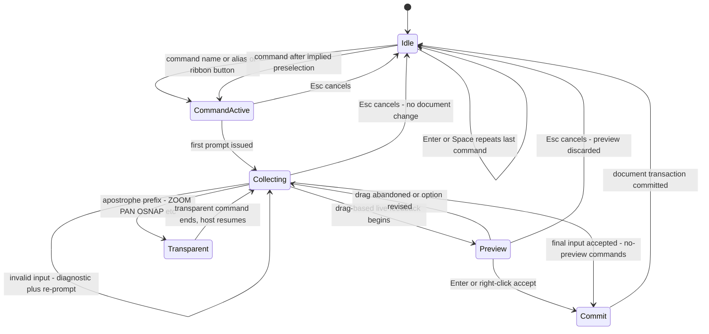

# UX Specification — AutoCAD-Familiar Interaction

- **Status:** Active — target-behavior specification for the CAD shell. Nothing described here is implemented at M0 (glossary §1 honesty rules); every section sets acceptance targets, not completion claims.
- **Owner:** W1 (UX & command systems)
- **Date:** 2026-10-19
- **Vocabulary:** [docs/GLOSSARY.md](../GLOSSARY.md) (binding)

## 0. Reading conventions

- **must** — binding target behavior. **should** — shipped default, user-configurable. **declared (P1/P2)** — optional item with an explicit support level (priorities per glossary §5).
- Features are cited by name + inventory area (e.g. "polar tracking (PREC area)"); feature IDs (FP-\*) are owned by the inventory task and are never repeated here (glossary §5).
- Citable stable references: ADR-0001…ADR-0006; TP-CAT-01…TP-CAT-12, with TP-CAT-10 = comparative usability; module names per glossary §4.
- Uncertain facts are tagged **(verify)** (glossary §13). Interaction patterns only — no proprietary Autodesk assets are reproduced anywhere in this document (§1.3).

## 1. Scope & principles

### 1.1 Target user

The primary persona is the **experienced AutoCAD user**: a professional drafter with ≥ 2 years of AutoCAD practice, fluent in typed commands and aliases, F-key toggles, object snaps, ortho/polar/tracking input, grip editing, and paper-space layouts. The interface is tuned so this persona works naturally (mission criterion 2, glossary §1). New CAD users and Blender-native users are served by discoverability (ribbon, tooltips, search) without reshaping the primary interaction model.

### 1.2 The familiarity bar (binding)

> **Routine operations require no relearning; advanced and Blender-specific features are additive.**

An experienced AutoCAD user who has never seen this product must be able to (allowance: first 30 minutes of a session, per [usability-validation-plan.md](usability-validation-plan.md)):

1. Start drawing within the first minutes by typing commands and aliases with familiar spellings.
2. Rely on the documented F-key map without relearning which key toggles what (§3.6).
3. Draft with running osnaps, one-shot overrides, tracking, ortho/polar, and direct distance entry without consulting help (PREC area).
4. Select with window/crossing/fence/lasso and edit with grips using familiar semantics (§3.5).
5. Produce a dimensioned drawing with layers, blocks, annotations, a layout, and a PDF publish using routine workflows (ORG, ANN, LAY areas).
6. Never have a Blender-specific or agent capability displace, interrupt, or break any of the above.

Familiarity is **measured, not asserted**: the comparative program is TP-CAT-10 ([usability-validation-plan.md](usability-validation-plan.md)).

### 1.3 Not-a-clone rules (binding)

- We implement **interaction patterns only**: prompt syntax, toggle semantics, selection behavior, grip editing, coordinate grammar. We do not copy proprietary Autodesk assets — no Autodesk UI artwork, icons, fonts, dialog layouts, sample drawings, hatch pattern files, help text, or code (glossary §1, §3).
- Familiar command names (LINE, OFFSET, DIMLINEAR, …) are drafting entry points in industry-wide use; they are adopted as interaction vocabulary, not branding. The product presents itself under its own name (ADR-0001) and never as Autodesk software.
- Distinctive non-drafting surfaces are not cloned: no ViewCube-style navigation cube, no SteeringWheels-style radial menus. The drawing area ships our own lightweight navigation aid (declared P1, design reviewed at M1).
- Trademark disclaimer, verbatim per glossary §3 (reproduced wherever naming/licensing is discussed):

  > *"Blender is a registered trademark of the Blender Foundation. AutoCAD, Autodesk and Procore are trademarks of their respective owners. This project is an independent work, not affiliated with or endorsed by any of them."*

### 1.4 Blender preservation rule (binding)

The CAD experience is strictly **additive** to Blender. No existing Blender editor, workspace, tool, modifier, menu item, or shortcut is removed, disabled, or hidden beyond recovery to make room for CAD surfaces. The CAD shell occupies its own Blender workspaces ("Drafting", "CAD Modeling" — final naming per ADR-0001) coexisting with native Modeling/Shading/Animation/Scripting workspaces (§7). Blender-native editing of non-CAD data remains fully available at all times.

### 1.5 Ownership map

| UX surface | Owning module (glossary §4) |
|---|---|
| Ribbon, palettes, status bar, command-line dock, workspace integration | `shell` |
| Command registry, aliases, prompt state machine, history, dynamic input | `commands` |
| Selection, grips, precision-input UX behaviors | `drafting` |
| Layouts, viewports, plot/publish and annotation dialogs | `drawings` |

## 2. Application layout

### 2.1 Default screen wireframe

```text
+-------------------------------------------------------------------------------------------------+
| [New][Open][Save][Plot][Undo][Redo] | Drafting v | Plan-01 v | [search]         <- QAT row    |
| Home Insert Annotate Parametric View Manage Output [toolset tabs ...]                           |
+-------------------------------------------------------------------------------------------------+
| RIBBON (Home active): Draw | Modify | Block | Layer | Annotation | Properties | Groups |       |
|                       Utilities | Clipboard     (panel buttons invoke commands only)          |
+-------------------------------------------------------------------------------+-----------------+
|                                                   | Docked palette stack (right):  |
|                CENTRAL DRAWING AREA              |  + Properties ------------+  |
|                                                   |  | per-entity grid         |  |
|   - crosshair + pickbox (sizes configurable)      |  + Layer Properties       |  |
|   - live coordinate readout x,y[,z]               |  | Manager (grid/filters)  |  |
|   - selected entities show grips                  |  + Tool Palettes ---------+  |
|   - drag previews follow the cursor              |  | authorable tools        |  |
|   - osnap markers + tooltips within aperture      |  + Content browser -------+  |
|                                                   |  | blocks/xrefs/images    |  |
|                                                   |  (dock/float/auto-hide)    |
+-------------------------------------------------------------------------------+-----------------+
| COMMAND LINE DOCK (resizable, 1..n lines):                                                      |
|   Command: OFFSET  Specify offset distance or [Through] <1.0000>: _                             |
|   Up/Down = input recall   click an [option] to choose it   F2 = history palette                |
+-------------------------------------------------------------------------------------------------+
| [Model | Layout 1 | Layout 2 | (+)]                         (right-click: page setup, plot)    |
+-------------------------------------------------------------------------------------------------+
| SNAP GRID ORTHO POLAR OSNAP OTRACK DUCS DYN | scale 1:1 v | LW | QP | coords | n selected      |
+-------------------------------------------------------------------------------------------------+
```

### 2.2 Ribbon

**Tabs, left → right:** `Home`, `Insert`, `Annotate`, `Parametric`, `View`, `Manage`, `Output`, then domain toolset tabs (§2.2.8).

**Binding rule — panels are command-entry surfaces only.** A button invokes a registered command (or opens a registered palette/dialog) through the `commands` registry; all behavior lives in the command system. Every ribbon capability must be reachable from the command line; a missing button never means a missing feature. Ribbon states: full → panel-titles-only → collapsed-to-tabs; state persists per workspace. The tables below fix the shipped default layout and representative commands per panel.

#### 2.2.1 Home tab

| Panel | Representative commands / controls | Notes |
|---|---|---|
| Draw | LINE, PLINE, CIRCLE, ARC, RECTANG, POLYGON, ELLIPSE, SPLINE, HATCH, POINT | flyouts by entity family |
| Modify | MOVE, COPY, ROTATE, SCALE, MIRROR, OFFSET, TRIM, EXTEND, STRETCH, FILLET, CHAMFER, ARRAY, EXPLODE, JOIN, BREAK | frequently-used subset; full set via command line (MOD area) |
| Block | BLOCK, INSERT, ATTDEF, BATTMAN, Block Editor entry | dialog/behavior §4.2 |
| Layer | LAYER, LAYCUR, LAYISO, LAYOFF, LAYFRZ, LAYWALK; quick color/linetype/lineweight dropdowns | full layer command set per ORG area |
| Annotation | MTEXT, DIMLINEAR, MLEADER, TABLE | quick-annotate subset |
| Properties | current color/linetype/lineweight setters | thin setters of "current entity properties" |
| Groups | GROUP (create/manage named groups) | ORG area |
| Utilities | MEASURE, DIST, AREA, ID, QUICKCALC | inquiry tools |
| Clipboard | CUTCLIP, COPYCLIP, PASTECLIP, PASTEBLOCK | standard clipboard ops |

#### 2.2.2 Insert tab

| Panel | Representative commands / controls | Notes |
|---|---|---|
| Block | INSERT (with browse), block-library shortcuts | §4.2 |
| Xref | XATTACH, XREF (palette), XCLIP, XBIND | xref behavior owned by interchange (IO area) |
| Raster | IMAGEATTACH, IMAGE (palette), image clipping | |
| PDF underlay | PDFATTACH (declared P1, scope (verify) in IO area) | |
| Point cloud | declared P2 (TS area) | |
| Layout | LAYOUT, layout-from-template | |

#### 2.2.3 Annotate tab

| Panel | Representative commands / controls | Notes |
|---|---|---|
| Dimensions | DIMLINEAR, DIMALIGNED, DIMRADIUS, DIMDIAMETER, DIMANGULAR, DIMCONTINUE, DIMBASELINE, DIMSPACE, QDIM, DIMREASSOCIATE | style manager §4.4 |
| Text | MTEXT, DTEXT, STYLE (text-style manager), FIELD | in-place editor §4.5 |
| Leaders | MLEADER, MLEADEREDIT, MLEADERSTYLE | |
| Tables | TABLE, TABLEEDIT, TABLESTYLE | data extraction to tables declared P1 (ORG/IO areas) |
| Hatches | HATCH, HATCHEDIT, GRADIENT | dialog §4.3 |
| Center marks | CENTERMARK, CENTERLINE (declared P1) | |
| Styles | quick launch: DIMSTYLE, MLEADERSTYLE, TABLESTYLE | |

#### 2.2.4 Parametric tab

| Panel | Representative commands | Notes |
|---|---|---|
| Geometric | GEOMCONSTRAINT (coincident, collinear, concentric, tangent, parallel, perpendicular, horizontal, vertical, symmetric, equal), AUTOCONSTRAINT | constraint semantics per PAR area; smooth constraint declared P2 |
| Dimensional | DIMCONSTRAINT (linear, aligned, horizontal, vertical, radius, diameter, angular) | driving vs annotative modes per PAR area |
| Manage | CONSTRAINTBAR, DELCONSTRAINT, PARAMETERS (Parameters Manager palette) | |

#### 2.2.5 View tab

| Panel | Representative commands / controls | Notes |
|---|---|---|
| Palettes | PROPERTIES, LAYER, TOOLPALETTES, XREF, CONTENT, command history | docking rules §2.5 |
| 2D Navigate | PAN, ZOOM (Window/Realtime/Previous/Extents/Scale), view transitions | wheel conventions §2.4.4 |
| 3D Navigate | 3DORBIT, 3DPAN, 3DZOOM (declared P1; P3D area) | |
| Visual Styles | 2D Wireframe (default), Wireframe, Hidden, Shaded; VSCURRENT | drafting-accurate display |
| Named Views | VIEW (dialog + quick dropdown) | |
| Coordinates | UCS, UCSICON, World/named presets | default: World UCS in Drafting workspace |
| Model Viewports | VPORTS (configurations, join, single) | |

#### 2.2.6 Manage tab

| Panel | Representative commands / controls | Notes |
|---|---|---|
| Action Recorder | record / stop / save / play action macros (command names finalized at implementation; declared P1) | bridge to the skills pipeline (ADR-0006) out of scope here |
| Customization | Customize dialog (aliases, keyboard, ribbon, workspaces); CUIx partial import (declared P2, (verify)) | §6 |
| Applications | add-in/script loader (declared P2; API contracts owned by `commands`/`agent` docs) | |
| Drawing Utilities | PURGE, AUDIT, RECOVER (IO area) | |
| Standards | STANDARDS, CHECKSTANDARDS (declared P2) | |

#### 2.2.7 Output tab

| Panel | Representative commands / controls | Notes |
|---|---|---|
| Plot | PLOT, PREVIEW | flow §4.8 |
| Publish | PUBLISH (multi-layout batch), batch plot | |
| Export | PDF/DXF/DWG/STEP export via interchange; export preset dropdown | IO area |
| Page Setup | PAGESETUP (manager) | §4.7 |

#### 2.2.8 Domain toolset tabs

Tabs contributed by enabled toolsets (mechanical, electrical, mep, plant, civil, gis, raster — TS area, `toolsets` module). They appear after `Output`, only while the toolset is installed/enabled; core tabs are never hidden by toolsets. Toolset tab content is specified per toolset in the TS-area inventory.

### 2.3 Quick-access toolbar (QAT)

Shipped default, left → right: **New, Open, Save, Plot, Undo, Redo** | **Workspace switcher** (saved workspaces dropdown) | **Document switcher** (our addition; lists open CAD documents, §7) | **Search box** (commands, settings, palettes, help). QAT accepts any ribbon button; customizations persist per workspace.

### 2.4 Central viewport (drawing area)

#### 2.4.1 Crosshair, pickbox, aperture

- **Crosshair:** two full-axis crossing lines; size = 5% of viewport height by default, configurable 1–100%. The crosshair keeps pointing behavior in all command states; a subtle tint indicates the active-command state (reduced-motion-safe, §9).
- **Pickbox:** square target for entity selection; default 6 px, configurable; visually distinct from the aperture.
- **Aperture:** osnap search radius, default 10 px, configurable; the aperture box itself is displayed only when the "show aperture box" option is on (default off, familiar behavior).

#### 2.4.2 Coordinate readout

Live `x,y` readout (plus `z` when 3D data is present) in the status bar and at the crosshair while dynamic input is on; decimal places follow UNITS precision. Clicking the readout toggles live ↔ frozen. Typed coordinates always override pointing (§3.3).

#### 2.4.3 Grips (interactive handles)

- Selected entities display grips at defining points (endpoints, midpoints, centers, etc. per entity type).
- Picking a grip makes it hot: dragging performs the entity's default edit (stretch-type); **Space/Enter cycles the edit mode** (stretch → move → rotate → scale → mirror); right-click opens the mode menu including base-point/copy options.
- Multi-grip picks (select several grips before dragging) perform multi-point stretch.
- Grip colors (unselected/hover/selected) and grip size are configurable. Multi-functional grip hover menus (per-vertex options on polylines etc.): declared P1.

#### 2.4.4 Navigation — AutoCAD-style wheel conventions (binding)

| Input | Behavior |
|---|---|
| Wheel forward / back | Zoom in/out centered on the cursor; continuous per notch; zoom increment configurable (default ≈ 10%/notch) |
| Wheel press + drag | Realtime pan (default on) |
| Wheel double-click | Zoom extents |
| ZOOM command | Window / Realtime / Previous / Extents / Scale / Object, invocable transparently (§3.2) |
| PAN command | Realtime pan; transparent |

Smooth view transitions run for ZOOM Extents/Window and view switches (duration capped; disabled under reduced motion §9). No ViewCube-style widget ships (§1.3); our own navigation aid is declared P1.

### 2.5 Dockable palettes — general rules

| Property | Rule |
|---|---|
| Docking | left/right edges; palettes stack with splitters; command-line dock and status bar are fixed bottom surfaces |
| Floating | any palette can float (multi-monitor supported) |
| Auto-hide | per palette; slide-in on edge hover |
| Resize | drag edges/corners; splitter between stacked palettes |
| Persistence | position/size/visibility/auto-hide persist across sessions, per workspace |
| Keyboard | palettes reachable and operable by keyboard (Ctrl+1/2/3 + focus traversal, §9) |

### 2.6 Shipped palette set

1. **Properties** (Ctrl+1) — content model §4.1.
2. **Layer Properties Manager** (LAYER) — full grid: Status, Name, On, Freeze, Lock, Color, Linetype, Lineweight, Transparency, Plot style (declared P1, interop (verify)), Plot, VP Freeze (in layouts), Description. Property filters + group filters; layer states (§4.6); inline rename; current-layer indicator; double-click sets current; per-viewport overrides in layouts.
3. **Tool Palettes** (Ctrl+3) — authorable groups/tools (§6.3); shipped starter content authored by us; toolset-contributed groups (TS area) are read-only.
4. **Content browser** (Ctrl+2) — library of open documents + file/folder sources: blocks, layers, text styles, dimension styles, hatch patterns, xrefs, images; drag-and-drop insert/copy between drawings.
5. **Command history palette** (F2) — full session transcript, searchable, copy-out; scrollback depth setting; same scrollback object as the dock (§2.7).
6. **External References** (XREF) — attach/detach/reload/unload/bind/repath (IO area).
7. **Parameters Manager** (PARAMETERS) — parametric dimensions/expressions (PAR area).

### 2.7 Command line dock

- Bottom strip spanning the drawing area; resizable 1..n lines (drag top edge; default 2 lines); collapsed = single line.
- Displays: prompt echo (`Command:` at idle; the active command's prompt), the current default in `<angle brackets>`, options in `[brackets]` as clickable chips, diagnostics, and the echoed input history above the active prompt.
- Input: typing goes to the active prompt whenever drawing focus is held; **Up/Down recalls previous inputs**; right-click during a command opens the options menu (§3.7).
- **F2 behavior (binding):** F2 expands the command history palette over the drawing area; F2 again restores the previous layout — one scrollback, two presentations.
- The dock is never auto-hidden by the shell; the user may still dock/auto-hide it explicitly.

### 2.8 Model / Layout tabs

- Bottom-left strip: `Model`, then layout tabs (`Layout 1`, `Layout 2`, …); `+` creates the next layout and selects its label for inline rename.
- Tab right-click menu: New layout, From template, Rename, Delete, Move or Copy, Page Setup Manager, Plot.
- `Model` is always first and cannot be deleted; layouts are printable sheets (§5).

### 2.9 Status bar

Per-toggle binding behavior and shipped defaults:

| Toggle | Key | Behavior (binding) | Default |
|---|---|---|---|
| SNAP | F9 | pointing constrained to the snap resolution grid (X/Y spacing, angle, base — Drafting settings §3.9.4) | off |
| GRID | F7 | grid display within limits; adaptive (hidden when too dense/sparse) | on |
| ORTHO | F8 | pointing restricted to horizontal/vertical relative to current snap rotation/UCS | off |
| POLAR | F10 | polar tracking paths at the increment angle (default 15°) plus additional angles (§3.9.2) | on |
| OSNAP | F3 | running object snaps active; default running set END, MID, CEN, INT, NEA (configurable in the OSNAP dialog) | on |
| OTRACK | F11 | object-snap tracking paths from acquired snap points (§3.9.3) | off |
| DUCS | F6 | dynamic UCS: XY plane temporarily aligns to the face under the cursor during 3D operations | off (auto-on in CAD Modeling workspace) |
| DYN | F12 | dynamic input: pointer input + dimension input fields at the crosshair (§3.8) | on |

**3DOSNAP:** declared P1; the toggle appears only while 3D toolsets / P3D features are active.

Non-toggle status items (right side): **annotation scale** (dropdown + right-click dialog), **lineweight display** (on/off), **quick properties** (on/off, §4.1), **coordinate readout** (§2.4.2), **selection counter**, and **viewport scale/maximize/lock controls** when a layout viewport is active (§5). The full row is right-clickable to show/hide items. Every toggle also has a typed command and a persisted setting named in the Options dialog (§6.6).

## 3. Command interaction specification

### 3.1 Typed commands, aliases, autocomplete

- Commands are invoked by typing anywhere while the drawing area holds focus — no dedicated command mode.
- **Aliases:** short tokens mapped to commands. Shipped defaults include L→LINE, PL→PLINE, C→CIRCLE, A→ARC, CO→COPY, M→MOVE, O→OFFSET, TR→TRIM, EX→EXTEND, F→FILLET, MI→MIRROR, RO→ROTATE, SC→SCALE, REC→RECTANG, H→HATCH; the full set is documented in the alias file itself (§6.1).
- **acad.pgp-style import:** user alias files load and merge (§6.1).
- **Autocomplete:** while typing, a suggestion list shows commands first, then system variables/settings matching the prefix; Up/Down + Enter or click selects; aliases match too. The QAT search reaches commands, settings, palettes, and help.

### 3.2 Prompt state machine (binding)



State semantics:

- **Idle** — empty `Command:` prompt; typing starts a command; Enter/Space repeats the last command; entity picks build an implied selection (§3.5).
- **CommandActive** — name resolved against the `commands` registry; options and defaults initialized.
- **Collecting** — the command consumes its input grammar: points, keywords, selections, distances/angles. Each valid step advances the sequence; invalid input reprompts without aborting.
- **Preview** — drag-driven commands show live geometry feedback; commit only on accept; cancel discards.
- **Commit** — one document transaction per command invocation (granularity §3.10).
- **Transparent commands** — invoked with the `'` prefix during point prompts (ZOOM, PAN, OSNAP, …): they run, then the host command resumes exactly where it paused; nesting is limited to one level (deeper nesting produces a diagnostic).
- **Cancel paths** — Esc returns to Idle with no partial document change: first press cancels the command, second clears grips, third clears the selection (§3.6).

### 3.3 Prompt syntax grammar (binding)

Prompt-line grammar (echoed in the command line and dynamic-input tooltip):

```ebnf
prompt       ::= base_text [ "[" option_list "]" ] [ " <" default ">" ] ":"
option_list  ::= option ( "/" option )*
option       ::= keyword                                (* uppercase chars are significant *)
default      ::= value
```

- Options appear in `[brackets]` separated by `/`; the default appears in `<angle brackets>`; Enter/Space accepts the default; **uppercase significant characters** select an option (`C` → `[Close]`, `U` → `[Undo]`); ambiguous input requires more characters until unique, else a diagnostic reprompts.
- Clicking an option chip (command line or tooltip) is equivalent to typing it.

Coordinate input grammar:

```ebnf
point           ::= absolute_xy | absolute_polar | relative_xy | relative_polar | direct_distance
absolute_xy     ::= number "," number [ "," number ]        (* x,y[,z] in current UCS *)
absolute_polar  ::= number "<" angle                       (* dist<angle from UCS origin *)
relative_xy     ::= "@" number "," number [ "," number ]    (* @dx,dy[,dz] from last point *)
relative_polar  ::= "@" number "<" angle                    (* @dist<angle from last point *)
direct_distance ::= drag_direction number ENTER              (* §3.9.5 *)
world_override  ::= "*" absolute_xy                          (* forces world coordinates - declared P1 *)
number          ::= per UNITS format - decimal, architectural, fractional, ...
angle           ::= per UNITS format, CCW positive from +X axis
```

Target echo example:

```text
Command: LINE
Specify first point: 12,7
Specify next point or [Undo]: @5<15
Specify next point or [Close/Undo]: 30,12
Specify next point or [Close/Undo]: C
```

At "Select objects:" prompts: Enter ends selection; `U` undoes the last selection step; selection keywords per §3.5.

### 3.4 Object snaps

| Class | Members | Behavior |
|---|---|---|
| Running set | END, MID, CEN, INT, NEA, PER, TAN, QUA, INS, NOD — managed in the OSNAP dialog (a tab of Drafting settings) | active while the OSNAP toggle is on; markers + tooltips + magnet within the aperture |
| One-shot overrides | the same names typed at a point prompt (e.g. `mid of`), or Shift+right-click osnap menu | next point only; overrides the running set |
| Point modifiers | FROM (base point + offset); M2P midpoint-of-two-points (declared P1) | |
| Deferred snaps | PER, TAN | resolve against the entity picked at the next input; may be invoked before the target exists |

- **Markers:** a distinct glyph per snap mode (our own design) plus a tooltip naming the snap and its coordinates; **magnet**: the cursor jumps to the snap point when inside the aperture.
- **Candidate cycling:** when several snap candidates fall within the aperture, **Tab cycles** them (marker + tooltip per candidate).
- `none` as a one-shot override suppresses all snaps for the next point.

### 3.5 Selection model

| Method | Gesture / keyword | Rule |
|---|---|---|
| Single pick | click with the pickbox | adds the entity; Shift+click removes |
| Window | drag **left→right** | selects entities **entirely inside**; visual: solid translucent fill + continuous border (defaults, configurable) |
| Crossing | drag **right→left** | selects entities **crossed or inside**; visual: dashed border + second tint (§8–§9: pattern + border style differ, never hue alone) |
| Fence | `F` | open polyline; selects crossed entities |
| WPolygon / CPolygon | `WP` / `C` | closed polygon; inside-only / crossing |
| Lasso | press-and-drag directly | freehand region; direction rule identical to window/crossing |
| Last / Previous / All | `L` / `P` / `ALL` | last-created / previous set / all selectable entities |
| Add / Remove | `A` / `R` | selection modes at object prompts |
| Undo selection step | `U` | removes the last added object |

- **Implied preselection (PICKFIRST-style, default on):** entities selected before a command starts are passed to it; commands that cannot use preselection prompt normally.
- **Grips on selection:** the selection set displays grips (§2.4.3) and persists after the command ends until cleared with Esc.
- Selection effects (highlight tint + dashed effect) are configurable; hover highlight is declared P1.

### 3.6 Keyboard conventions (binding table)

| Input | Behavior |
|---|---|
| Enter | accept current input/default; complete a point; repeat last command at idle; newline inside text editing |
| Space | Enter-equivalent outside text entry; inserts a space during text entry |
| Esc | cancel active command (1st press); clear grips (2nd); clear selection (3rd) |
| F1 | context help |
| F2 | toggle command history palette (§2.7) |
| F3 | toggle OSNAP |
| F4 | reserved / unassigned at M1–M2 (customizable, §6.4) |
| F5 | isoplane cycling (declared P1, isometric drafting) |
| F6 | toggle DUCS |
| F7 | toggle GRID |
| F8 | toggle ORTHO |
| F9 | toggle SNAP |
| F10 | toggle POLAR |
| F11 | toggle OTRACK |
| F12 | toggle DYN |
| Ctrl+1 / Ctrl+2 / Ctrl+3 | Properties palette / Content browser / Tool Palettes |
| Ctrl+0 | clean-screen toggle (declared P1) |
| Ctrl+Z / Ctrl+Y | undo / redo (equivalent to U / REDO) |
| Up / Down at empty prompt | recall previous typed inputs |
| Alt | ribbon KeyTips (keyboard-complete ribbon navigation, §9) |
| Shift+right-click | osnap override menu during point prompts |

### 3.7 Right-click model (configurable, §6.6)

| Mode | Behavior |
|---|---|
| Default (shipped) | context menu: repeat last command, clipboard, osnap overrides, view submenu, selection operations |
| During a command | the active prompt's option keywords as a menu + accept + cancel (per Options; the alternative mode treats right-click as accept) |
| Quick-click mode (option) | right-click = accept/repeat; long-press opens the menu; delay slider in Options |

### 3.8 Dynamic input

- **Pointer input:** with DYN on, a tooltip at the crosshair carries the live point-entry field; typing uses the same grammar as §3.3.
- **Dimension input:** for drag-driven prompts (LINE segments, OFFSET distance, ROTATE angle, …), the tooltip shows labeled fields (length + angle, or the command's parameters); **fields update live during the drag**.
- **Tab (binding):** Tab moves to the next field and locks the previous one at its current value (locked visual state); Shift+Tab returns; typing over a locked field unlocks it; Enter accepts all fields; angle entry via its field; Esc cancels the pending input first, the command second.
- DYN off → all typing flows to the command line.

### 3.9 Precision aids

1. **ORTHO** — restricts pointed directions to horizontal/vertical (relative to snap rotation); does not constrain typed coordinates.
2. **Polar tracking** — alignment paths at the increment angle (**default 15°**) with angle+distance tooltip; **additional angles list** (user angles outside the increment series, e.g. 23°); measurement absolute or relative-to-last-segment (setting).
3. **Object-snap tracking** — hovering over a snap point **acquires** a tracking point (acquisition cue); dashed **alignment paths** (horizontal/vertical, plus polar increments when POLAR is on) guide the cursor; path intersections snap; acquired points clear at command end; acquisition mode configurable.
4. **Grid/Snap settings dialog (DSETTINGS-equivalent)** — snap X/Y spacing, angle, base; grid spacing; adaptive grid; isometric grid (declared P1); snap type grid vs polar.
5. **Direct distance entry** — at a "next point" prompt, point in a direction (constrained by ortho/polar when active), type the distance, press Enter; the point lands along the tracked direction.

### 3.10 Undo / redo (and agent transactions)

| Entry point | Behavior |
|---|---|
| U | undo the last command/step group |
| UNDO | grouped undo; options Mark, Back (to mark), Control (All/None/One) |
| REDO | redo one undone step (immediately following U/UNDO) |
| OOPS | restore the last erased set, even after intervening commands (until the next erase) |
| MREDO | redo multiple (declared P1, (verify)) |
| Checkpoints | named rollback points (glossary §6): restorable via drawing utilities + typed command; checkpoint restore rewrites the journal (distinct from UNDO) |

**Agent transactions:** every agent-committed transaction (`cad.*` tools, glossary §6) forms one undo group labeled with the agent action; a user U steps back one such transaction; locking/conflict behavior follows the shared-document terms (`doc_version`, `entity_lock`, `selection_epoch`). Undo is journal-backed (`document` module) with a configurable depth.

### 3.11 Units dialog and drawing limits

- **UNITS dialog:** length type (scientific, decimal, engineering, architectural, fractional), precision, angle type (decimal degrees, deg/min/sec, grads, radians, surveyor), angle direction (CCW default / CW), insertion-scale units (mm, cm, m, in, ft, …), live sample preview. Typed/echoed values follow these formats (§3.3).
- **LIMITS — declared P1, optional legacy support:** sets the grid-bounded area and a soft extents guide; limits are **not** enforced as a hard drawing boundary (consistent with modern drafting practice).

## 4. Palettes & dialogs (content models)

### 4.1 Properties palette + quick properties

- Category groups: **General** (Color, Layer, Linetype, Linetype scale, Lineweight, Transparency, Plot style (declared P1, (verify))), **Geometry** (entity-specific: endpoints, center, radius, …), and per-type groups (text content/style/height; block name/insertion/scale/rotation; dimension overrides).
- Inline editing; each field commits as one undo group. Multiple selection shows common properties only; values that differ across the selection show a "varied" state and accept one new value applied to all.
- **Quick properties:** status-bar-toggleable popup near the selection; configurable property subset per entity type; dismissed by Esc or click-away.

### 4.2 Block insertion + Block editor

- **INSERT dialog:** name dropdown (drawing blocks) + browse; insertion point (on-screen toggle + X/Y/Z); scale (X/Y/Z + uniform lock); rotation (angle field); explode checkbox; unit conversion per UNITS insertion scale.
- **Block editor:** authoring environment for block definitions; parameters/actions authoring is the dynamic-block-like feature set — declared P1/P2 per the ORG area inventory; this document fixes only the entry points.
- **ATTDEF dialog:** tag, prompt, value, modes (invisible, constant, verify, preset, locked position), text settings; **BATTMAN** manages attributes in existing blocks.

### 4.3 Hatch & gradient dialog

- **Patterns:** shipped set authored by us (generic drafting patterns); user `.pat` files importable. Settings: scale, angle, relative-to-paper-space (declared P1), associativity toggle.
- **Boundaries:** pick internal points with island detection (nested/outermost modes), select objects, remove boundaries, re-create boundary; live preview during drag.
- **Origin controls**; **GRADIENT tab:** two-color gradient, variants, angle, centered option.
- **HATCHEDIT** reopens the dialog for existing hatches.

### 4.4 Dimension style manager

- Style tree; **New / Modify / Override / Compare** actions; family styles: Linear, Angular, Radius, Diameter, Ordinate.
- Settings tabs: Lines, Symbols & Arrows, Text, Fit, Primary Units, Alternate Units (declared P1), Tolerances.
- **Update** action re-applies the current style to selected dimensions.

### 4.5 Text styles + in-place MTEXT editor

- **STYLE dialog:** font family/style, height, width factor, oblique angle, orientation flags, preview.
- **In-place MTEXT editor (binding):** editing happens in the drawing at the text's location; ruler; in-editor toolbar: style, font, height, bold/italic/underline, color, stacking (fractions), bullets/numbering, justification, fields (FIELD). Background mask declared P1; columns declared P2. Text commits live; Esc cancels the edit session and restores content; Space inserts a space and Enter inserts a newline while in the editor.
- **Single-line text (DTEXT):** entered in place at the insertion point with justification preview; **DDEDIT** edits existing text in place.

### 4.6 Layer states manager

Save the current layer state with selectable property subsets (on/off, freeze, lock, color, linetype, lineweight, transparency, plot, current layer); named state list; restore; import/export (our format; AutoCAD `.las` import declared P2 (verify)).

### 4.7 Page setup manager

Per-layout named page setups: plot device (system printer or our PDF pipeline — LAY/IO areas), paper size, plot area (Layout / Extents / Window / View), plot offset, scale (Fit / 1:1 / standard / custom), plot style table (CTB/STB read support (verify), declared P1), orientation, plot options, preview.

### 4.8 Plot dialog flow + publish

- **Flow (binding):** PLOT → page-setup selector (current layout default) → device/paper/scale/area → **PREVIEW** (full-screen preview with zoom/pan; exit returns) → **Plot** executes; progress dialog; result summary (pages, output path); failures produce diagnostics — never silent.
- **PUBLISH:** sheet list (layouts from open documents), reorder, per-sheet page-setup override, single/multi-sheet PDF, output naming templates; background publish declared P1 (verify). Batch plot from the Output tab.

## 5. Layouts & paper space

- **Parity:** the full command set works in model space and paper space; only viewport-specific commands are layout-only. **MSPACE/PSPACE** switch focus; double-clicking inside a viewport enters model space through it; double-clicking the paper exits.
- **Viewports:** created via VPORTS (rectangular standard; polygonal and clipped viewports — **VPCLIP** — declared P1). Per viewport: standard/custom scale list, **display lock** (preserves scale + view), **maximize toggle** (status-bar control; VPMAX/VPMIN entry points).
- **Annotative objects (ANN/LAY areas):** annotative text/dimension styles carry scales; each viewport has an annotation scale; annotative objects display at correct size per viewport scale; ANNOAUTOSCALE-like auto-addition declared P1.
- **Page setup & plot styles** attach per layout (§4.7). The Model tab is not printable as a layout (familiar behavior). Layouts can be created from templates; per-layout UCS declared P1.

## 6. Customization

### 6.1 Aliases

Alias file: ours, documented plain text, editable via dialog or file. **acad.pgp-style import** parses a user's existing alias file and merges it (conflict policy: user file wins, with a report).

### 6.2 Workspaces

Save the current UI state (ribbon tabs/panels visibility, palette layout, status-bar items) as a named workspace; switch via the QAT dropdown; reset to shipped default; export/import (our format). Shipped: **Drafting** (default) and **CAD Modeling** (3D ribbon layout).

### 6.3 Tool palette authoring

Create/rename/delete groups; create tools by dragging entities/blocks onto palettes; per-tool overrides (layer, scale, rotation, prompt toggles); shared palettes export/import; toolset-contributed groups read-only.

### 6.4 Keyboard remap

Options dialog lists all bindings (§3.6); user remap with conflict detection (no silent shadowing); per-binding reset; changes persist per workspace.

### 6.5 CUIx partial import — declared support level

**(verify)** Parsing of Autodesk CUIx packages is unverified; declared **P2**: partial, best-effort import of menus/macros/shortcuts where mapping is possible. **No full-compatibility claim** (glossary §1); interop scope per IO area.

### 6.6 Options dialog (drawing preferences)

Tabs: **General** (files, autosave), **Display** (colors, crosshair/pickbox/aperture/grip sizes, fonts), **Drafting** (osnap marker size/color, tooltips, alignment paths), **Selection** (pickbox, effects, PICKFIRST-style preselection, grip behaviors), **Save** (formats, autosave, backups), **Compatibility** (units/interop defaults per IO area), **Profiles** (export/import of the settings bundle). Every shipped default in this document has a findable, named setting here.

## 7. Blender integration (binding)

1. **Workspace coexistence:** the CAD shell ships as Blender workspaces ("Drafting", "CAD Modeling") alongside native Modeling/Shading/Animation/Scripting. Switching workspaces never mutates the CAD document and never resets the other workspace's UI state (Blender's per-workspace layouts + our shell state persistence).
2. **No removals (glossary §1):** all native Blender editors, tools and workspaces remain available and functional from within CAD workspaces; nothing is disabled by the extension.
3. **Document/session model:** one CAD document per Blender session (matches Blender's single-file model; `document` module, glossary §4). The QAT document switcher lists open sessions. MDI-within-one-window is not committed (verify).
4. **Outliner ownership:** CAD-owned entities appear in a dedicated collection tree (`CAD/…`) with ownership tags (custom properties carrying entity/document identity). Native Blender edits to CAD-owned objects follow the **adoption/detachment policy** in [docs/00-architecture/document-model-and-geometry-kernel.md](../00-architecture/document-model-and-geometry-kernel.md): such an edit either adopts the object into pure-Blender data or is rejected, per that policy — the UX never silently forks the authoritative document.
5. **Rendering/compositing:** Blender render/composite nodes operate on the synchronized scene (display/plot tessellation produced via the `kernel` module); renders are read-only consumers of document geometry — a render never writes back to the document.
6. **Agent operations** surface in the same shell through the command-line registration hook (glossary §4 recorded decision); permissions per the permissions doc (AGT area). Agent flows are additive and never displace drafting input focus outside the documented approval flow (`plan → preview → approve → execute → verify`, glossary §6).
7. **Identity:** the product presents itself under its own name/branding (ADR-0001); it is never presented as Autodesk software, stock Blender, or the ZCode IDE (glossary §1, §3).

## 8. Theming & visual design

- **Drawing area:** dark theme default in model space; paper space uses a paper-white background (familiar model-dark/paper-white split). Background, grid, crosshair, and marker colors configurable per theme.
- **Crosshair/pickbox/aperture:** sizes configurable (§2.4.1); a subtle crosshair tint cues the active-command state.
- **Shell chrome:** ribbon/palettes follow the host platform theme system (Blender theme options + a CAD accent), so the product reads as one application.
- **High contrast:** OS high-contrast mode honored (OS palette forced); a shipped high-contrast theme.
- **Cues are never color-only** (§9): window vs crossing, osnap markers, toggle states pair color with shape/pattern/text.

## 9. Accessibility

1. **Keyboard-complete drafting:** every drafting command, dialog and palette function is operable by keyboard alone (typed commands, Alt KeyTips on the ribbon, focus traversal in palettes/dialogs, keyboard accept/cancel of previews). Validated by task T9 of the usability plan.
2. **Hit targets:** at 100% UI scale, interactive controls ≥ 24 px minimum dimension (status toggles, palette headers); ribbon buttons ≥ 32×24 px; platform UI scaling honored.
3. **Reduced motion:** option disables smooth view transitions and non-essential animation; drag previews (functional feedback) remain; OS-level reduced-motion honored where the platform exposes it (verify).
4. **Screen readers:** palette contents, ribbon, and status readouts exposed to platform accessibility APIs where feasible (Blender's accessibility surface is limited (verify) — best-effort, honestly documented); the command-line transcript provides a text equivalent of every prompt interaction.
5. **Colorblind-safe indicators:** all state cues are icon+label+color, never color-only; shipped selection/window/crossing defaults are checked with colorblindness simulation before release (testing module).

## 10. Specification-to-inventory traceability

- The behaviors specified here are the UX-area entries of the feature-parity inventory ([feature-parity-inventory.md](feature-parity-inventory.md); `data/inventory/ux.yaml`; owning module `shell`, glossary §5). The inventory task owns feature IDs; this document deliberately cites none.
- During M1 implementation, each numbered behavior above maps to: (a) one or more UX-area inventory entries, plus owning-module entries for the behavior (e.g. PREC area for tracking); (b) `commands` registry entries for anything invocable; and (c) test items in TP-CAT-01 and TP-CAT-10 — category semantics are owned by [../30-process/test-plan.md](../30-process/test-plan.md).
- Usability acceptance evidence is produced only by the validation program ([usability-validation-plan.md](usability-validation-plan.md)) — never by this document.

## 11. Honest scope statement

- **Nothing in this document is implemented at M0** (glossary §1). Every section is a target-behavior specification with support levels; "must" items are acceptance targets for the milestones that own them, not claims of current state.
- **M1–M2 deliver the P0 drafting core** (glossary §11): basic entities and modify, the prompt state machine, precision aids (osnap/ortho/polar/tracking/dynamic input), layers and blocks, basic annotation, layouts + PDF publish — the subset of this spec required for routine professional drafting.
- **Advanced items follow their declared support levels:** dynamic-block-like behaviors, sheet-set-like management (declared P2, LAY area), CUIx partial import (§6.5), action recorder, standards checking, 3DOSNAP, isometric drafting — none promised for 1.0 beyond their inventory priority.
- Where this document and the inventory or glossary disagree, the glossary/inventory win; the conflict is recorded in the worklog and this document is corrected (glossary header rule).
