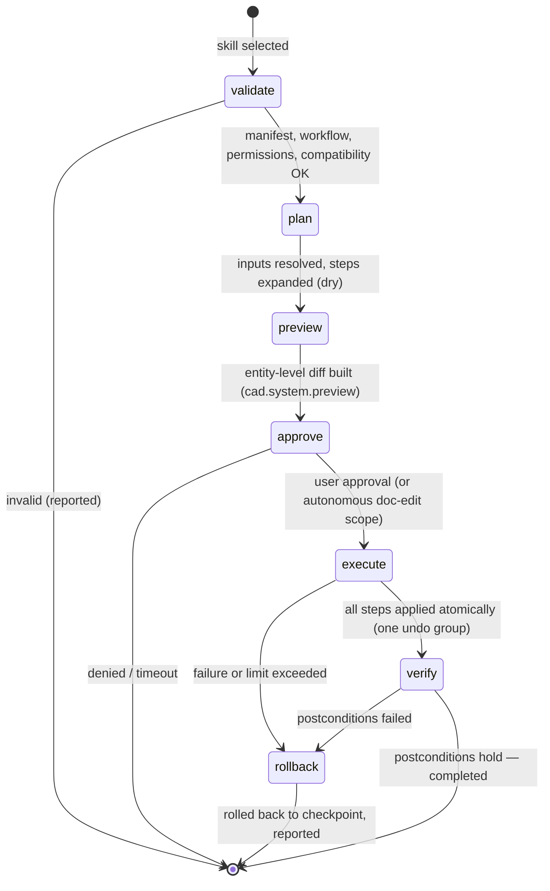
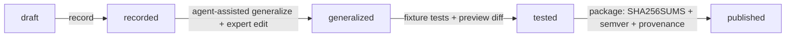

# Skill Execution & Publishing Policy

- **Status:** Binding M0 specification — all items `planned`; nothing is implemented at M0
- **Owner:** W3 — Agent & skills (modules `skills`, `agent`)
- **Date:** 2026-10-19 (UTC)
- **Vocabulary:** [docs/GLOSSARY.md](../GLOSSARY.md) (binding)

## 1. Execution engine



State semantics (the glossary pipeline `plan → preview → approve → execute → verify`, with `validate` as the entry gate):

- **validate:** manifest + workflow schema check; declared permissions vs session grants; compatibility (product range, contract versions, kernel capabilities); declarable preconditions.
- **plan:** resolve `$inputs` (auto-generated form or `prompt_user` at runtime); expand the step list with worst-case loop counts (`max_iterations` × nesting — refuse if the bound exceeds `max_steps`); intersect the tool allowlist with session grants.
- **preview:** build the reviewable diff via `cad.system.preview` (whole workflow when statically batchable, otherwise checkpoint-segmented previews).
- **approve:** per the permissions model — `propose`: every run; `approve`: plan-level; `autonomous`: in-scope `doc-edit` only; all other classes and high-impact ops always prompt.
- **execute:** deterministic interpreter. **Declared limits are enforced:** `max_time_s` (wall clock), `max_steps` (counted per step including loop iterations), per-call tool allowlist, `max_iterations` on every `foreach`/`while`. The executor injects `base_doc_version` for every transactional step and handles conflicts per rules R1–R4.
- **verify:** postconditions + `validate` step assertions, including fixture comparisons wherever declared.
- **rollback on any failure:** to the last checkpoint (or run start). Atomic transaction groups make partial states impossible; the exit report states the reason, applied undo groups, and the checkpoint.

Limit enforcement (all hard, executor-side):

| Declared limit | Mechanism | On violation |
|---|---|---|
| `max_time_s` | wall-clock deadline per run | abort → rollback to last checkpoint |
| `max_steps` | step counter including loop iterations | abort → rollback |
| `max_iterations` (per `foreach`/`while`) | loop counter; the field is REQUIRED — the schema rejects its absence | abort → rollback |
| `tool_allowlist` | per-`tool_call` set membership | abort → rollback + incident record |
| plan bound (`plan` state) | worst-case loop expansion must stay ≤ `max_steps` | refuse to start |

**Concurrency:** one skill run per agent session at a time (runs are serialized); concurrent user editing is fully supported — rules R1–R4 keep the run consistent or roll it back.

**`prompt_user` at run time:** skills needing missing inputs pause execution with a typed form (never free-form); in `autonomous` mode a `prompt_user` step pauses the run — the executor never fabricates input values. A paused run keeps its locks only under the standard lock-lapse policy (permissions doc §4 R3), then rolls back and reports `awaiting-input (timeout)`.

**Execution log per run:** JSONL activity records plus step-level records (`run_id, step_id, tool, args_digest, result_status, ts`); retained (project-local, 90-day default), exportable by the user, bundled into incident reports.

Run exit report (attached to every terminal state; exportable):

```json
{"run_id": "r-2f…", "skill": "com.payswapcad.drafting.generate-title-block@1.0.0", "state": "completed",
 "undo_group": "agent:as-7f3a:generate-title-block", "doc_version_after": 51,
 "checkpoints": ["pre-insert", "placed"], "evidence": {"screenshot": "b64:…", "diff": "preview:pv-…"},
 "steps_total": 15, "elapsed_s": 8.2}
```

**Determinism:** wherever a check can be deterministic, it is. **LLM assistance is used in AUTHORING (generalization), NOT in execution** — execution is deterministic and replayable: same inputs + same document fixture ⇒ same outputs, so every published run can be reproduced and audited. Replays run against fixture copies, never the live document.

**Replay and audit procedure:** (1) any run can be replayed by re-running the recorded inputs against the same fixture — outputs must match the stored diff; (2) auditors export the execution log + exit report + diff chain from the activity panel; (3) a mismatch is a defect: non-determinism in a skill (e.g., wall-clock-dependent steps) is rejected at the static-analysis gate when detected.

## 2. Isolation and safety

- **Declarative steps** run in an in-process interpreter with a per-skill tool allowlist (manifest `tools` ∩ session grants = effective allowlist); every call is permission- and mode-checked by the adapter (`enforced` — see the permissions doc labels).
- **Scripts** (exceptional, ADR-0006) run in a restricted subprocess: declared interpreter only; scrubbed environment (secrets removed unless declared); filesystem scope = manifest-declared directories (read/write separated); **network off unless declared AND granted**; output contract = JSON on stdout; non-zero exit → failure policy. Per-platform confinement is best-effort and documented honestly.

```yaml
# manifest excerpt — declaration checked by the static-analysis gate at publish and install
scripts:
  - file: scripts/export_bom.py
    interpreter: python3
    filesystem: [{mode: read, path: assets/bom}, {mode: write, path: out/}]
    network: []
    env_allowed: [PROJECT_ROOT]
```

- **Effective allowlist example:** a skill declares `tool_allowlist: [cad.blocks.insert, cad.blocks.manage_attributes]`; the session (mode `propose`, `doc-edit` granted) intersects it with `cad.system.capabilities` → both tools available; `cad.layers.create` fails validation at the interpreter before any tool call is attempted; `cad.io.*` is not callable at all (not declared).
- **Dependency pinning:** installed skills are pinned in a project `skills-lock` file (`id@version` + integrity digest); upgrades are explicit; `cad.skills.run` refuses version drift.
- **Revocation/removal:** uninstall removes allowlist entries and session grants; a revoked (security) skill is disabled everywhere — registry push plus local digest blocklist.
- **Test packages are isolated from production documents:** skill tests and `cad.skills.validate` dry-runs execute against fixture copies only (never the live document); live-document execution goes exclusively through preview → approve → commit.

## 3. Authoring pipeline (record → generalize → … → published)

The central value proposition: **an expert turns a complex procedure into a reusable skill.** Pipeline states per glossary §7: `draft → recorded → generalized → tested → published`.

1. **record:** capture a command/operation log with context — every command the user runs is recorded with object types, parameters, dependencies (layers/blocks/styles used) and inferred preconditions. Recording is explicit and stays local (module `commands` history is the source; the recorder adds parameter/dependency context). A recorded entry looks like:

   ```json
   {"ts": "2026-09-30T14:02:11Z", "command": "-INSERT", "args": {"name": "std-title-block-A3", "position": [0,0,0]},
    "object_types": ["block-reference"], "dependencies": {"block": "std-title-block-A3", "layer": "0"},
    "preconditions_inferred": ["layout exists", "standard block library attached"], "doc_version": 118}
   ```

   The recorder captures per operation: command name and arguments, resulting object types, parameters, entity ids, dependencies, inferred preconditions and the document version — enough to generalize without re-recording. It deliberately does **not** capture screen coordinates or UI-only state, so generalization targets the command contract, not pixels (mission rule: typed API first).

2. **generalize (agent-assisted):** replace project-specific values with typed inputs; add conditions, loops, subroutines and error handling. **LLM assistance lives here only** — the agent proposes, the expert disposes.
3. **expert edit:** the expert reviews and edits manifest + workflow. Expert sign-off is required for `team`/`public` publication.
4. **test on fixture copy:** run against fixtures until assertions pass (TP-CAT-08 suites).
5. **preview diff:** review a sample run's entity-level diff.
6. **package + version:** `SHA256SUMS` + semver + provenance per `skill-format-v1.md` §4.4.



**Mission rule, stated plainly: a recorded macro alone is not enough.** A raw command log is brittle — hard-coded values, no error handling, no inputs, no compatibility claims. Publication to `team`/`public` requires the generalize + test stages; `local`-tier un-generalized recordings may run with a visible warning and cannot be published.

## 4. Publishing and registry

REST API sketch (registry; `team` = org-hosted, `public` = global; hosting decision at M6 (verify)):

| Endpoint | Method | Purpose |
|---|---|---|
| `/skills` | POST | `publish` a package (manifest + files + `SHA256SUMS`) |
| `/skills/{id}/versions` | GET | `versions.list` |
| `/skills/{id}/versions/{v}` | GET | `get` (manifest + file digests) |
| `/skills/search` | GET | `search` by task language |
| `/skills/{id}/install` | POST | `install` (returns package + digests; client verifies integrity before loading) |
| `/skills/{id}/revoke` | POST | `revoke` (author or registry admin — security or withdrawal) |
| `/skills/{id}/report` | POST | `report` an issue or security incident |

Authentication: registry accounts with per-publisher signing keys; `publish` and `revoke` require signed requests; `install` is anonymous-readable but integrity-verified client-side.

**Validation gates** (all must pass before a package is `published`):

1. Schema validation (manifest + workflow).
2. Permission review — human review for the `public` tier; declared permissions justified and minimal.
3. Static analysis of `scripts/` (interpreter allowlist, no eval, no network/filesystem outside declarations).
4. Compatibility test — the package's `tests/` run against the declared product versions in CI.
5. Provenance + integrity verification (digests recomputed; signature checked when present).
6. License check (OSI license required for `public`; attribution preserved).

**Third-party skills are UNTRUSTED until validated.** Validation status is part of publication metadata and is surfaced in install prompts. Trust tiers with per-tier install prompts (always shown **before** anything executes):

| Tier | Source | Validation | Install prompt |
|---|---|---|---|
| `local` | disk / dev | none (author = you) | "Unvalidated local skill" + plain-language permission summary |
| `team` | org registry | gates 1, 3–6 + team review | validations passed + permission summary + publisher identity |
| `public` | public registry | all gates 1–6 | full provenance chain + permission summary + validation badges |

Tier escalation: `local` → `team` passes gates 1, 3–6 at submission; `team` → `public` additionally passes gate 2 (human permission review). Validation results are re-earned — not inherited — on every major version bump.

Registry publication record (metadata; the provenance chain in §6 extends it):

```json
{"id": "com.payswapcad.drafting.generate-title-block", "version": "1.0.0", "tier": "team",
 "digest": "sha256:…", "signature": {"key_id": "w3@2026-q4", "algorithm": "ed25519"},
 "gates": {"schema": "pass", "permission_review": "pass", "static_analysis": "n/a — no scripts",
            "compatibility": {"0.6.0": "pass"}, "integrity": "pass", "license": "MIT"},
 "published_at": "2026-10-19T09:00:00Z", "published_by": "w3"}
```

Version policy on the registry: package versions are immutable (republish = new version); withdrawn versions are **yanked** (hidden from search; installable only by explicit digest for incident analysis) but never deleted — provenance chains must stay verifiable. Breaking skill changes bump major; new optional inputs/fields bump minor; fixture/test-only changes bump patch.

## 5. Discovery UX

- **Search by TASK in natural language, not implementation** — "create a title block", not "insert block + set attributes". The index is built from manifest `name`/`description`/`categories`.

```json
→ GET /skills/search?q=create%20a%20title%20block
← {"results": [{"id": "com.payswapcad.drafting.generate-title-block", "name": "generate-title-block",
                 "version": "1.0.0", "trust_tier": "team", "score": 0.92,
                 "description": "Insert the standard title block into the current layout…"}]}
```
- **Inputs form auto-generated** from the manifest `inputs` JSON Schema (enums → dropdowns, patterns → validated text, defaults prefilled).

| JSON Schema feature | Form widget |
|---|---|
| `enum` | dropdown; `default` preselected |
| `pattern` / `minLength` / `maximum` | validated text/numeric input — invalid entries are blocked before the run starts |
| `required` | marked; the run button stays disabled until filled |

- **Preview before execute:** the entity-level diff is shown and approved before any run (`cad.system.preview`).
- **Surfaces:** command line (skill names registered via the `commands` registration hook — glossary §4 dependency inversion), tool palettes, ribbon, agent area, skill library. All surfaces resolve to the same engine; there are no per-surface execution variants.
- **Skill library surface:** a searchable, tier-filtered library panel (installed / team / public tabs); each entry shows plain-language permissions, last verified product version, and provenance badges. Command line surface: typing a skill name completes via the registration hook and opens the auto-generated inputs form inline.
- Approval prompts, mode indicators and the activity panel follow `permissions-and-execution-model.md`; their usability is validated under TP-CAT-10.

## 6. Security incident policy

- **report → quarantine → revoke:** a user or automated report quarantines the skill (disabled across installs, activity logs preserved) pending review; confirmed incidents revoke it (removed from the registry, blocked at install via digest blocklist, signing key revoked if compromised).
- **Provenance chain in publication metadata:** author key → package digest → registry entry digest → install record — each hop recorded and exportable.
- **Compatibility testing cadence:** every product release re-runs published skills' `tests/` against the new version (CI, TP-CAT-08); broken skills are flagged in the library with "last verified product version" — no silent breakage.

Incident timeline (each hop digest-linked in the incident log):

1. `report` — a user reports unexpected file writes by a `public` skill (activity-log excerpt attached).
2. `quarantine` — the registry disables the package; installed copies receive a kill signal at next app start; local blocklist entry by digest.
3. `investigate` — W3 replays the skill deterministically against its fixture with the reported inputs (§1) and reviews the static-analysis findings.
4. `revoke` — package removed; publishing key revoked if compromised; affected users notified with removal instructions.

Registry compromise handling: if the registry itself is compromised, the digest blocklist and signing-key revocation are the containment lines; clients pin installed skills by digest (`skills-lock`), so a tampered registry cannot silently alter already-installed packages — installs re-verify digests against the provenance chain before loading.

## 7. Traceability

Skill creation/versioning tests live in the TP-CAT-08 suites; skill security tests (sandbox escape attempts, revocation, quarantine, integrity mismatch) live in TP-CAT-09. Discovery/approval usability is measured under TP-CAT-10.
