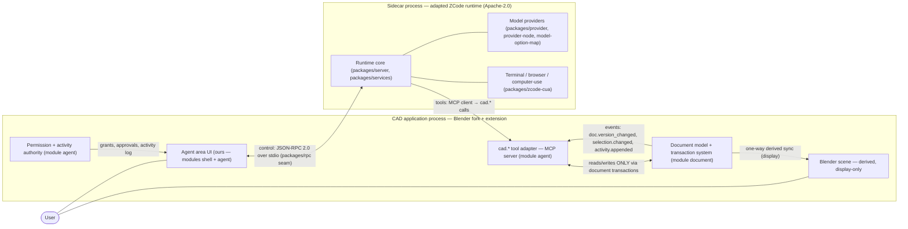

# ZCode Runtime Adaptation Plan — Agent Sidecar

- **Status:** Binding M0 specification — all items `planned`; nothing is implemented at M0
- **Owner:** W3 — Agent & skills (modules `agent`, `skills`)
- **Date:** 2026-10-19 (UTC)
- **Vocabulary:** [docs/GLOSSARY.md](../GLOSSARY.md) (binding)

## 1. Upstream facts (fixed at handoff)

Facts below are recorded in glossary §6 and bind this plan verbatim.

- **Upstream repository:** `zai-org/ZCode` — **Apache-2.0**, version **3.16.1**, a **TypeScript pnpm monorepo**, described as "Z.ai's coding agent harness."
- **Upstream pin (binding):** `0a1fc56d279fd1001f78387bd81aec1c26767411` (zai-org/ZCode `main`, 2026-10-19T02:34Z). Recorded in `release-manifests/manifest-*.json` → `components.zcode_runtime.upstream_ref`; pins never change silently (glossary §8).
- **Our fork:** `payswapdotorg/ZCode`. GitHub created the fork under the root-name cache entry "Gen" and it was renamed to `ZCode` — **cosmetic only**; parent verified as `zai-org/ZCode`.
- **Fork actual state (ADR-0007, M1 entry — supersedes any in-sync assumption):** fork `main` = pristine mirror at the pin (verified identical to upstream main); immutable annotated tag `upstream-pin-0a1fc56` records the pin in-repo; product patch branch **`cad-adaptation`** sits at the pin (series empty — every future runtime patch lands there with a `PATCHES.md` ledger entry, §4.3); the fork's pre-existing legacy "Gen" program history is preserved on `gen/archive` and its worker branches — unrelated to the runtime and never a build input. Runtime compatibility is tested against the exact pinned tree, reachable identically via upstream `zai-org/ZCode@0a1fc56`, fork `main`, or tag `upstream-pin-0a1fc56`.
- **Top-level layout:** `apps/`, `packages/`, `patches/`, `.agents/skills`, `skills-lock.json`, `AGENTS.md`, `DESIGN.md`, `architecture-policy.yaml`, `dependency-graph.mmd`.

## 2. Architecture



Binding invariants:

1. **The sidecar NEVER touches the Blender scene directly.** All drawing mutation goes through the `cad.*` tool contract into the document transaction system (mission rule; restated as the authoritative-write rule in `cad-tool-contract-v1.md` §8).
2. The **CAD application exposes the `cad.*` adapter as an MCP server; the sidecar is an MCP client.** The tool surface belongs to the app; the agent runtime is a consumer.
3. Blender scene state is a **derived, display-only, one-way projection** of the CAD document (module `document` is authoritative).
4. The **permission and activity authority lives in the CAD application process**, never in the sidecar. The sidecar receives grants and approval outcomes; it cannot grant itself anything.
5. **Crash isolation is bidirectional:** a sidecar crash leaves the document and UI unaffected; application shutdown tears the sidecar down cleanly.

### 2.1 Process lifecycle and supervision

| Step | Actor | Action |
|---|---|---|
| 1 | CAD app | Application start; agent area docked but idle; no sidecar yet (zero cost until used) |
| 2 | User | Opens the agent area (or invokes any agent/skill surface) |
| 3 | CAD app | Spawns the sidecar (packaged build of our fork, pinned upstream per §1); starts MCP server + control pipe |
| 4 | Sidecar | Sends handshake (§3); app replies with session token + document snapshot |
| 5 | CAD app | Registers the session in the permission authority + activity log |
| 6 | Both | Steady state: tool calls, events, approvals per the permissions model |

- **Supervision:** the app watches the sidecar process; on crash it applies recovery (§3), auto-restarts at most 3 times per session, then switches the agent area to "manual restart" — no silent zombie relaunching.
- **Resources:** the sidecar runs with memory/CPU caps and a startup timeout; the app never blocks UI or document work on sidecar health.
- **Teardown:** application shutdown sends `shutdown`, waits a bounded drain window, then terminates the sidecar; sessions are closed and their `entity_lock`s released.

## 3. Versioned runtime interface v1 (`agent-runtime-interface/v1`)

The control channel between the CAD application and the sidecar is its own versioned contract, separate from the tool surface (`cad-tool-contract/v1`).

- **Handshake** (versions + capabilities), issued at sidecar start:

```json
{"interface": "agent-runtime-interface/v1",
 "runtime": {"name": "zcode-runtime", "fork": "payswapdotorg/ZCode",
             "upstream_ref": "0a1fc56d279fd1001f78387bd81aec1c26767411", "version": "3.16.1-adapted"},
 "contract_versions": ["cad-tool-contract/v1"],
 "capabilities": {"terminal": true, "browser": true, "computer_use": true,
                  "providers": ["openrouter", "local"], "event_replay": true}}
```

Application reply (session established, state snapshot):

```json
{"interface": "agent-runtime-interface/v1", "app_version": "0.1.0",
 "session": {"session_token": "st-…", "mode": "read-only", "permissions": []},
 "doc": {"doc_version": 43, "selection_epoch": 128, "units": {"length": "mm", "angle": "deg"}}}
```

- **Tool registration/discovery:** tools are discovered through the adapter's MCP surface and `cad.system.capabilities` (the app is the server of record). The runtime registers only its own non-document capabilities (`terminal`, `browser`, `computer_use`, provider list) in the handshake. The adapter never needs provider details — need-to-know separation.
- **Event subscription:** `events.subscribe {types[], since_seq}` → stream with monotonic `seq`. Required types: `doc.version_changed`, `selection.changed`, `approval.requested`, `activity.appended` (payload schemas in `cad-tool-contract-v1.md` §7). Replay from `since_seq` recovers after gaps. Control-channel lifecycle events (`approval.resolved`, `permission.changed`, `shutdown.requested`) are runtime-interface events, not document events.
- **Permission plumbing:** the app pushes grants/revocations and approval outcomes; approval requests raised by tools surface to the user in the agent area. The sidecar cannot originate grants.
- **Shutdown/recovery:** graceful `shutdown {reason}` drains in-flight tool calls. On **sidecar crash**: the CAD app is unaffected — the document is authoritative and in-process; pending approvals lapse with user notification; advisory `entity_lock`s held by the session are released; the session is marked `interrupted` in the activity log. On **restart**: new handshake → state resync (doc_version, selection_epoch, document status, session grants per the permissions model) — pending proposals are never auto-resumed (they are stale by definition; the agent re-plans).
- **Transport options and recommendation:**

| Option | Description | Assessment |
|---|---|---|
| A. Single MCP connection for tools + control | One pipe, one protocol | Rejected: lifecycle/events fit poorly into tool-call semantics; MCP has no first-class push events (verify against current MCP spec at M5) |
| **B. Dual channel over stdio (recommended)** | Control: JSON-RPC 2.0 adapted from `packages/rpc`; tools: MCP with the app as server | Process-local, no sockets/ports, minimal `packages/rpc` patching, typed tool schemas + ecosystem interop (any MCP-capable runtime could drive `cad.*` tools) |
| C. MCP + SSE over local socket | Multi-client / remote agent hosts | Deferred to a future major interface version; not in v1 |

### 3.1 Restart state resync checklist

| State | On sidecar restart | Rationale |
|---|---|---|
| `doc_version`, `selection_epoch`, document status | resynced (handshake + `cad.doc.status`) | cheap, always current |
| Session mode + granted classes | restored from the app's permission authority (session still open) | authority lives in the app, not the sidecar |
| Pending previews/proposals | **dropped** — never auto-resumed | stale by definition; the agent re-plans (rule R4) |
| `entity_lock`s held by the session | released at crash detection, not re-acquired | locks protect previews that no longer exist |
| Pending approvals | lapsed with user notification | the user decides again on the new proposal |
| Activity log | retained in the app; sidecar re-reads tail | append-only, app-owned |

## 4. Package adaptation scope

### 4.1 Scope decisions

| Upstream package | Decision | Role in our stack | Rationale | Risk |
|---|---|---|---|---|
| `apps/zcode-cli` | reuse-as-is (reference only) | Harness reference for behavior studies; never shipped in the product | Lowest-cost way to learn harness semantics | Low |
| `packages/server` | fork-with-patches | Sidecar core (headless runtime) | Patch out repo/code-tooling assumptions; re-register CAD context | **High** — core assumptions (§8 R1) |
| `packages/zcode-server-cli` | wrap | Sidecar launcher entrypoint | Thin entrypoint with our config | Low |
| `packages/rpc` | fork-with-patches | The seam for our versioned interface | Keep diffs minimal and upstream-diffable; carry `agent-runtime-interface/v1` | Medium — drift conflicts on update |
| `packages/provider`, `packages/provider-node`, `packages/model-option-map` | reuse-as-is / wrap | Pluggable model providers incl. OpenRouter (§5) | Config-driven; no provider hardcoding in our code | Medium — fast-moving packages |
| `packages/services` | wrap | Tool/service layer; mount point for the `cad.*` bridge and permission plumbing | Narrow integration point | Medium |
| `packages/zcode-cua` | wrap + permission-gate | Terminal, browser and computer-use (§6) — secondary path | Reuse capability, gate hard | **High** — runs with user rights |
| `packages/client` | wrap | Client contracts where used inside the sidecar | Follows `packages/rpc` changes | Low |
| `packages/shared` | reuse-as-is | Shared types/contracts used by runtime packages | Stable, low-touch | Low |
| `.agents/skills` + `skills-lock.json` | reference (conventions) | Skill loading conventions; input to our `skill-format/v1` | Our format is specified in-repo; upstream conventions tracked, not adopted blindly | Medium — conventions may evolve |
| `packages/web`, `packages/ui`, `packages/web-share`, `packages/share-ui`, `packages/desktop`, `packages/android` | **exclude** | — | ZCode's own desktop/web/mobile UIs; no-UI-merge rule below | Low (excluded) |
| `packages/formal-proof`, `packages/stream-animate`, `packages/e2e-report` | **exclude** | — | Unrelated infrastructure | Low (excluded) |

**No-UI-merge rule (ADR-0004, binding):** ZCode's UI packages are NOT merged into Blender and never shipped in our product UI. The runtime runs as a sidecar behind the versioned interface. Our agent area UI is authored in the `shell`/`agent` modules and must not imitate the ZCode IDE (glossary §1 honesty rules; ADR-0001 naming). **M5 note:** the M5 source audit gate may re-scope any row above; re-scoping requires an ADR amendment (glossary §6).

### 4.2 Runtime context registration (coding-agent assumptions → CAD context)

The upstream runtime assumes a code-editing context. Risk R1 (§8) requires re-registering that context for CAD; the bridge supplies the mapping below at session start:

| Upstream assumption | CAD registration |
|---|---|
| Repository / workspace root | Project root + open CAD document (name, units, WCS via `cad.doc.info`) |
| Source files and diffs | Entities/layers/blocks/styles addressed via the `cad.*` contract; diffs via `cad.system.preview` |
| Run/build/test commands | `cad.geometry.validate`, skill fixture tests, project-scoped terminal (§6) |
| Search across code | `cad.select.filter`, `cad.blocks.list`, `cad.layers.list`, `cad.skills.search` |
| Version-control diff review | Approval flow with entity-level before/after diffs |
| Issue/todo tracking | Activity log + run reports (JSONL export) |

- Registration is **declarative and versioned** with the interface: the app sends a context bundle; the runtime must not scrape the document store itself (it cannot — it has no document access outside the contract).
- Prompt scaffolding that hardcodes coding-agent behavior is patched out in the `packages/server` fork; our scaffolding lives in module `agent`, where it is reviewable and testable (TP-CAT-07 behavior tests).

### 4.3 Patch policy

- Our fork carries patches on a branch `cad-adaptation` on top of the pinned commit — never a divergent history. The branch exists at the pin as of M1 entry (ADR-0007); the patch series is empty.
- Every patch has an entry in a patch ledger (`PATCHES.md`: upstream package, purpose, owner, review status); undocumented patches fail CI.
- Updates are evaluated as `git range-diff` between the old pin, the new pin and our branch; a patch that no longer applies **blocks the re-pin** until resolved (rebased or deliberately dropped with ledger justification).
- Excluded packages (§4 rows marked exclude) are removed from the sidecar build; the build fails if any of them is imported by an included package (boundary check).

## 5. Model providers

- **Pluggable** through the upstream provider abstraction (`packages/provider`, `packages/provider-node`, `packages/model-option-map`); selection is sidecar configuration, not code.
- **OpenRouter is first-class:** enabled by the presence of `OPENROUTER_API_KEY` in the sidecar environment. Keys are read from the environment only — never persisted in project/document files, never written to the activity log.
- **Local/offline fallback:** any OpenAI-compatible local endpoint is configurable via sidecar config; the recommended local stack is a M5 decision (verify). Offline operation degrades gracefully: the agent area shows a "no model provider" state; all read tools and non-LLM skill execution remain available.
- **No vendor lock:** no provider is hardcoded in product code; contract tests (TP-CAT-07) run against a recorded-response mock provider, so CI never depends on a paid API.

Provider selection is sidecar configuration, never product code:

```yaml
# sidecar config (excerpt)
model:
  primary: openrouter        # OPENROUTER_API_KEY from the environment
  fallback: local-openai      # OpenAI-compatible endpoint; recommended local stack at M5 (verify)
  request: {timeout_s: 120, max_retries: 2}
```

## 6. Terminal, browser and computer-use

- **Project-scoped terminal tool** (from `packages/zcode-cua`): working directory = project root; permission class `terminal` (per-action approval, per the permissions doc); activity-logged — every command and exit code is appended to the activity log. Used for scripts, file processing, build and report tasks. Path confinement outside the project is enforced at the permission layer and **best-effort** at the OS level (honest labeling in the permissions doc).
- **Browser workflows:** standards research, manufacturer catalogs, part libraries — class `network` with explicit approval. Results land as citations/attachments for review, never silently into drawings.
- **GUI/computer-use automation is SECONDARY to typed `cad.*` tools.** Mission rule: *"never rely solely on screenshot clicking where a typed API exists."* Binding consequences:
  1. The runtime must prefer `cad.*` tools whenever one exists; the tool bridge advertises availability and the prompt layer enforces the preference.
  2. GUI automation requires explicit interaction permission (class `network` for browser use; GUI automation against the CAD application itself additionally requires `doc-edit` — such edits route through the command layer and therefore the same document transactions: allowed, but discouraged).
  3. **Observable execution:** live action view in the agent area plus full activity logging.
  4. **Recovery controls:** pause/abort at any time; automatic checkpoint before each GUI-driven change group; failures roll back to the checkpoint.

Concrete scoped uses:

| Task | Path | Permission | Logged as |
|---|---|---|---|
| Batch-process a parts CSV into custom properties | terminal script in project root | `terminal` per action | command + exit code |
| Look up a DIN standard dimension for a callout | browser workflow | `network` per action | URL + citation |
| Walk a manufacturer catalog for a component footprint | browser workflow | `network` per action | URL + citation |
| Drive a legacy dialog with no typed API (last resort) | computer-use | `network` + `doc-edit`; discouraged | live view + step log |

## 7. Update path

- The fork tracks the **pinned commit only** — never upstream `main`. Pin changes require a release-manifest version bump (glossary §8).
- **Quarterly audit checklist** (owner W3; suites recorded under TP-CAT-11 upstream updates):
  1. API surface diff via `packages/rpc`, `packages/client`, `packages/shared`.
  2. Skill-format changes via `.agents/skills` conventions + `skills-lock.json`.
  3. Security advisories across the dependency tree.
  4. License/NOTICE drift (Apache-2.0 obligations; ADR-0005 inventory).
  5. Behavior changes in `packages/provider*` and `packages/zcode-cua`.
- **Re-pin procedure:** audit report filed → ADR amendment if adoption scope changes → new `upstream_ref` in a new release manifest → CI drift alerts resolved → `cad.*` contract tests and sidecar smoke tests re-run. **Never silent adoption.**

## 8. Honest risk register

| # | Risk | Impact | Mitigation | Residual |
|---|---|---|---|---|
| R1 | Coding-agent assumptions baked into the runtime (repo/tooling context, file-centric tools, code-editing prompt scaffolding) must be re-registered for CAD context | High | `packages/server` fork-with-patches; context injection at the bridge; behavior tests in TP-CAT-07 | Medium |
| R2 | Upstream moves fast (high commit rate) — pin drift makes audits stale | Medium | Pinned manifest; quarterly audit; minimal, upstream-diffable patches | Low |
| R3 | Upstream skill conventions may evolve (`.agents/skills`, `skills-lock.json`) | Medium | Our `skill-format/v1` is specified in-repo; upstream changes tracked in the audit; migrations documented | Low |
| R4 | Sandbox limits: declarative engine is enforceable in-process; subprocess confinement is best-effort per platform; GUI automation runs with the user's rights | High | Permission-gating, observability, checkpoints; every claim labeled enforced / best-effort / advisory (permissions doc §8) | High — accepted and documented |
| R5 | Two-process boundary (TypeScript sidecar ↔ C/Python host) — contract drift | Medium | Versioned contracts + schema drift checks in CI; JSON-only wire format | Low |
| R6 | Provider behavior changes alter agent output quality | Medium | Provider package pinning; recorded-response mocks in CI; quality evaluations at M5+ | Medium |
| R7 | Apache-2.0 upstream inside a GPL-3.0-or-later extension (ADR-0005) | Low | Apache-2.0 is GPL-compatible (high confidence); NOTICE preservation required | Low |

Sandbox limits, stated plainly: we can **enforce** the in-process tool allowlist and expression sandbox; we can only **best-effort** confine subprocesses and terminal per platform; we cannot technically confine GUI automation at all — it is governed by permissions, observation and recovery controls instead. No claim beyond this appears in product UI or docs.

## 9. M5 entry and exit criteria

- **Entry:** (1) upstream source audit complete — every row of §4 confirmed or re-scoped via ADR amendment; (2) adapter contract tests green against a headless document fixture (`cad.*` adapter + `agent-runtime-interface/v1` handshake/events).
- **Exit:** TP-CAT-07 suites green — `cad.*` tool contract, document/selection sync, conflict detection, rollback — matching milestone M5 (glossary §11): ZCode runtime sidecar; CAD tool contract v1 live; permissions; shared-document conflict model.

M5 deliverables owned by this plan (all `planned`):

| Deliverable | Module | Gate evidence |
|---|---|---|
| `cad.*` adapter (MCP server) + contract schemas | `agent` | TP-CAT-07 contract tests |
| Sidecar bridge (spawn, handshake, events, recovery) | `agent` | crash/restart drills (TP-CAT-07) |
| Permission authority + approval UX plumbing | `agent` + `shell` | permission drills (TP-CAT-09) |
| Runtime context registration + patched fork build | `agent` (fork) | behavior tests + source audit |
| Event bus (`doc.version_changed`, `selection.changed`, `approval.requested`, `activity.appended`) | `agent` | sync tests (TP-CAT-07) |
