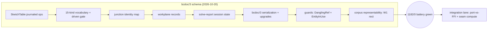

# Completion Graph — bcdoc/3 schema (TL1 track, the first M3 product-code lane)

- **Status:** implementation exit record — ticks ONLY for items backed by
  committed, reproducible evidence (policy: glossary §11 — no tick without
  a test)
- **Owner:** TL1 (this lane); the contract is
  [m3-module-contracts.md](../00-architecture/m3-module-contracts.md)
  (binding)
- **Date:** 2026-10-20 (UTC)
- **Vocabulary:** [docs/GLOSSARY.md](../GLOSSARY.md) (binding)

## 1. Mission acceptance gates

The five schema items are exactly the m3-eval seam gap list items 1/2/4/5/6
(m3-eval §8 item 4; `findings/bcdoc-seam.md` §4) and the head-to-head
record §6 item 3 ("unchanged and independent of this decision") — all
landed as product code with a binding contract:

| Gate | Status | Evidence |
|---|---|---|
| SketchTable + SketchRecord — constraints as journaled, serialized, undoable document content (gap 1) | ✅ | `modules/document/bcdoc/sketches.py` (`SketchTable.add/remove/set_props` + `add/set/remove_constraint` + `add/set/remove_junction` — all tx-gated, journaled, snapshot-restored); contract §2; `test_document_v3.py::TestSketchTableOps/TestConstraintOps/TestJunctionOps` (19 tests) |
| Junction identity — the id-stable per-sketch junction map (gap 2, the "map" option; Point-entity refs rejected with reason, contract §7) | ✅ | `JunctionRecord` (entity+slot members, identity survives member growth); junction refs addressable from constraints (`{"junction": …}` refs, sketch-local guard); `TestJunctionOps`, `test_junction_refs_are_sketch_local` |
| Workplane record per sketch (gap 4) | ✅ | `Workplane` (origin + basis; default XY@origin; degenerate bases rejected; normal derived not stored); `TestWorkplaneAndJunctionRecords`; `test_set_props_journals_prior_values` |
| Driving-dimension records with the reference-dimension gating flag (gap 5; CAD Sketcher `curve_solver.py:335-352` as a first-class record field) | ✅ | `ConstraintRecord.driven` (dimensional kinds only; geometric + driven refused at construction); value required-finite for dimensional kinds; the parametric edit `set_constraint(value=…)` = ONE journal op with per-constraint undo granularity; `test_driven_reference_dimension_is_first_class`, `test_parametric_edit_is_one_op_undo_granular`, `test_driven_reference_dimension_survives_save_reopen` |
| Solve-report records (gap 6 — session state; "NOT a SolidCraft-style full diagnosis" honored: empty lists are honest) | ✅ | `SolveReport` + `SolveReports` holder on `Document` (set/get/all/clear); NEVER serialized/journaled/snapshotted, cleared on load, no `doc_version` bump; agent-boundary JSON round-trip; `TestSolveReports` (5 tests incl. the failed-transaction-does-not-revert check) |
| Gap 3 (per-entity solver-param persistence) — the m3-eval record's NOT-WANTED decision kept | ✅ | not implemented; §7 records it with the m3-eval citation + the recorded future direction (`param_ids` inside the SketchRecord, never on entities) |
| Serialization `bcdoc/3`: pinned key order, byte-stability, v2/v1 deterministic upgrades, parse-time cross-validation, journals through save/load | ✅ | `serialize.py`: `SCHEMA = "bcdoc/3"`, `sketches` slots between `layouts` and `entities`; v2 → `sketches = []` upgrade; v1 rides the v1→v2 path then gains it; `_sketch_records` cross-validates refs against the payload entity list (dangling ref / slot-on-non-line / foreign junction / duplicate ids all refuse `load`); the 9 new journal op shapes in `_validate_group`; `TestSerializationV3` (12 tests) |
| Guards (contract §5): dangling refs refused at mutation; EntityInUse on `remove` (BlockInUse precedent, replay guarded belt-and-braces) | ✅ | `DanglingSketchRef` / slot-on-non-line / sketch-local junction guards in every ref-writing op; `Document.remove` refuses while referenced AND the journal-replay remove refuses to strand refs (JournalConflict); composed-removal-then-entity-remove proven atomic-undoable; `TestRefGuards/TestEntityInUse` |
| Corpus representability — the W1 rect fixture (the redundancy case that rejected slvs) storable as verbatim document content | ✅ | `TestCorpusRepresentability::test_w1_rect_fixture_is_storable_document_content`: k1–k6/d1/d2 labels verbatim, corner junctions, SolidCraft-style report (`redundant=("k6",)`) storable session-side; round-trips through save/load |
| Failed-transaction rollback covers sketches (the m2 invariant extended) | ✅ | `_snapshot_state`/`_restore_state` adopt the sketch table; `test_failed_mid_transaction_is_bit_identical` asserts serialize()-equality |
| Regression: the full existing battery stays green through the schema bump | ✅ | `pytest modules tests` = **1182 passed / 0 failed** (1127 M2-era + 55 new v3 tests); the 4 schema-pin assertions updated per contract §6 with citations; TP-CAT-00 repo consistency 6/6; `build_extension.py --check` OK; `render_inventory.py --check` in sync; compileall OK |
| Lane discipline (nothing outside the schema scope; bcdoc stays first-party — no adoption consequences) | ✅ | changed files: `modules/document/bcdoc/**` + `modules/document/tests/**` + the schema-string docstrings/comments in bcshell/bcio-consumer files + `modules/parametric/README.md` status pointer + `docs/**`; **`release-manifests/` untouched** (0 changed lines); no external dependency added (stdlib only); no kernel/OCCT/ADR-0002 implication; no component adoption (matrix/license rows unchanged — bcdoc is first-party) |
| Versioning discipline (the 0.N.0 ↔ bcdoc/N pairing kept) | ✅ | extension version 0.2.0 → 0.3.0 in `blender_manifest.toml` + bcshell/bcio/bcagent/bcdoc pins (the m2 §578 precedent); package builds + checks as `blender_cad-0.3.0.zip` (68 entries); agent tests assert the APP_VERSION symbol — green unchanged |

## 2. Known limitations (recorded, not hidden)

1. The constraint kind vocabulary is closed at exactly the 15 kinds the
   committed evidence exercised (23-case corpus + seam demo + h2h adapter
   notes); growth is a schema revision with evidence (contract §1.2/§7) —
   M3 UX needing more kinds will have to land that revision first.
2. Slots address LINE endpoints only (0 = p1, 1 = p2 — the demonstrated
   seam surface); arc endpoints are not slot-addressable in v3 (arcs are
   whole-entity refs). The m3-eval §2.5 arc mapping nuance remains the
   adapter's job.
3. No `on_solve` change events for solve reports in v3 (the solve's caller
   holds the return value); recorded in contract §7 as the integration
   lane's limitation to revisit.
4. No sketch rename op (`sketch_id` immutable, `name` is display — contract
   §7); junction member count is ≥1-tolerant by design (1-member junctions
   are named points), so the map tolerates the draw-first-connect-later UX
   rather than policing it.
5. The workplane is a stored description, not enforced geometry: only
   exact-zero vectors and exact-parallel bases are rejected (no epsilon);
   near-degenerate bases are the adapter's problem (contract §1.1).
6. `EntityInUse` is a refusal, not a cascade: the UX layer composes
   remove-constraint-then-remove-entity (proven atomic-undoable in tests);
   bcdoc never silently deletes constraints (contract §5.3).
7. Undo-of-remove of LAYERS/blocks/layouts/styles still restores at list
   end (the M2 behavior) — this lane's position-restoring `index` rule was
   applied to the NEW sketch ops only (the entity precedent), not
   retrofitted to the older tables; retrofitting is a separate, unclaimed
   change.
8. The Blender 5.2.2 in-host battery was not re-run: bcdoc is pure-Python
   and the shell driver's schema-string check was updated to bcdoc/3, but
   the in-Blender evidence set stands at M2's run; the first M3 in-host
   battery lands with the parametric integration lane.

## 3. Not done / explicitly not claimed

- **No parametric-module code and no solver integration** — the seam's
  compute side (M3 §6 items 1–2 of the head-to-head record) stays gated on
  port-vs-FFI + unicode-ident (verify) + the platform policy (verify);
  `modules/parametric` gains a status pointer only.
- **No milestone release** — no `manifest-0.4.0-m3.json`; the manifest
  series is owned by milestone releases (contract §6).
- **No bcdoc/4 preview, no kind-vocabulary expansion, no named-UCS
  workplanes, no 3D/surface constraints** — each recorded in contract §7
  with the reason.
- **No AutoCAD-parity claim** — bcdoc's sketch content is this product's
  own schema; DXF/DWG interchange of constraint data is not claimed and
  not attempted.
- **No kernel claim** — ADR-0002 (OCCT/OCP) unaffected; the OCCT lane
  proceeds independently of this schema work.

## 4. Mermaid — gate state

