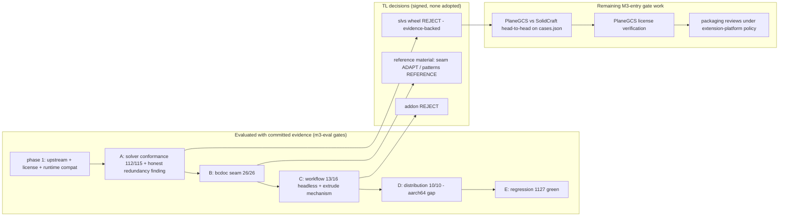

# Completion Graph — CAD Sketcher evaluation (TL1 track, m3-eval)

- **Status:** evaluation exit record — ticks ONLY for items backed by committed, reproducible test evidence
- **Owner:** TL1 evaluation worker (Task ID m3-eval); TL owns the decisions + license verdicts (signed)
- **Date:** 2026-10-20 (UTC)
- **Vocabulary:** [docs/GLOSSARY.md](../GLOSSARY.md) (binding); policy per glossary §11 — no tick without a test
- **Decision record:** [docs/00-architecture/cad-sketcher-evaluation.md](../00-architecture/cad-sketcher-evaluation.md)

## 1. Mission acceptance gates

| Gate | Status | Evidence |
|---|---|---|
| Upstream audit with exact release/SHA facts, manifest analysis, release pipeline, structure map — all with citations | ✅ | pin tag `v0.32.1` (6a5a340 → `e7db7e6`), `latest` = moving pointer recorded; wheels-never-rebuilt-by-CI + 10/10 PyPI byte-identity; single vendored-module finding (units.py) — `experiments/cad-sketcher/results/upstream-audit.json` (11 checks), `findings/audit-upstream.md` |
| License/supply-chain record: every license claim traceable to a quoted file at a pinned SHA; the METADATA-vs-COPYING inconsistency documented with both texts' provenance; the slvs source repo identified with its own license evidence | ✅ | SolveSpace = upstream solvespace/solvespace @ `477d4c8` (identified from the sdist's embedded git refs; solvespace v3.2 tag drift recorded); GPLv3-or-later, NO linking exception; slvs wheel METADATA "MIT" vs shipped GPLv3 COPYING.txt inconsistency recorded explicitly — `results/license-supply-chain.json` (11 checks + inconsistencies[] + open_questions[]), `findings/license-supply-chain.md` (verbatim quotes, §7-format verification log) |
| Python 3.13 / Blender 5.2.2 compatibility demonstrated (or its failure precisely recorded) | ✅ | cp313 manylinux wheel imports + smoke-solves EXACTLY under Blender 5.2.2's Python 3.13.13; official v0.32.1 linux_x64 ZIP installs + enables 6/6 probe checks via Blender's extension system; startup +0.125 s median — `results/runtime-compat.json` |
| Experiment A — solver conformance on W1-identical fixtures: constraints, DOF, dimensions, convergence, determinism, invalid/overconstrained input, edit stability, performance on increasing sizes; non-equivalent tests clearly distinguished | ✅ | 17 W1-identical fixtures transcribed exactly (9 identical / 8 adapted with binding per-case reasons) + 6 PAR-coverage probes: 115 checks, 112 pass / **3 honest failures** (the redundancy finding); bitwise determinism in-process 5× + cross-process 3×; failure-restore measured not assumed; scale medians @ N=10/50/100/200 — `results/solver-conformance.json`, `fixtures/solver/cases.json` (the canonical shared fixtures), `findings/solver-conformance.md` |
| Experiment B — bcdoc seam: no second authoritative store; identity/persistence semantics intact; undo/redo + doc-version checks unbroken; constraints survive save/reopen; no untracked mutations; dependency integrity after edits | ✅ | **26/26 checks on the REAL bcdoc** (read-only): stateless solver service; apply-back via real journaled transactions; undo bit-exact; ids/handles/selection stable; save→fresh load digest-equal; dimension edit on the reopened doc exact; failed solve writes NOTHING; 6-item bcdoc gap list as proposed bcdoc/3 items — `results/bcdoc-seam.json`, `findings/bcdoc-seam.md` |
| Experiment C — parametric workflow: workplanes, dimensions, sketch updates, extrusion/revolution, dependent rebuilds; reusable algorithms separated from UI/host-coupled code; full add-on NOT adopted | ✅ | 16 recorded steps, 13 headless-ok (3 viewport-event steps recorded with exact errors + working non-UI equivalents); exact solve + exact edit→dependent-rebuild; extrude MECHANISM headless-proven (GN group + body + modifier → 6 verts/5 faces); reusable-vs-UI separation table; the addon's PropertyGroup persistence = second document model, explicitly NOT adopted — `results/parametric-workflow.json`, `findings/parametric-workflow.md` |
| Experiment D — runtime/distribution: platform availability, ABI, size, native requirements, startup, error handling, distribution obligations | ✅ | 10/10 checks: linux-aarch64 GAP (4/5 targets), cp311+cp313 (no cp312), ZIP 13,968,966 B / wheels 14,880,583 B / installed 17,022,892 B, ldd = standard glibc only, startup +0.125 s, error surface + GPL obligations recorded — `results/runtime-distribution.json`, `findings/runtime-distribution.md` |
| Decision record transcribing TL's dispositions faithfully + integrated with committed evidence + citations | ✅ | `docs/00-architecture/cad-sketcher-evaluation.md` (5 dispositions verbatim, recommended solver path verbatim, TL-signed license verdicts, scorecard with citations, limitations, mission answers, next actions, exclusions) |
| No regression to M2 | ✅ | pure-Python suite **1127 passed / 0 failed** at branch tip (identical to the M2 record); `scripts/build_extension.py --check` green (blender_cad-0.2.0.zip, 67 entries); repo-consistency 6/6; Blender 5.2.2 battery NOT re-run — **no production-facing file touched** (`git diff main..HEAD` = `experiments/cad-sketcher/**` + the four docs + lane README only); product tree untouched |
| No production dependency adoption or manifest status flip; bcdoc stays authoritative; ADR-0002 kernel direction unaffected | ✅ | release + runtime manifests untouched; adoption matrix gains ONE `evaluate` row + the §4.3 note (no `adopted`/`candidate` flip); the SolveSpace row's (verify) tag resolved to verified (status unchanged); license-inventory §2.2 rows added; no vendored upstream code or wheels in git (`.upstream/` gitignored, reproducible from pinned SHAs + committed fetch scripts); the decision record states OCCT/OCP proceeds independently |
| Unresolved license questions recorded as explicit blockers, not resolved by assumption | ✅ | Eigen@`3147391d` MPL-2.0 text unverifiable from this sandbox — explicit (verify) BLOCKER; slvs METADATA-MIT-vs-GPLv3 — formal inconsistency, METADATA treated as unreliable; solvespace tag-drift policy (provenance from sdist-embedded git refs) — `findings/license-supply-chain.md` §7, `results/license-supply-chain.json` open_questions[] |

## 2. Experiments (runnable, evidence committed)

| Experiment | Status | Evidence |
|---|---|---|
| Phase 1 — upstream + license/supply-chain audit + runtime compatibility | ✅ | 11 + 11 + 6 checks green — `results/upstream-audit.json`, `results/license-supply-chain.json`, `results/runtime-compat.json`, `findings/{audit-upstream,license-supply-chain}.md` |
| A — solver conformance (phase 2a) | ✅ (with 3 recorded honest failures = the redundancy finding) | `results/solver-conformance.json` (23 cases, 115 checks), `fixtures/solver/cases.json`, `findings/solver-conformance.md` |
| B — bcdoc seam (phase 2b) | ✅ | `results/bcdoc-seam.json` (26/26), `findings/bcdoc-seam.md` |
| C — parametric workflow (phase 2b) | ✅ (3 headless-blocked steps recorded with reasons) | `results/parametric-workflow.json` (16 steps), `findings/parametric-workflow.md` |
| D — runtime & distribution (phase 2b) | ✅ | `results/runtime-distribution.json` (10/10), `findings/runtime-distribution.md` |
| E — regression (phase 3) | ✅ | §1 row "No regression to M2" (1127/0; package check green; consistency 6/6) |

## 3. Known limitations (recorded, not hidden)

1. Single 2-CPU sandbox host; all timing evidence is shape-within-host (recorded per case; the honesty note that 16 ms @ 200 entities is not slow in absolute terms stands in the decision record §4.1).
2. Python-call overhead vs TL2's in-process Rust timings — cross-solver absolute timings never used as checks.
3. **No PlaneGCS head-to-head** — that is the M3-entry gate work (the fixture corpus is committed to make it runnable), not this evaluation's.
4. 3 of 16 workflow steps headless-blocked (viewport-event tools) — recorded with exact errors + working non-UI equivalents.
5. Constraint-kind exercise: 8 direct + 5 derived/observed of the 38 exposed slvs types (PAR-12 + tangency/redundancy paths); no cubic/spline/3D-heavy or hostile-input corpora.
6. The measured surface is the exposed slvs binding (the shipped binary any integration would use), not SolveSpace's internal GUI solver paths.
7. Blender 5.2.2 acceptance battery not re-run (not triggered: zero production-facing files changed; standing committed evidence remains authoritative).
8. Eigen license text at the pin `3147391d` unverifiable from this sandbox — explicit (verify) blocker.

## 4. Not done / explicitly not claimed

- **No component is adopted**; no release-manifest entry; no production code, schema, kernel, contract or packaging change.
- **No PlaneGCS head-to-head suite** — the remaining M3-entry gate item (planeGCS vs SolidCraft-solver on `experiments/cad-sketcher/fixtures/solver/cases.json`), explicitly left as gate work.
- **No Blender 5.2.2 battery re-run** (not triggered: zero production-facing files changed).
- **No AutoCAD-parity claim is made or implied** from constrained-sketch success.
- The addon's UI, stateful-operator framework and PropertyGroup persistence layer are **explicitly not adopted** (second document model; mission boundary); the slvs wheel is rejected as a dependency (re-review conditions recorded, never waived).
- The OCCT/OCP kernel direction (ADR-0002) is **unaffected** — no kernel claim arises from this evaluation.

## 5. Mermaid — evaluation state

