# M0 Completion Graph — Handoff & Architecture

- **Status:** Complete at handoff — every item's evidence is the TP-CAT-00 repo-consistency suite
- **Owner:** TL
- **Date:** 2026-10-19 (UTC)
- **Vocabulary:** docs/GLOSSARY.md (binding)

## 1. Graph

```mermaid
graph TD
    GATE{{"M0 exit gate: TP-CAT-00 repo-consistency CI green"}}
    D1["D1 Repos and upstream pins"] --> GATE
    D2["D2 Binding glossary and repository map"] --> GATE
    D3["D3 Architecture: document model and geometry kernel"] --> GATE
    D4["D4 Component adoption matrix and license inventory"] --> GATE
    D5["D5 ADR series 0001 to 0006"] --> GATE
    D6["D6 Feature-parity inventory, 14 areas"] --> GATE
    D7["D7 File compatibility matrix"] --> GATE
    D8["D8 UX specification and usability validation plan"] --> GATE
    D9["D9 Agent and skills design"] --> GATE
    D10["D10 Process suite: test plan, upstream CI, milestone plan"] --> GATE
    D11["D11 Repo scaffolding and executable CI"] --> GATE
```

## 2. Deliverables and evidence

Every tick below means: the repo-consistency suite (TP-CAT-00 —
`tests/test_repo_consistency.py`, run by `.github/workflows/ci.yml`) verifies
the item structurally on the merged tree. That is the **only** thing green at
M0 — no product feature exists yet.

| # | Deliverable | File path(s) | Status | Acceptance evidence (TP-CAT-00) |
|---|---|---|---|---|
| D1 | Repos & upstream pins (Blender fork, ZCode fork, this repo) | `release-manifests/manifest-0.1.0.json`, `patches/README.md`, `docs/00-architecture/repo-and-upstream-sync.md` | ✅ | manifest validated (`validate_manifest.py`); drift-check script wired to CI |
| D2 | Binding glossary & repository map | `docs/GLOSSARY.md` | ✅ | all repo docs link back to it; vocabulary consistency enforced by render + boundary checks |
| D3 | Architecture: document model & geometry kernel | `docs/00-architecture/document-model-and-geometry-kernel.md` | ✅ | file present; feature-id traceability scan green |
| D4 | Component adoption matrix & license inventory | `docs/00-architecture/component-adoption-matrix.md`, `docs/00-architecture/license-inventory.md`, `LICENSE-NOTES.md` | ✅ | files present; manifest dependency modules validated against the 13 modules |
| D5 | ADR series 0001–0006 | `docs/30-process/adr/0001` … `0006` | ✅ | files present; id traceability scan green |
| D6 | Feature-parity inventory, 14 areas (YAML source of truth) | `data/inventory/*.yaml` (14 files), `docs/10-product/feature-parity-inventory.md`, `docs/10-product/inventory-tables.md` (generated) | ✅ | YAML schema + global id uniqueness tests; generated tables byte-in-sync (`render_inventory.py --check`) |
| D7 | File compatibility matrix | `docs/10-product/file-compatibility-matrix.md` | ✅ | file present; id traceability scan green |
| D8 | UX specification & usability validation plan | `docs/10-product/ux-specification.md`, `docs/10-product/usability-validation-plan.md` | ✅ | files present; id traceability scan green |
| D9 | Agent & skills design | `docs/20-agent/zcode-adaptation-plan.md`, `cad-tool-contract-v1.md`, `permissions-and-execution-model.md`, `skill-format-v1.md`, `skill-execution-and-publishing.md` | ✅ | files present; id traceability scan green |
| D10 | Process suite: test plan, upstream CI, milestone plan | `docs/30-process/test-plan.md`, `upstream-update-ci.md`, `milestone-plan.md`, `completion-graph-m0.md` | ✅ | files present; workflows present and referenced; no-secrets scan green |
| D11 | Repo scaffolding & executable CI | `modules/` (13 modules + `modules.json`), `scripts/`, `tests/`, `.github/workflows/`, `requirements-dev.txt` | ✅ | module-boundary check green; manifest validator green; suite green in CI |

## 3. Feature status — the honest statement

**Every feature inventory entry across the 14 areas in `data/inventory/` is
`status: planned`.** The number of entries implemented, in-progress, partial
or verified at M0 is **zero** — and the number of `planned` entries is exactly
the total inventory size. The authoritative counts live in the generated
totals of `docs/10-product/inventory-tables.md` (regenerated by CI on every
push; this graph deliberately does not hardcode numbers that the generator
owns).

What the M0 ticks do NOT mean: they certify **structural acceptance** — files
exist, schemas validate, references trace, no secrets, CI green. They certify
nothing about product behavior, because at M0 there is no product code. The
first feature tick in a milestone graph will require a passing test from the
relevant TP-CAT category (docs/30-process/test-plan.md).

## 4. No silent drift

Inventory statuses flip **only with evidence**: a `test` field referencing a
TP id plus a recorded artifact (CI run link, test log, screenshot, usability
report) — glossary §5, test-plan §7. `scripts/render_inventory.py` drift-checks
the generated tables so out-of-band edits cannot hide; reviews enforce the
semantics. If it is not evidenced, it is not done.
