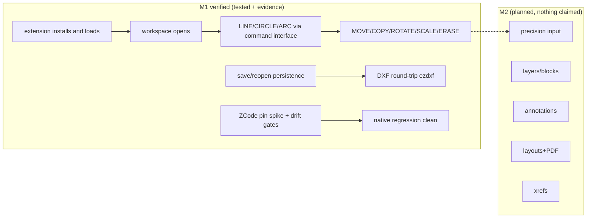

# Completion Graph — M1 (Walking Skeleton)

- **Status:** M1 exit record — per-item status with ticks ONLY for items whose acceptance tests ran and passed; evidence artifacts linked per item
- **Owner:** TL
- **Date:** 2026-10-19 (UTC)
- **Vocabulary:** [docs/GLOSSARY.md](../GLOSSARY.md) (binding; §15)
- **Policy:** glossary §11 / milestone-plan §12 — no tick without a test

## 1. Operator-directive acceptance requirements (the M1 gate)

Every requirement below was exercised against **Blender 5.2.2 LTS** (the runtime
test build recorded in `release-manifests/manifest-0.2.0-m1.json`), with the
extension **installed through Blender's actual extension system**
(`blender --command extension install-file`, isolated user dir, enabled at
startup — no sys.path bootstrap in the acceptance path).

| # | Requirement | Status | Evidence |
|---|---|---|---|
| 1 | Extension loads into the selected Blender build | ✅ | `acceptance_m1_result.json` — `extension.install` (STATUS Installed), `extension.loaded_at_startup`; CI builds the package: `scripts/build_extension.py --check` |
| 2 | CAD workspace opens | ✅ | same — `workspace.opens` ("BlenderCAD" workspace present and creatable; headless activation limits recorded in shell tests) |
| 3 | LINE, CIRCLE and ARC through the command interface | ✅ | same — `command.LINE/CIRCLE/ARC` (exact geometry; Close honored) — same registry+state machine the modal UI uses (`bcshell.run_scripted`) |
| 4 | Basic modifications work | ✅ | same — `command.MOVE/COPY/ROTATE/SCALE/ERASE` + `document.undo_roundtrip` |
| 5 | Documents survive save/reopen | ✅ | same — fresh Blender process reopens the .blend: 6 entities, kinds {line:3, circle:2, arc:1}, doc_version preserved, undo journal survived, document live (undo/redo callable) |
| 6 | Real DXF fixture passes initial round-trip | ✅ | in-Blender: export→wipe→re-import byte-exact entity compare (engine `ezdxf`); pytest: `modules/testing/roundtrip/` + `modules/interchange/tests/test_dxf_roundtrip.py` (22 tests, R12-minimal file validated by ezdxf audit, loss-ledger for unsupported types) |
| 7 | Native Blender functions remain usable | ✅ | TP-CAT-06 baseline `result-m1.json`: 7/7 native ops stock AND loaded, `no_native_regressions`, clean unload, startup delta +0.00s |
| 8 | Upstream compatibility smoke test now (not at M7) | ✅ | TP-CAT-11: zcode drift check **in sync** (0a1fc56); blender drift check live — detected upstream movement (bf200615 → 207122d) as designed, triage note §4; ZCode pinned-source spike green (`docs/20-agent/zcode-runtime-spike-m1.md`): installs, builds, `--version` → 3.16.1 |

**Battery outputs (committed artifacts):**
`modules/testing/blender/acceptance_m1_result.json` (30/30),
`modules/testing/blender-regression/result-m1.json` (all checks pass),
`modules/shell/tests/blender_driver_result.json` (53/53),
pytest: **440 passed** across `modules/ + tests/` (TP-CAT-00/01/02/04/07
precursor suites; bpy-free).

## 2. Milestone-plan §4 deliverables

| Deliverable | Status | Evidence |
|---|---|---|
| `document` v0 — entities, transactions, undo journal | ✅ | `modules/document/tests/` 48 tests green; dual identity (uuid + handle), atomic rollback, undo/redo monotonic doc_version, bcdoc/1 serialization |
| `commands` — registry + prompt state machine + aliases | ✅ | `modules/commands/tests/` green; FP-CMD-001/006/008/014 verified, FP-CMD-003/009/011/013 partial |
| `shell` v0 — command-line entry, status/prompt line, N-panel, workspace | ✅ (v0 scope) | acceptance §1 rows 1-2; popup command entry + prompt line — the **dockable** command line (FP-UX-004) and full status bar (FP-UX-006) remain planned |
| `drafting` — LINE/CIRCLE/ARC + basic modify | ✅ | FP-DRAW-001/005 verified, FP-DRAW-008 partial (2 of 11 arc methods); FP-MOD-001/037 verified, FP-MOD-002/003/004 partial (options planned) |
| `interchange` — DXF R/W on ezdxf | ✅ (v0 scope) | FP-IO-001/002 partial: LINE/CIRCLE/ARC+layers via ezdxf (R2010) + pure-Python R12 minimal engine, loss ledger; full entity set/versions at M2+ |
| kernel bindings evaluation concluded (OCCT/OCP decision recorded) | ✅ | `docs/00-architecture/kernel-bindings-evaluation-m1.md` — OCP 8.0.1.1.0, cp313 wheels on all 5 platforms (Blender 5.2 py3.13 compatible), 45-65MB/wheel; leading candidate confirmed, packaging gate stays at M3; no adoption claim |
| fork apply-check workflow (workflow_dispatch) live | ✅ | `.github/workflows/patch-apply-check.yml` (canonical-side decision recorded in upstream-update-ci.md §7); fork Actions enabled; `product/main` created at the pin |

## 3. Entry criteria — honest record

| Criterion | Status | Note |
|---|---|---|
| M0 exit | ✅ | completion-graph-m0.md |
| Actions enabled on the Blender fork (patch apply-check) | ✅ | Actions verified enabled (API, 2026-10-19); apply-check runs canonical-side (§7 decision) |
| Headless `bpy` environment for tests | ✅ (deviation recorded) | **Not a container image**: the M1 gate runs against the pinned official Blender 5.2.2 LTS linux-x64 tarball (sha256 in the manifest) driven headlessly. A containerized `bpy` pipeline for GitHub CI remains planned (test-plan §4 "headless container from M1" — the local pinned binary satisfies the M1 gate; containerization tracked for M2 CI) |
| ezdxf adoption gate | ✅ | adopted (MIT); tested 1.4.3 (dev/CI) + 1.4.5 (Blender python 3.13); conformance-oracle + optional bridge architecture (ADR-0003) |
| OCP adoption gates per matrix | ✅ as evaluation | M1 deliverable was the evaluation conclusion (recorded); adoption itself is an M3 entry gate per ADR-0002 |

## 4. TP-CAT-11 upstream currency (2026-10-19)

- **zai-org/ZCode:** pin `0a1fc56` **in sync** with upstream main (drift check
  green). Fork alignment completed per ADR-0007 (mirror main == pin, tag
  `upstream-pin-0a1fc56`, patch branch `cad-adaptation` at pin, legacy program
  preserved on `gen/archive`).
- **blender/blender:** pin `bf200615` **drifted** — upstream main advanced to
  `207122d` within days of the handoff (Blender main moves near-hourly; the M0
  drift run already caught fff5351 the same day). **Triage:** pin unchanged
  for M1 (extension compatibility is guarded against the pinned runtime test
  build 5.2.2 LTS, not against a moving main); adoption happens at the monthly
  update window per repo-and-upstream-sync.md §7; the apply-check workflow
  asserts product/main == pin in the meantime. This is the designed,
  non-silent path — no action silently taken.

## 5. Operator-directive immediate work items

| Item | Status |
|---|---|
| 1. ZCode upstream/fork alignment (audit 2 missing upstream commits + 35 legacy commits; immutable mirror ref; product patch branch; manifest + architecture docs updated; entry points tested at the exact pin) | ✅ ADR-0007 + fork refs live + spike green |
| 2. Product-scope expansion (BIM/QTO/RCM areas, traceable FP-IDs, priorities, target modules, dependencies, test IDs, acceptance criteria, milestone ownership, explicit interop limitations — no lossless Archicad/Revit claims) | ✅ `docs/10-product/scope-expansion-m1.md`, 68 new entries (+4 IO limitation entries), 17 areas / 15 modules, all `planned` |
| 3. M1 implementation W1/W2/W3 + TL integration | ✅ this graph §1-§2 |
| Runtime compatibility testing now (not M7) | ✅ §1 row 8 |

## 6. Implementation vs planned scope (inventory honesty pass)

- **561 total entries across 17 areas** (was 489 across 14 at M0).
- **8 verified** — FP-CMD-001/006/008/014, FP-DRAW-001/005, FP-MOD-001/037
  (each carries a TP id + evidence artifacts §1, per glossary §5).
- **12 partial** — implemented M1 slices with explicit notes on what remains:
  FP-AGT-007/014, FP-CMD-003/009/011/013, FP-DRAW-008 (2 of 11 arc methods),
  FP-IO-001/002 (entity subset + version tiers), FP-MOD-002/003/004
  (missing options).
- **All others planned** — including the entire BIM/QTO/RCM scope expansion
  (documented ≠ implemented) and every M2+ capability.
- Rendered tables regenerated and `--check` in sync; every flip carries a TP
  id; evidence artifacts live in this repo (§1).

## 7. Not done at M1 (explicitly, no weasel)

- Dockable command line (FP-UX-004) — M1 ships a popup command entry + prompt
  line; the AutoCAD-style docked command line is M2.
- Full status bar toggles (FP-UX-006), autocomplete (FP-CMD-002), transparent
  commands (FP-CMD-005), precision input engine (osnap/ortho/polar/tracking —
  PREC area), layers/blocks UI (ORG), annotations (ANN), layouts (LAY),
  PLINE/splines/hatches, xrefs, DWG, IFC — all planned, M2+.
- The ZCode sidecar PROCESS is not shipped (M5): M1 proves the pinned runtime
  installs/builds/runs and delivers the in-process `cad.*` adapter v0 (15 of
  62 tools) with permission/transaction/security tests (153 green).
- Pixel-level UI verification (rubberrand rendering, real mouse events, ESC
  keypress, workspace GUI stick) is not headless-verifiable; the code paths
  exist and their bpy-free logic is tested, the draw-handler add/remove
  discipline is probed, and the gap is recorded in the shell tests. Formative
  GUI sessions are an M2 activity per the usability plan.
- GitHub CI does not yet run the Blender-touching batteries (no container
  image yet — §3); they run in the pinned dev environment with committed
  JSON evidence, and the bpy-free suites (440 tests) run in CI on every push.

## 8. Mermaid — M1 state

