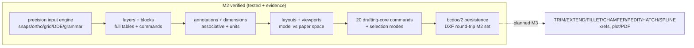

# Completion Graph — M2 (Drafting core)

- **Status:** M2 exit record — per-item status with ticks ONLY for items whose
  acceptance tests ran and passed; evidence artifacts linked per item.
- **Owner:** TL
- **Date:** 2026-10-19 (UTC)
- **Vocabulary:** [docs/GLOSSARY.md](../GLOSSARY.md) (binding; §15)
- **Policy:** glossary §11 / milestone-plan §12 — no tick without a test
- **Scope authority:** operator M2 directive (areas A–D) + [ADR-0008](adr/0008-m2-scope-rebaseline.md)
  re-baseline; binding implementation spec:
  [m2-module-contracts.md](../00-architecture/m2-module-contracts.md)

## 1. Battery outputs (committed artifacts)

| Battery | Result | Artifact |
|---|---|---|
| bpy-free pytest suites (TP-CAT-00/01/02/04/07 sections) | **1127 passed**, 0 failed | run: `python3 -m pytest modules tests -q` |
| M2 in-Blender acceptance battery (§11 sections 1–7) | **59/59 PASS** | `modules/testing/blender/acceptance_m2_result.json` |
| M1 acceptance battery (regression re-run) | **30/30 PASS** | `modules/testing/blender/acceptance_m1_result.json` |
| bcshell driver, main phase | **44/44 PASS** | `modules/shell/tests/blender_driver_result.json` |
| bcshell driver, reopen phase (fresh Blender process) | **53/53 PASS** | same JSON (phases.main/reopen) |
| M2 scripted smoke suite (headless, same registry the UI uses) | **8/8 PASS** | `modules/shell/tests/test_blender_driver_m2.py` |
| TP-CAT-06 native regression (stock vs extension-loaded) | **ALL PASSED**, regressed=[], startup delta +0.00s | `modules/testing/blender-regression/result-m2.json` |
| Interchange in-Blender probe (ezdxf 1.4.5) | full M2 universe export→audit-clean→import→compare OK, 0 handle reallocations | `/home/z/probe/blender_verify_result.json` (W-B2-fix worklog; scripted probe) |

Runtime: Blender 5.2.2 LTS (pinned test build, manifest `0.3.0-m2`), extension
**0.2.0** installed through Blender's actual extension system (isolated user
dir, enabled at startup — no sys.path bootstrap in any acceptance path).

## 2. Operator-directive acceptance (the M2 gate)

| # | Directive area | Status | Evidence |
|---|---|---|---|
| A | Precision input: numeric coordinates/lengths/angles integrated into REAL command execution; validation, cancellation, error recovery; valid/invalid/boundary/cancel/undo tests | ✅ | `modules/drafting/tests/test_precision.py` (82), `test_precision_commands.py` (30), `test_selection_modes.py` (24); grammar tests in `modules/commands/tests/`; acceptance §2 (mouse ENDPOINT snap exact, ORTHO projection, typed DDE, one-shot osnap, invalid-input recovery, cancel leaves doc_version unchanged) |
| B | Layers and blocks: coherent layer model, entity assignment, visibility; blocks + insertion; identity/persistence/selection/transform consistency; round-trip + regression tests | ✅ | `test_document_v2.py` (tables/journals/undo), `test_organization.py` (35), `test_draw_core.py`/`test_modify_core.py` (transforms on all kinds incl. inserts); acceptance §3 (off → hidden, frozen → not snappable, locked → MOVE rejected) + §4 (BLOCK/INSERT/MOVE/redefine/save-reopen/DXF) |
| C | Annotations and dimensions: geometry, dimension values, units, formatting, persistence, rendering; extensible data model; no unsupported assumptions | ✅ | `modules/drawings/tests/` (121: golden dims, formats, associativity end-to-end, command flows, persistence); acceptance §5 (DIMLINEAR measurement 10.0 exact, dim display objects, SCALE+regen → "14.0000", TEXT, MTEXT, DIMSTYLE/STYLE, save/reopen, DXF round-trip) |
| D | Layouts: first useful paper-space implementation; model vs paper clearly distinct; persistence + export/import for the supported subset; unsupported behaviors documented | ✅ | `test_document_v2.py` (layouts/spaces), bcdraw layout command tests; acceptance §6 (LAYOUT new/set, paper-space frame, MVIEW Fit, MSPACE/PSPACE, model collection hidden in paper space, save/reopen, DXF export includes paper space + viewport, reimport maps back) |
| — | M1 baseline not regressed | ✅ | §1 rows 3–5 + 7 (30/30 M1 acceptance, 44+53 driver, TP-CAT-06 zero regressions); 440 M1 pytest grew to 1127 with zero M1 test removals (schema-intent updates documented in W-B1 worklog) |

## 3. Work items (plan §1, final state)

### W-B1 — document model v2 (W2)

| # | Item | Status | Evidence |
|---|---|---|---|
| B1.1 | Entity framework + 10 new kinds | ✅ | per-kind round-trip + coercion tests in `test_document_v2.py` (78 tests); byte-stable v2 |
| B1.2 | Layer table (records, props, states, current) | ✅ | journaled add/remove/mutate + guards + M1-journal replay compat tests |
| B1.3 | Blocks (definitions, redefine, refs) | ✅ | copy semantics, BlockInUse guard, redefine undo incl. save/load (TL fixed the redefine_block journal deserialization: `serialize.py` validated `name` as a dict) |
| B1.4 | Layouts + spaces | ✅ | record ops, space validation, non-empty remove guard, reorder |
| B1.5 | Settings store (19 sysvars) | ✅ | typed set/get, unknown/type rejection, v1-defaults upgrade; NOT-journaled exception documented + tested |
| B1.6 | Style tables (text + dim) | ✅ | "Standard" protected; journaled mutations |
| B1.7 | Serialization bcdoc/2 + v1 upgrade | ✅ | byte-stability incl. non-empty undo stacks; deterministic v1 upgrade cycles |

### W-A — precision input (W1)

| # | Item | Status | Evidence |
|---|---|---|---|
| A.1 | InputValue.source + resolution hook in ask_point | ✅ | typed-unchanged regression tests; mouse-resolution integration tests |
| A.2 | Grammar completion + validation/cancel/error-recovery | ✅ | `test_precision.py` boundary/cancel cases; acceptance §2 recovery check |
| A.3 | Osnap engine (7 P0 modes) + aperture + running + one-shot | ✅ | exact-value per-mode tests; frozen/cross-space exclusion; consumed-once |
| A.4 | ORTHO + grid snap + DDE | ✅ | H/V projection; lattice snapping; pointer-direction DDE (orth-snapped) |
| A.5 | Sysvar commands (SETVAR/GETVAR/OSNAP/ORTHO/SNAP/GRID/UNITS/DYN) | ✅ | `test_precision_commands.py` (30) incl. invalid-value re-prompts + cancel-unchanged |
| A.6 | bccmd additions (suggestions, osnap tokens, repeat-last) | ✅ | `test_suggestions.py` (28); `?`-listing fix (worklog m2-2a-fix); repeat-last shell test |

### W-D — drafting core commands (W1)

| # | Item | Status | Evidence |
|---|---|---|---|
| D.1 | PLINE (+arcs, +width), RECTANG, POLYGON, POINT, XLINE, RAY | ✅ | `test_draw_core.py` (45): bulge values, width carry-over, exact vertex math, degenerate rejection |
| D.2 | ELLIPSE, CIRCLE 2P/3P | ✅ | exact geometry; ⚠️ elliptical arcs planned (FP-DRAW-012 partial) |
| D.3 | MIRROR, OFFSET, ARRAYRECT, MATCHPROP | ✅ | `test_modify_core.py` (79): reflections, sweep swaps, bulge flips, sign/side handling |
| D.4 | BREAK, JOIN, EXPLODE, STRETCH | ✅ | piece/merge/endpoint-rule tests; documented limits in feedback strings + notes |
| D.5 | SELECT modes + noun-verb + locked-layer skip | ✅ | `test_selection_geometry.py` (40) + `test_selection_modes.py` (24) |
| D.6 | LAYER/BLOCK/INSERT (+redefinition) | ✅ | `test_organization.py` (35) incl. freeze-current refusal, copy semantics, redefine updates refs |

### W-C — annotations + layouts, bcdraw (W1)

| # | Item | Status | Evidence |
|---|---|---|---|
| C.1 | Dimension engine linear + aligned | ✅ | golden-value tests (horizontal/vertical/rotated 30°/aligned 45°, dimscale) |
| C.2 | Associativity + regen | ✅ | live-entity MOVE/SCALE → measurement refresh; refresh_document idempotent; acceptance §5 |
| C.3 | DIMLINEAR/DIMALIGNED/DIMSTYLE commands | ✅ | entity-select path, Rotation option, invalid-input recovery |
| C.4 | TEXT/MTEXT/STYLE commands | ✅ | justification, \n conversion, style create/set/list |
| C.5 | LAYOUT/MSPACE/PSPACE/MVIEW commands | ✅ | all options; Copy clones entities; guards; TILEMODE maintained |

### W-B2 — interchange v2 (W2)

| # | Item | Status | Evidence |
|---|---|---|---|
| B2.1 | ezdxf round-trip for all M2 kinds | ✅ | `test_roundtrip_m2.py` (41 tests) incl. full-universe 23-entity exact compare, 0 reallocations; audit-clean exports |
| B2.2 | Layers/blocks/spaces/viewport/settings round-trip | ✅ | table equality incl. props; paper-space routing; header sysvars; honest losses ledgered (dim associativity, linetype patterns, member handles…) |
| B2.3 | Minimal R12 fallback honesty | ✅ | TEXT added; unsupported kinds ledgered (never silent); polyline LINE-degradation ledgered + excluded from compare by design |

### W-S — shell v2 (W1)

| # | Item | Status | Evidence |
|---|---|---|---|
| S.1 | Display sync v2 (all kinds, spaces, layer visibility/color) | ✅ | `test_display_specs_v2.py` (39 incl. integrated-transform test); space collections; ByLayer ACI mapping |
| S.2 | Panels + operators (layers/layouts/snaps) — no dead UI | ✅ | every toggle performs a real mutation + sync (operator tests in `test_shell_v2_ops.py`) |
| S.3 | Autocomplete wiring + repeat-last + pointer tracking | ✅ | did-you-mean suggestions; empty-entry repeats; modal path feeds source/pointer |
| S.4 | Regen hook (dims current after MOVE/SCALE) | ✅ | `refresh_document_dims` in the on_change chain (test + acceptance §5) |

### W-TL — integration, evidence, delivery

| # | Item | Status | Evidence |
|---|---|---|---|
| T.1 | Boundary/build/CI updates | ✅ | bcdraw in PACKAGES; modules.json (drawings in-progress, +commands dep); ci byte-compile; boundary checker green (15 modules, no cycles) |
| T.2 | M1 baseline re-verified | ✅ | §1 (30/30, 44/44+53/53, TP-CAT-06 zero regressions) |
| T.3 | acceptance_m2.py battery | ✅ | §1 row 2 — 59/59 |
| T.4 | Inventory honesty pass | ✅ | 61 flips, every one carries a TP id + note; tables regenerated, `--check` in sync; repo-consistency 6/6 |
| T.5 | Manifests + docs + amendments | ✅ | `release-manifests/manifest-0.3.0-m2.json`; milestone-plan §5 note; contracts §15 amendments (below) |
| T.6 | Commit + push + CI | ✅ | see §5 (commit SHAs + GitHub Actions runs) |

## 4. Implementation bugs found and fixed during integration (evidence-backed)

- `bcdoc/serialize.py` — redefine_block journal op validation treated `name`
  as a dict → every document with a redefined block failed save/reopen
  (found by acceptance §reopen; fixed + pinned by a load/undo/redo/byte-stability probe).
- `bcdraft/_common.py` + `commands_draw.py` — the chained (option-carrying)
  point prompts bypassed mouse-point resolution: ORTHO/one-shot did not apply
  to LINE next-point picks; `dde_input` upgraded to the full chained-prompt
  resolution helper (osnap arm / DDE / mouse resolve) and LINE routes through
  it; acceptance §2 now exercises ORTHO through the chained prompt.
- Battery authoring bugs (fixed in `acceptance_m2.py`, all re-run green):
  MOVE base-point math in `blocks.move_reference`; a MOVE-doesn't-change-length
  expectation in the associativity check (now SCALEs the measured line);
  object-count==entity-count in `reopen.display_synced` (multi-object
  entities compared against display-spec counts).
- Agent tools (`bcagent`) — M2 §8 update: full layer table on the wire +
  `cad.layers.set_props` (propose-gated, one tx, structured validation);
  `cad.doc.info` gains table counts + spaces; capabilities `"1.1-m2"`;
  155 agent tests green (2 v0 wire-shape tests updated to the v2 contract,
  3 new tests added).
- Worker-phase fixes (recorded in each worker's worklog entry): 6 drafting
  implementation bugs (W-D-fix), 4 precision bugs incl. SETVAR `?` (W-A-fix),
  9 interchange root causes incl. the ezdxf handle cascade (W-B2-fix).

## 5. Delivery

- Repository: https://github.com/payswapdotorg/blender-cad — commit(s) on
  `main` (see git log for the exact M2 SHA; this graph + the manifests record it).
- Changed modules: document (bcdoc v2), commands (bccmd v2), drafting
  (bcdraft v2 + precision engine + 20 new commands), drawings (bcdraw NEW,
  11 commands), interchange (bcio v2), shell (bcshell v2), agent (honesty
  surface), testing (M2 batteries + evidence), scripts/docs/inventory.
- CI: `ci.yml` runs 1127 bpy-free tests + byte-compile (incl. bcdraw) +
  extension build/check + tables check on every push; `patch-apply-check.yml`
  unchanged (empty patch series at the pin).
- TP-CAT-11 drift: pins unchanged (Blender bf200615, ZCode 0a1fc56); the
  Blender upstream movement is triaged per M1 policy (monthly window).

## 6. Not done at M2 (explicitly, no weasel — ADR-0008)

- **Kernel-bound P0 commands deferred to M3**: TRIM, EXTEND, FILLET, CHAMFER,
  PEDIT, HATCH, SPLINE — robust curve intersection/trimming, boundary
  detection and NURBS machinery are scheduled with the OCCT kernel
  (ADR-0002). The analytic prerequisites that M2 shipped (pairwise
  intersections in the osnap engine, BREAK/JOIN/STRETCH/OFFSET subsets)
  compose into that work.
- **TP-CAT-01 "full category green" is NOT claimed**: 18 of the 26 P0
  command-system entries + 11 of 14 DRAW P0 + 16 of 20 MOD P0 are
  verified/partial-verified; the deferred list above is explicit.
- GUI presentation items remain partial with headless-honest notes:
  autocomplete popup visuals, arrow-key recall, on-cursor dynamic input
  fields, osnap marker pixels, ESC keypress glue (M1 §7 precedent).
- P1/P2 scope named by the original milestone plan is rescheduled, not
  silently dropped: xrefs, WBLOCK, PURGE, PDF publish/plot pipeline (M3),
  annotative scales, per-viewport layer overrides, attributes, dynamic
  blocks (M3+). Full AutoCAD compatibility is NOT claimed — no lossless
  round-trip claim beyond the tested DXF subset (loss ledger is the record).
- Width-applied display rendering (PLINE widths are data+interchange only),
  isometric grid, architectural unit formats, linetype pattern rendering —
  all explicitly noted in the inventory entries.

## 7. Mermaid — M2 state

