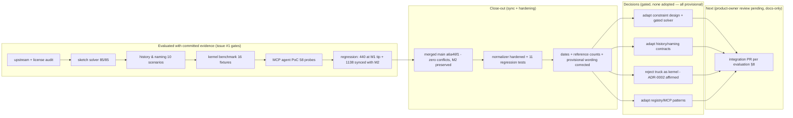

# Completion Graph — SolidCraft evaluation (TL2 track, issue #1)

- **Status:** evaluation exit record — ticks ONLY for items backed by committed, reproducible test evidence
- **Owner:** TL2
- **Date:** 2026-10-19 (UTC) — experiments per result envelopes 17:20–18:21 UTC; decision record `467eaba` 18:47 UTC; station re-verification `685f7c4` 20:07 UTC; close-out sync with main `a6a46f1` (M2) on 2026-10-20
- **Vocabulary:** [docs/GLOSSARY.md](../GLOSSARY.md) (binding); policy per glossary §11 — no tick without a test
- **Decision record:** [docs/00-architecture/solidcraft-evaluation.md](../00-architecture/solidcraft-evaluation.md)

## 1. Issue #1 acceptance gates

| Gate | Status | Evidence |
|---|---|---|
| Exact upstream SHA/version and license/dependency audit recorded | ✅ | pin `3b4db52` (v0.16.2) + release tag `5de48e9` (80 commits behind, measured) in every envelope; license verified from files: `results/w3b-supply-chain.json` + license-inventory §2.1 (closures 1+2 enumerated programmatically, zero GPL); upstream reference-count statements recorded distinctly: README status line "75 of 76 public reference parts" (stale hand-maintained line, set at upstream `e12758ff` when the corpus was 76 cases with 1 tracked failure) vs the generated oracle record `docs/oracle.md` "83/83 cases pass, 62 analytic + 21 FreeCAD, 0 known failures" — verified at the pin: `tests/oracle/` = 83 case dirs, table = 83 rows all `pass`; our claims use the generated record (decision record §2) |
| Each candidate has an explicit verdict | ✅ | seven verdicts (adapt/port, adapt, adapt, reject, adapt, adapt, reference+adapt) in solidcraft-evaluation.md §1/§4 with gates |
| Sketch, feature/naming, kernel and agent claims backed by runnable tests | ✅ | experiments A/B/C/D below — all runnable from `experiments/solidcraft/` (fetch scripts + drivers committed; externals gitignored at pinned SHAs) |
| OCCT/OCP remains the product direction unless comparative evidence justifies a separately reviewed ADR | ✅ | kernel evidence AFFIRMS ADR-0002 (`results/w2-kernel.json`: OCCT 1–2 orders faster on curved booleans in release config; truck STEP-import anomaly; evaluation proposes no kernel change) |
| No regression to M1/M2 | ✅ | two green records: (a) M1-baseline tip `685f7c4` — root `python3 -m pytest -q` **440 passed** (identical to the M1 record), `scripts/build_extension.py --check` green; (b) close-out sync with main `a6a46f1` (merge `df378b3` + fixes) — `pytest tests/ -q` **6 passed**, `pytest modules tests -q` **1127 passed** (M2 batteries, unchanged vs main), root `pytest -q` **1138 passed / 0 failed / 0 errors** (1127 + 11 lane normalizer tests), `compileall` rc 0, extension build + `--check` green (`blender_cad-0.2.0.zip`, zero experiments entries), `render_inventory.py --check` in sync; zero production files changed (`git diff a6a46f1..HEAD` = experiments/ + docs/ only); Blender 5.2.2 battery not re-run — **no production-facing file touched** (the issue requires it only then; standing evidence on main: `acceptance_m2_result.json` 59/59 + M1 re-run 30/30) |
| No production dependency adoption or manifest status flip | ✅ | release manifests untouched; adoption matrix gains ONE `evaluate` row (§4.2) — no `adopted`/`candidate` flip; no vendored upstream code in git (`.upstream`/`.release`/`.ocp-venv` gitignored, reproducible from pinned SHAs) |
| Concise decision memo naming what integrates next, what stays reference-only, what is rejected | ✅ | solidcraft-evaluation.md §1 (scorecard), §8 (next-PR scope), §9 (excluded with reasons) |

## 2. Experiments (runnable, evidence committed)

| Experiment | Status | Evidence |
|---|---|---|
| A — sketch solver: constraints, DOF, dimensions, convergence, failure, determinism | ✅ | 17 cases, 85/85 checks; bitwise determinism in- and cross-process; failure restore bitwise; rerun leaf-identical — `results/w1-sketch.json` (+ `verification_rerun`), `results/w1-upstream-tests.json` (upstream suite 235/0/3), `findings/w1-sketch.md` |
| B — feature rebuild & naming: edit → recompute, reference stability, failure propagation, determinism | ✅ (9 pass + 1 recorded observation) | `results/w2-history.json` (10 scenarios; honest observation: coincident-wall marginal geometry diverges across evaluation paths), `fixtures/history/` (11 scripts + provenance), `findings/w2-history.md` |
| C — kernel benchmark: booleans, fillet/chamfer, shell, STEP, tolerances, failure, timing, memory, packaging | ✅ | 16 fixtures (10 oracle-derived + 6 self-authored); both kernels 15/15 within oracle tolerance; full re-run reproduced (0 substantive diffs across 9,322 leaves) — `results/w2-kernel.json`, `results/w2-kernel-verification.json`, `findings/w2-kernel.md` |
| D — agent interface: real CAD op through the seam, schema validation, permissions, transactions/rollback | ✅ | 58 probes × 2 runs: 54 pass / 0 fail / 4 info; CAD chain exact (24000 mm³, rel_err 0.0); 11/11 filesystem refusals; exact-snapshot rollback incl. undo history — `results/w3-mcp.json`, `findings/w3-mcp.md` |
| E — regression | ✅ | two records, both green (decision record §10): M1-baseline tip `685f7c4` — 440 passed root-wide; close-out sync with main `a6a46f1` — 6 + 1127 + 1138 passed (root-wide incl. the lane's 11 normalizer regression tests), extension build/check green, tables in sync; zero production files changed |

## 3. Known limitations (recorded, not hidden)

1. Behavioral MCP evidence ran on the official release binary (tag `5de48e9`, 80 commits behind the pin) because `cadmpeg-ir` cannot compile in the 4 GiB evaluation sandbox — drift recorded in every envelope, mitigated by 10/10 oracle agreement between binary and pin-level paths.
2. Kernel benchmark: 16 small fixtures, single 2-CPU host, three timing contexts not directly comparable (labeled per-case); no scale/spline/hostile-corpus coverage — open items for any future kernel ADR.
3. Sketch lane exercised 12/32 constraint kinds; PlaneGCS comparison is the candidate-1 gate, not this evaluation's.
4. One honest observation (experiment B): coincident-wall marginal geometry diverges across evaluation paths in upstream's incremental evaluator (ΔV 39.26 mm³) — recorded as upstream-behavior evidence, not our defect.

## 4. Not done / explicitly not claimed

- No SolidCraft component is adopted; no release-manifest entry; no production code, schema, kernel, contract or packaging change.
- No PlaneGCS head-to-head suite (candidate-1 gate — future work if the PAR area pursues the gated path).
- No Blender 5.2.2 battery re-run (not triggered: zero production-facing files changed).
- The next integration PR (solidcraft-evaluation.md §8) is **design/docs-only**, remains **provisional** (product-owner review pending), and remains to be authored after review of this evaluation.
- The temp-path normalization discrepancy is closed out BOTH ways: normalizer hardened + 11 regression tests (`experiments/solidcraft/tests/test_mcp_normalizer.py`, including a committed-envelope verdict re-check), and residual temp-path variance classified as environment-only; determinism claims are scoped to the normalized comparison (w3-mcp findings §3).

## 5. Mermaid — evaluation state

