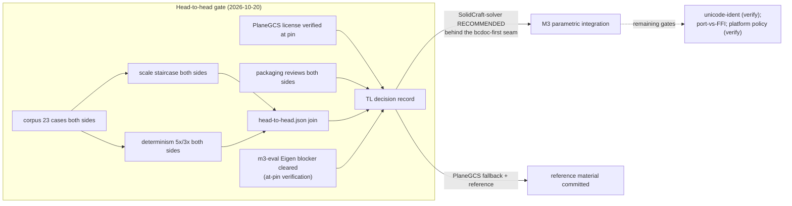

# Completion Graph — PAR-area solver head-to-head (TL1 track, h2h lane)

- **Status:** evaluation exit record — ticks ONLY for items backed by committed, reproducible evidence
- **Owner:** TL1 (Task IDs h2h-1..h2h-7; h2h-3 harness executed by a delegated subagent, TL1-verified before landing); TL owns the decisions + license verdicts
- **Date:** 2026-10-20 (UTC)
- **Vocabulary:** [docs/GLOSSARY.md](../GLOSSARY.md) (binding); policy per glossary §11 — no tick without a test
- **Decision record:** [par-solver-head-to-head.md](../00-architecture/par-solver-head-to-head.md)

## 1. Mission acceptance gates

| Gate | Status | Evidence |
|---|---|---|
| The head-to-head gate (m3-eval §8 item 1): BOTH remaining candidates on the SAME fixtures, recorded envelopes | ✅ | SolidCraft-solver @ `3b4db52` (TL2's pin): 131 checks 127 pass / 4 honest (all one root cause, remedy probed); PlaneGCS @ FreeCAD `1.1.4` + eigen 3.4.0: 121 checks 112 pass / 9 honest — `experiments/solver-h2h/results/{solidcraft,planegcs}-conformance.json`; corpus consumed read-only; both transcriptions machine-verified (planegcs: `transcription_verification: clean`; solidcraft: fixture_consistency block); the slvs baseline quoted from m3-eval — `results/head-to-head.json` |
| PlaneGCS license verification (m3-eval §8 item 2; the inventory's blocking (verify)) | ✅ | LGPL-2.1-family verified at the FreeCAD 1.1.4 pin from the actual files (11 per-file headers verbatim + root LICENSE = full LGPL-2.1 + sibling SPDX; ambiguity recorded) — `results/license-planegcs-eigen.json` (11 checks; 10 pass — the 1 FAIL is the honest intermittent-gitlab environment check) + `findings/license-planegcs-eigen.md`; **bonus: the m3-eval §9 Eigen@`3147391d` blocker CLEARED with at-pin evidence (byte-identical COPYING.MPL2)** |
| Packaging reviews of both candidates (m3-eval §8 item 3; solidcraft gate (b)) | ✅ | `findings/packaging-review.md`: SolidCraft Rust cdylib (permissive 12-crate closure; aarch64 native) vs PlaneGCS vendored C++ (LGPL boundary duties + eigen/boost notices; OCCT-toolchain synergy); the extension-platform policy (verify) binds BOTH equally and remains the shared open gate — recorded, not resolved |
| TL decision record choosing the PAR-area solver (m3-eval §8 item 5; solidcraft gate (a)) | ✅ | `docs/00-architecture/par-solver-head-to-head.md`: SolidCraft-solver RECOMMENDED behind the experiment-B seam (remaining gates (c)(d) + platform policy); PlaneGCS NOT the primary — fallback + REFERENCE with the honest measured reasons; slvs unchanged; kernel direction unaffected; nothing adopted |
| Determinism protocol (m3-eval's, per candidate) | ✅ | SolidCraft: in-process 5× + cross-process 3× bitwise (TL1 independently re-ran the digest protocol post-landing); PlaneGCS: 5× + 3× bitwise (`PLANEGCS_HASH … ok=1` identical) — both envelopes' determinism cases |
| Scale protocol (m3-eval's staircase, identical construction both sides) | ✅ | 5 fresh processes per N ∈ {10,50,100,200}, medians + edit at N=200 (rebuild + native mutation + warm re-solve paths) — SolidCraft 0.076/0.17/0.27/**0.48 ms**; PlaneGCS 0.21/2.2/11.8/**106.3 ms** — both envelopes' `scale_performance` + `results/head-to-head.json` |
| Lane isolation (no product code, no manifests, upstream never vendored) | ✅ | all work under `experiments/solver-h2h/` + the 3 docs/ updates (decision record + matrix/license rows) + this completion graph; fetch scripts sha-verify pins into gitignored `.upstream/`; compat shims are evaluation-only and marked; `modules/` and `release-manifests/` untouched |
| Honesty discipline (failures recorded, never dropped) | ✅ | every failing check recorded with root cause + probes: SolidCraft's 2 unsigned-distance DOF findings (+ remedy probe), PlaneGCS's 9 (rect no-solve through the FULL FreeCAD chain; slot ~2.5e-5 + formulation probes A/B/C; empty diagnostics on the unsolvable edit); the intermittent-gitlab fact recorded both ways |

## 2. Known limitations (recorded, not hidden)

1. Single 2-CPU sandbox host; all timings are shape-within-host (recorded per
   envelope; the medians-of-5-fresh-processes protocol mitigates but does not
   eliminate host variance — cross-solver ABSOLUTE times were never used as
   checks; the 220× RATIO at N=200 is quoted from medians of the same protocol).
2. PlaneGCS numbers use upstream C++ defaults (maxIter=100, convergence=1e-10 —
   the values FreeCAD's Sketch.cpp drives unmodified); no parameter tuning was
   attempted (tuning would invalidate the comparison).
3. The slot's ~2.5e-5 convergence is planegcs's DogLeg stopping at its
   convergence threshold under its own residual scaling — recorded as the
   outcome of the faithful contract, not retuned.
4. SolidCraft's 4 failures share one root cause (zero-valued unsigned
   distance_x/y rank blindness at dp=0); the remedy (native
   HorizontalPoints/VerticalPoints) is probe-verified in its envelope but the
   corpus mapping stayed LITERAL (the corpus is read-only).
5. The h2h-3 subagent timed out mid-run before writing its findings doc +
   worklog append; its harness + envelope were committed only after TL1
   independently re-verified the reruns and digests, and TL1 wrote the
   findings close-out (credited).
6. No Blender 5.2.2 battery re-run — zero production-facing files changed
   (standing committed evidence remains authoritative).
7. The extension-platform policy (verify) is NOT resolved by the packaging
   review — it is the shared open gate for the solver AND the kernel binding.

## 3. Not done / explicitly not claimed

- **No component is adopted**; no release-manifest entry; no product code,
  schema, kernel, contract or packaging change; bcdoc untouched.
- **No bcdoc-seam re-run per solver** — the seam is design-locked by m3-eval
  experiment B; adapter-level notes (Difference/P2PSymmetric/4-point angle/
  curve-level tangent; HorizontalPoints-vs-DistanceX) are recorded for the
  seam implementers.
- **No ADR-0002/kernel claim** — the OCCT/OCP direction is unaffected; no
  AutoCAD-parity claim from constrained-sketch results.
- **No milestone-plan edit** — the decision record supersedes the plan's
  "constraints (PlaneGCS)" framing with the measured outcome; the plan's
  M3-entry criterion ("PlaneGCS license verification done") IS satisfied.
- The slvs re-review conditions are unchanged and un-waived (moot for the
  primary slot: a winner was measured).

## 4. Mermaid — gate state

