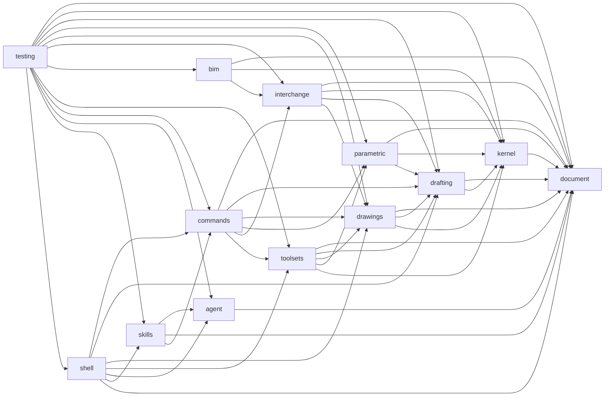

# Modules — Index, Boundaries, Dependency Graph

- **Status:** Active — 13 modules defined at M0; all `planned` (no code at M0)
- **Owner:** TL (module owners per glossary §10 below)
- **Date:** 2026-10-19 (UTC)
- **Vocabulary:** docs/GLOSSARY.md (binding)

## 1. Module index

Machine-readable source of truth: [`modules/modules.json`](modules.json)
(checked by `scripts/check_module_boundaries.py`).

| Module | Owner | Purpose (one line) | FP areas | Status |
|---|---|---|---|---|
| `document` | W2 | CAD document model: entities, layers, blocks, properties, units, transactions, undo journal, checkpoints | — | planned |
| `kernel` | W2 | OCCT-based precise B-rep/analytic geometry + 2D/3D construction ops + tessellation-for-display | — | planned |
| `drafting` | W1 | 2D entities, precision-input engine (osnap/ortho/polar/tracking), selection, grips, layers/blocks editing UX | DRAW, MOD, PREC, ORG | planned |
| `parametric` | W2 | Geometric + dimensional constraints, constraint solver, parametric edits | PAR | planned |
| `drawings` | W1 | Layouts, viewports, dimension/text/table styles, annotation scale, plot/publish | ANN, LAY | planned |
| `interchange` | W2 | DXF/DWG/IFC/STEP I/O, xrefs, round-trip conformance, loss ledger | IO | planned |
| `bim` | W2 | BIM workflows through Bonsai + IfcOpenShell | IO | planned |
| `toolsets` | W1 | Specialist toolsets (mutually independent sub-packages): mechanical, electrical, MEP, plant, civil, GIS, raster | TS | planned |
| `commands` | W1 | Command registry, aliases, prompt state machine, command history, dynamic input | CMD | planned |
| `agent` | W3 | CAD tool contract (`cad.*`), MCP adapter, runtime sidecar bridge, activity/permissions plumbing | AGT | planned |
| `skills` | W3 | Skill authoring (record→generalize), package format, execution engine, registry client | SKL | planned |
| `shell` | W1 | CAD application shell: ribbon, palettes, status bar, command-line dock, workspace integration with Blender | UX | planned |
| `testing` | TL | Cross-module regression, interop, usability and security suites + fixtures (test-only) | — | planned |

## 2. Dependency graph

Exact edges from `modules/modules.json` — `A --> B` reads "**A depends on B**":

`scripts/check_module_boundaries.py` re-derives this graph, verifies
acyclicity (with `testing` exempt as a test-only module) and fails CI on any
violation.

## 3. Boundary rules (binding, glossary §4)

1. **Only listed dependencies allowed.** A module may import/use ONLY modules
   in its `depends_on` list. Anything else is a CI-violating boundary break.
2. **No toolset may depend on another toolset's internals.** The seven
   toolsets are mutually independent sub-packages inside `toolsets`.
3. **Shared code goes down, not sideways.** Functionality needed by several
   modules is pushed into a lower-level module (ultimately `document`), never
   copied across siblings.
4. **`testing` is test-only.** It depends on everything but produces no
   production code; nothing may depend on it.

## 4. The commands/skills inversion (recorded decision)

`commands` does **NOT** depend on `skills`. Skills depend on commands (a skill
step may invoke a command through the registry). The command line still
exposes installed skills through a **registration hook**: `skills` registers
itself into `commands` at load time. This keeps the graph acyclic
(skills→commands, not commands→skills) while preserving the familiar
"type a skill name in the command line" UX (glossary §4).

## 5. Module READMEs

Every module directory carries a `README.md` with, in order:

1. Title + status block (status `planned (no code at M0)`, owner, date, glossary
   link, target milestone);
2. **Purpose** (2–3 lines);
3. **Owns / Does NOT own** (explicit boundary bullets);
4. **FP areas** owned;
5. **Allowed dependencies** (mirrors `modules.json`);
6. **Planned public API sketch** — clearly labeled *PLANNED CONTRACTS, not
   implementations*: names and one-line intents only;
7. **Tests** pointer to the owning TP-CAT categories in
   [docs/30-process/test-plan.md](../docs/30-process/test-plan.md).

When a module gains code, its status moves to `in-progress` (then `active`); the README gains an implemented-surface section and `modules.json` follows the same status enum.
